# Rewind player

The rewind player plays a replay track back inside the engine, with time going in either direction. This folder holds the Lua that reads a track (issue #3792) and the gadget that makes the world match it (issue #3794): units, features, terrain and the shots in the air (issue #3795) at any time, with every turret and torso pointing where it pointed in the match (issue #3796). Each unit's own script is told when its unit moves and when a builder works, so units walk and builders turn to their work (issue #3797), and a builder at work shows its stream of build particles (issue #4029). A unit's fire animation does not play (issue #4030). The control on screen is a widget, the timeline (issue #3798), and a second widget draws the buildings a builder had queued (issue #3804). What a game switches off or hides during playback is its adapter (issue #3799).

A track is the file `crates/coilbox-track` writes, in the format `docs/reference/replay-track-format.md` describes. The format was designed so that the engine's Lua can read the file as it is, so there is no export step and no second copy on disk.

This page is for whoever works on the player or writes something that talks to it. The first half is the player: what it publishes, the messages it takes, the timeline that sends them, how to add to it and what it does about the base game. The second half is the reader: its functions, the conventions that are easy to get wrong, and what the tests do and do not prove.

## The player

The player holds a time `t`, a frame of the track that can be a fraction. On every simulation frame it moves `t` by direction times speed and makes the world the track at `t`. It simulates nothing, so `t` can jump and run backwards. A seek that needs many units made or removed is done over several frames, and the player says when it is done ([A seek over frames](#a-seek-over-frames)).

| File | What it is |
| --- | --- |
| `luarules/gadgets/coilbox_rewind_player.lua` | the gadget: opens the track, hands the engine's call-ins to the player and times a frame's work |
| `luarules/gadgets/!coilbox_rewind_guard.lua` | stops the base game killing a team or ending the match |
| `luarules/rewind_player/coilbox_player.lua` | the player: the clock, the list of stages, the published state |
| `luarules/rewind_player/coilbox_player_clock.lua` | the time and the messages that change it. It touches nothing in the engine |
| `luarules/rewind_player/coilbox_player_engine.lua` | the table of engine calls the player needs, and the check of it ([Engine calls](#engine-calls)) |
| `luarules/rewind_player/coilbox_player_terrain.lua`, `coilbox_player_features.lua`, `coilbox_player_units.lua`, `coilbox_player_aim.lua`, `coilbox_player_animation.lua`, `coilbox_player_projectiles.lua`, `coilbox_player_resources.lua` | the seven stages |
| `luarules/rewind_player/coilbox_player_rotation.lua` | a track's rotation as the pitch, yaw and roll the engine takes |
| `luarules/rewind_player/coilbox_player_adapter.lua` | reads the game's adapter, and guards its hooks |
| `luarules/rewind_player/coilbox_log.lua` | the playback's own log file, which every line of the player, the timeline and the ghosts goes to ([The log file](#the-log-file)) |
| `luarules/rewind_player/coilbox_player_view.lua` | works out where the viewer looks, for the unsynced half of the gadget to send ([Which units first](#which-units-first)) |
| `luarules/rewind_player/coilbox_player_arrival.lua` | draws the effect where a unit arrives, in the unsynced half of the gadget ([The arrival effect](#the-arrival-effect)) |
| `luarules/rewind_player/coilbox_player_stream.lua` | draws a builder's stream of build particles, in the unsynced half of the gadget ([Build particles](#build-particles)) |
| `luaui/widgets/coilbox_rewind_timeline.lua` | the timeline widget: the engine's call-ins for drawing, keys and the pointer |
| `luaui/rewind_timeline/coilbox_timeline.lua` | the timeline: where everything is, what a key or a press sends, and the drawing. It takes the engine as a table, so the tests run it |
| `luaui/rewind_timeline/coilbox_timeline_engine.lua` | the widget's own table of engine calls, in the same shape |
| `luaui/widgets/coilbox_rewind_ghosts.lua` | the ghosts widget: the call-ins, and finding the track and the adapter |
| `luaui/rewind_ghosts/coilbox_ghosts.lua` | the ghosts: which buildings are queued at a time, and the drawing. It takes the engine as a table, so the tests run it |
| `luaui/rewind_ghosts/coilbox_ghosts_engine.lua` | the ghosts widget's own table of engine calls |

It runs in synced Lua, because creating a unit is synced. It moves only on simulation frames, and a paused engine runs none. So the player's own pause is what holds `t`, and the engine has to be left running for a seek to show. A game can still pause the engine or change its speed, with a key or a chat command, and the gadget hands that to the player ([The engine's own pause and speed](#the-engines-own-pause-and-speed)).

### The log file

The player's lines, the timeline's and the queued building ghosts' all go to `coilbox_rewind.log`, in the engine's write folder beside `infolog.txt` (issue #4032). None goes to the engine's log, so none appears in the game's console, where a viewer would read it as an error.

That is the only way to keep a line off the console, read in the engine source at commit `6e5c5a0`. A line's section and level decide whether it is logged at all, once, for every place it goes (`log_filter_record` in `rts/System/Log/DefaultFilter.cpp`). Every line that is logged goes to every sink, the console among them (`log_backend_record` in `rts/System/Log/Backend.cpp`), and the console hands every line to Lua's `AddConsoleLine` with its level and no section. The `LogSections` setting and `Spring.SetLogSectionFilterLevel` set a section's level for all sinks at once. A game's console widget decides what it shows from there: Beyond All Reason's drops only the `DEPRECATED` level outside a developer's own game, and Splinter Faction's ignores the level. `print` writes to stdout only, which coilbox throws away when it launches a playback. The engine opens `infolog.txt` with `"wb"` and an 8 kB buffer (`rts/System/Log/FileSink.cpp`), so nothing else can write into it safely.

- Synced Lua has no `io`. The synced half sends each line to the unsynced half with `SendToUnsynced("coilbox_rewind_log", line)`, and the unsynced half writes it. The unsynced half loads after every synced gadget (`CSplitLuaHandle::InitSynced`, then `InitUnsynced`), so the lines logged before the first frame wait for it.
- The unsynced half empties the file as it loads, before any widget does. Each Lua state then keeps a handle of its own and appends, so the lines are in the order they were written. A headless run checked that two states append in order.
- The guard gadget hands its lines to the player gadget through `GG.coilboxRewindLog`, and logs to the engine's log in a game where the player gadget is not there.
- Without `io`, or with a file that cannot be opened, the lines go to the engine's log as before.
- A line a viewer needs is the timeline's note ([The note](#the-note)). A playback that does not start says why there as well as in the log.

The ignored Rust tests read the file with the engine's log, so they find the lines as before. In a window on Beyond All Reason, after a slow frame forced by a scratch adapter hook, the console's own buffer (`Spring.GetConsoleBuffer`) held no line starting `COILBOX_REWIND_` in three launches, `infolog.txt` held none, and the log file held the adapter line and the slow frame line.

### The engine's own pause and speed

A game can pause the engine or change its speed: Beyond All Reason binds its pause key to the engine's `pause` and `Alt` with `=` or `-` to its own speed actions, and the chat commands `/pause` and `/setspeed` work in every game. The playback's one spectator is the local host, which the server lets do both (`NETMSG_PAUSE` and `NETMSG_USER_SPEED` in `rts/Net/GameServer.cpp`). A paused engine holds a seek too, and a faster one plays faster than the timeline says.

So the gadget's unsynced half reads `Spring.GetGameSpeed` in `gadget:Update`, which runs on every drawn frame and while the engine is paused (issue #4033). A paused engine is sent `pause 0` and the player is sent `toggle`, so the pause the viewer asked for is the player's own. An engine at another speed is sent `setspeed 1` and the player `faster` or `slower`. The engine stays paused, or at its new speed, until the server answers, over several drawn frames, so each is handed on once. Without `Spring.GetGameSpeed` or `Spring.SendCommands` the engine is left alone, which the `enginePace` row says.

### Published state

Game rules parameters, which any widget reads with `Spring.GetGameRulesParam(name)`. All are numbers. The names are also `Player.PARAMS` in `coilbox_player.lua`.

| Parameter | Value |
| --- | --- |
| `coilbox_rewind_frame` | the time `t`, as a frame of the track. It can be a fraction |
| `coilbox_rewind_playing` | 1 while playing, 0 while paused |
| `coilbox_rewind_direction` | 1 for forward, -1 for backward |
| `coilbox_rewind_speed` | frames of the track for each simulation frame: 0.5, 1, 2, 4, 8, 16 or 32 |
| `coilbox_rewind_first_frame` | the track's first frame |
| `coilbox_rewind_last_frame` | the track's last frame |
| `coilbox_rewind_frames_per_second` | simulation frames in a second of the match, 30 |
| `coilbox_rewind_settled` | 1 when the world is the track at `coilbox_rewind_frame`, 0 from a seek until it is. See [A seek over frames](#a-seek-over-frames) |

A parameter is set when the player is made, before the first frame, and again whenever its value changes. A message changes them as it arrives, so a widget sees a seek's frame before the world has moved to it. The world moves on the next simulation frame, and for a seek that needs a lot made or removed, on several. `coilbox_rewind_settled` is 0 from the seek's message until the last of them.

`coilbox_rewind_first_frame` being a number is how a widget knows the player is there. A game with no track or a bad one sets none of them, and logs one line starting `COILBOX_REWIND_PLAYER failed:`.

### Messages

A widget sends a message with `Spring.SendLuaRulesMsg(text)`. A spectator's message is delivered, which the real engine run shows, since the one player of a playback is a spectator. The text is `coilbox_rewind:`, a command, and for some commands a space and one argument.

```lua
Spring.SendLuaRulesMsg("coilbox_rewind:seek 1200")
Spring.SendLuaRulesMsg("coilbox_rewind:step -30")
Spring.SendLuaRulesMsg("coilbox_rewind:speed 0.5")
Spring.SendLuaRulesMsg("coilbox_rewind:toggle")
```

| Command | Argument | Does |
| --- | --- | --- |
| `seek` | a frame | jumps to the frame, held inside the track. Play goes on, or stays paused |
| `step` | a number of frames, which can be negative | jumps by that many frames. Play goes on, or stays paused |
| `play` | nothing, or `1` or `-1` | plays, in the direction given or the way it last played. At the end it would play into, it starts from the other end |
| `pause` | | pauses |
| `toggle` | | pauses a playing clock and plays a paused one |
| `reverse` | | plays the other way, starting if it was paused |
| `direction` | `1` or `-1` | sets the direction and leaves playing or paused as it was |
| `speed` | `0.5`, `1`, `2`, `4`, `8`, `16` or `32` | sets the speed |
| `faster`, `slower` | | the next speed up or down the list, stopping at its ends |
| `drag` | `1` or `0` | says the timeline's knob is being dragged, or has been let go. It moves nothing. While a drag lasts no arrival effect is shown ([The arrival effect](#the-arrival-effect)) |

Every row of the replay page's key table (`src/content/replayMapView/timelineKeys.ts`) is one message:

| Key | Message |
| --- | --- |
| Space | `toggle` |
| R | `reverse` |
| Left, Right | `step -30`, `step 30`, which is one second of `coilbox_rewind_frames_per_second` frames |
| Shift and Left, Shift and Right | `step -300`, `step 300` |
| Comma, Full stop | `step -1`, `step 1` |
| Home, End | `seek` with `coilbox_rewind_first_frame`, `seek` with `coilbox_rewind_last_frame` |
| `[`, `]` | `seek` with the mark's frame. The player knows nothing of marks |
| Minus, Plus | `slower`, `faster` |

The gadget's own unsynced half sends one more, `coilbox_rewind_budget:` and three whole numbers, the most units a frame may make, the most it may remove and the most corners of the ground it may set for a seek. Two numbers leave the ground's budget as it was. It is not for a widget. [How many a frame](#how-many-a-frame) has what sets it. It sends a second of its own, `coilbox_rewind_view:`, which says where the viewer looks. [Which units first](#which-units-first) has that one.

A message that is refused changes nothing and logs one line, `COILBOX_REWIND_PLAYER the message "..." was refused:` and the reason. A speed off the list, a frame that is not a number and a command the player does not know are refused. Playing into either end pauses there.

A unit that dies while playing forward at 0.5x, 1x or 2x dies with the game's own death effect. A unit that goes for any other reason, a seek, a step, playing backward or playing at 4x and over, is removed with nothing shown. A shot is the same: it lands with the game's impact effect and makes its weapon's sound at those three speeds going forward, and otherwise comes and goes with nothing shown. [Projectiles](#projectiles) has the detail.

### Mod options

The start script can carry two, which `Player.OPTIONS` also names. Passing them is issue #3809's.

| Key | Value |
| --- | --- |
| `coilbox_rewind_start_frame` | the frame to open on, held inside the track. Without it, the track's first frame |
| `coilbox_rewind_start_paused` | `1` to open paused. Without it, playing |

### The timeline

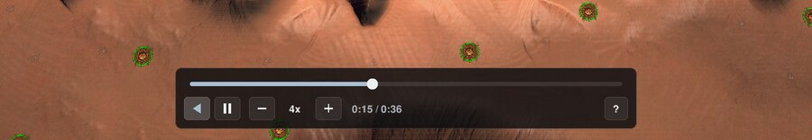

The timeline is a LuaUI widget. It reads the parameters above on every draw and sends the messages above, and keeps nothing about playback itself. It sits at the bottom centre of the view. Dragging the panel by any part that is not a control moves it.

From the left: play the other way, play or pause, slower, the speed, faster, the time and the match's length, and a `?` that opens the key list. The bar above them has a knob that seeks while it is dragged, and a press anywhere on the bar seeks there. A press on the bar sends `drag 1` before its first seek, and letting go sends `drag 0`, which is how the player tells the many seeks of a drag from one seek. A widget that is switched off in the middle of a drag sends the `drag 0` too. The times count from the track's first frame, as the replay page's do.

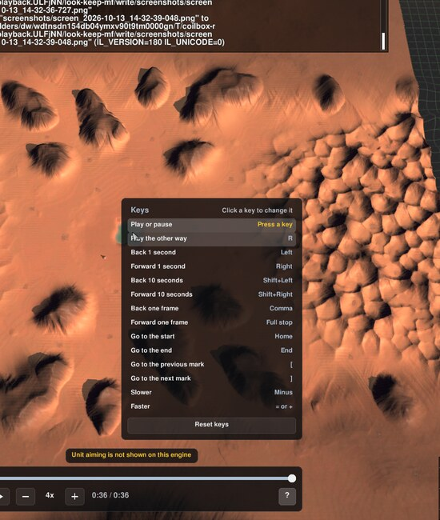

#### Keys

The keys are the replay page's (`src/content/replayMapView/timelineKeys.ts`). `M.ACTIONS` in `coilbox_timeline.lua` is the same table for the engine.

| Key | Does |
| --- | --- |
| Space | Play or pause |
| R | Play the other way |
| Left, Right | Back or forward 1 second |
| Shift and Left, Shift and Right | Back or forward 10 seconds |
| Comma, Full stop | Back or forward one frame |
| Home, End | Go to the start or the end |
| `[`, `]` | Go to the previous or the next mark |
| Minus | Slower |
| Equals or Plus | Faster |
| G | Show or hide the queued building ghosts. Not on the replay page, and left to the game when the ghosts widget is not there |

- A key held with Ctrl, Alt or Meta is never taken.
- A held key repeats a step and a change of speed. It does not repeat play, pause or reverse.
- To change a key, open the key list with `?`, click the action's row and press the key. Escape leaves it as it was. A key that another action had is taken from that action. `Reset keys` puts the table back.
- The mark keys are left to the game when the playback game has no marks.

A key the timeline takes goes no further. `widget:KeyPress` gives true for it, and the engine then runs no binding for that key (`CGameInputReceiver::KeyPressed` in `rts/Game/GameInputReceiver.cpp`), its own pause included. The widget's layer is the lowest there is, so it is asked before any other widget.

One thing gets in before it. A widget handler that comes from the engine's runs the actions that widgets have registered and a key is bound to, before it asks any widget for the key. If a game binds one of the timeline's keys to such an action, that action runs and the timeline never hears the key. In Splinter Faction 0.1.89 none of the keys is bound that way: they are bound to the engine's own `repair`, `moveleft`, `moveright`, `prevmenu`, `nextmenu`, `increaseviewradius`, `decreaseviewradius` and `buildfacing`, which the timeline does stop. The cure in a game where one is, is to change the key in the list.

Beyond All Reason `test-30922-8064a43` has one such case. Its default keys (`luaui/configs/hotkeys/grid_keys.txt`) bind Minus, Equals and the keypad's Plus to `snd_volume_decrease` and `snd_volume_increase`, which its Volume OSD widget registers and takes, so those keys change the volume and the timeline never hears them. Every other key of the timeline reaches it: the engine's actions bound to them and the game's `gridmenu_cycle_builder`, `gridmenu_key` and `stop` handlers let them through for a spectator. That was measured by handing each key to the game's widget handler with the actions the game binds to it, in a window and in a headless engine. The adapter leaves the volume keys alone, since they tell nobody anything wrong about the match. Issue #4027 is for deciding which should win.

#### What it remembers

The widget handler keeps what `widget:GetConfigData` gives, in the file it keeps every widget's data in. Splinter Faction's and THIS's handlers name that file after the game being played, which is the playback game and not the game it depends on. Beyond All Reason's names it after the game's short name, `LuaUI/Config/BYAR.lua`, and the playback game has the short name of the game it depends on, so the timeline's place and keys are kept beside the player's own Beyond All Reason widget settings. What is kept is the panel's place, as a share of the view so that it holds in a window of another size, and the keys when they are not the table's.

#### Marks

The replay page's marks are chat lines, players leaving and kills (`src/content/useReplayTimelineMarks.ts`). The chat and the leavers come out of the replay file and the kills out of the stored analysis, and neither is in a track. So the timeline reads marks from a file of the playback game, `coilbox_rewind/marks.lua`, when there is one:

```lua
return { { frame = 1200 }, { frame = 4530 } }
```

A mark draws as a tick above the bar. Marks that fall in one column of the bar, which is 8 pixels wide in a view 1,080 high, are one mark, at the first of them, as on the replay page. Nothing writes that file yet (issue #3978), so `[` and `]` do nothing today.

#### The note

`coilbox_rewind_note` is one more game rules parameter. When it holds a string that is not empty, the timeline shows it in a small panel above itself. The gadget sets it once, when it loads, from the check of the engine's calls ([Engine calls](#engine-calls)). It says either what is switched off on this engine or why playback did not start. It is set with `Spring.SetGameRulesParam("coilbox_rewind_note", text)`, and it is left unset when there is nothing to say.

When playback does not start there is no player, so none of the other parameters is set. The timeline then draws the note and nothing else.

#### How a game comes to load it

Nothing is asked of the game. A widget handler that comes from the engine's `cont/LuaUI/widgets.lua` lists `luaui/widgets/*.lua` out of the game and everything it depends on, and turns on a widget it has no saved state for when the widget's `enabled` is true. The playback game is a new game to the handler, so it has no saved state for it. Read in the handlers of Splinter Faction (`luaui/widgets_custom.lua`), THIS (`luaui/widgets.lua`) and Beyond All Reason (`luaui/barwidgets.lua`), and run in four: see [In a real engine](#in-a-real-engine).

A game whose LuaUI is not a widget handler, or a player who has LuaUI switched off, gets no timeline. The player still plays, and takes messages from anything else.

#### Drawing

It draws with `gl.Color`, `gl.Rect`, `gl.BeginEnd`, `gl.Vertex` and `gl.Text`, measures with `gl.GetTextWidth` and `gl.GetTextHeight`, and calls `gl.Texture(false)` once. All are registered in `rts/Lua/LuaOpenGL.cpp` at the tags `105.0`, `2025.04.11` and `2026.07.04`. It uses the engine's own font, and no shader, texture, font or library from the game.

Sizes are in pixels of a view 1,080 high and follow the view's height, down to three quarters of that size and no smaller. A draw allocates nothing.

The look follows Slate, the interface in `luaui/slate` of [xta-springrts](https://github.com/Recoil-Game-Archive/xta-springrts/tree/master/luaui/slate): a dark translucent panel, a thin light border, rounded corners and buttons that are a faint wash of white. Its colours and proportions were followed and none of its code, its font or its images was taken. Slate blurs the world behind a panel with a shader. The timeline has no shader, so its panel is more opaque than Slate's, 0.82 against 0.6.

### Queued building ghosts

A builder's queue of buildings is in the track (`sampleQueue` in the reader, whose values are checked against the Rust reader's), and the world has nothing that shows one. The ghosts widget draws each queued building at its place and facing, in its team's colour. It is a widget in the playback game like the timeline, so any game's widget handler loads it and nothing is asked of the game.

#### How it gets the queues

The widget reads the track itself, with the player's reader. The engine allows it. `VFS.LoadFile` and `VFS.Include` in unsynced Lua take any path of the game (`LuaVFS::GetModes` only forbids the `VFS.RAW` and `VFS.MENU` modes in synced Lua, and looks at no path), so a widget can include `luarules/rewind_player/coilbox_track.lua` and read `coilbox_rewind/track.cbtrack`. The timeline keeps its own table of engine calls because each widget checks the calls it uses, and not because a widget cannot reach the gadget's files. The time is the player's `coilbox_rewind_frame`.

The other way is for the gadget to send the queues. A queue is variable length data, so that is a message for each change, from the synced half to the unsynced half and on to the widget through `Script.LuaUI`. It was not chosen.

- The synced half would sample every builder on every frame, which the widget does for itself at no cost to the simulation.
- A widget that is loaded late or reloaded would need a message of its own to catch up.
- It changes the gadget, which issues #4008 and #4009 were changing at the same time.

The cost of reading it itself is a second copy of the track in the widget's Lua state, and a window read in the widget when the time crosses into one, as the player reads one in its own. The whole match's track is 321,116 bytes, which is small. A track of tens of megabytes would be held twice, and nothing has measured the widget on one.

#### What a frame costs

For each builder, whether it exists and which key of its queue it is on. Nothing is made unless one of those changed or a unit that is a queued building began or ended. A draw allocates nothing, which `tests/ghosts_test.lua` counts over 300 frames of play with changes in them, 300 draws of an unchanged queue, and backward play and seeks inside a window. Reading a window allocates, as it does in the player.

#### A started building

The recorder writes a builder's queue as the build commands it holds. The engine leaves a build command at the front of the queue while the building is made, and takes it off some frames after the building is finished. In the whole match the first extractor is in the queue from frame 504 and is a unit in the track from that same frame. The queue loses it on frame 888 and the unit was finished by frame 873. So a queued item is not a building that has not been started, and drawing every item would draw a ghost over the real building.

An item is not drawn while a unit of its definition stands within 8 elmos of it on each axis. That is half a square of the 16 elmo grid the engine snaps a building to (`CGameHelper::Pos2BuildPos`). The match's first extractor was queued at 480,8128 and stands at 488,8136. A building that is destroyed while it is still queued is a ghost again. Where each unit stands is read once for each window, and the frames each one begins and ends on are kept in order, so a frame only has to ask whether it has crossed one.

#### The drawing

For each ghost the widget outlines the footprint on the ground in the team's colour, lightened, with a pale fill, and asks the engine for the building's own shape with `gl.UnitShape(unitDefID, teamID, false, false, false)`. That is translucent in the engine's own state, with the alpha from the player's `UnitTransparency` setting (0.3 by default).

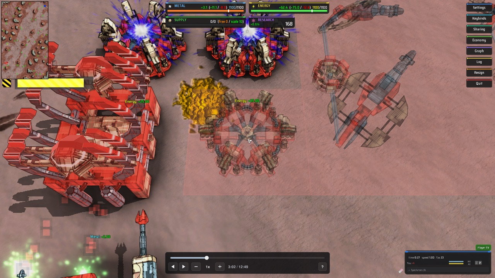

Before the call the widget loads the identity into the model view and then turns and moves it to the building, as the engine's own `CUnitDrawerGLSL::DrawBuildIcons` does for a building being placed. Without its raw state `UnitShape` puts the camera's view on the projection matrix and loads the identity into the model view (`CModelDrawerHelper::PushTransform`), then pops that and pushes a copy of the matrix Lua left (`DIDResetPrevModelView`), as its comment says: "assumes the Lua transform includes a LoadIdentity!". In a widget's `DrawWorld` the model view holds the camera's view, so a shape drawn without the identity went through the view twice and landed off the screen. That is why nothing drew in the first windowed runs (issue #4018), and why the raw form, which leaves the matrices alone, drew in the right place.

A footprint is the definition's `xsize` and `zsize` squares of 8 elmos, turned by the facing. The height is the engine's own, `Spring.Pos2BuildPos(unitDefID, x, 0, z, facing)`, which is `CGameHelper::GetBuildHeight`: the levelled ground of a building that levels it, the ground of one that does not, and the water for one that floats. A building the engine would level is put at that height, and on a slope part of its outline is under the ground.

The outline's width, its lightening and the fill's opacity are design choices, made after the first look at the outline found it too dark to read.

A facing of 0 is south, 1 east, 2 north and 3 west, and the shape is turned 90 degrees for each (`gl.Rotate(facing * 90, 0, 1, 0)`), as `DrawBuildIcons` turns it.

In a window on Splinter Faction 0.1.89 and engine `2026.07.01-102-g6e5c5a0`, the whole match paused at frames 4,695, 5,460 and 7,905, each queued building drew as its shape in the team's colour over its outline. Two were checked against the building that later stood there:

| Queued | Facing | Ghost's height | Built unit's height | Built unit's facing |
| --- | --- | --- | --- | --- |
| `fissionpowerplant` at 728, 8104, frame 5,460 | 2 | 172.15 | 172.13 at frame 6,300 | 2 |
| `fedmetalextractor_up1` at 992, 9248, frame 7,905 | 0 | 167.87 | 167.75 at frame 9,000, standing at 1000, 9256 | 0 |

The ground at those two places was 172.16 and 168.03. The pictures are in `docs/reports/milestone-80-gallery/` from 110, which is gitignored.

#### An adapter's own drawing

The adapter's `hooks.drawQueuedBuilding(unitDefID, teamID, x, y, z, facing)` replaces both the shape and the outline. The widget reads `coilbox_rewind/adapter.lua` itself with `VFS.Include`, in its own environment, so a hook that calls `gl` works there. The player reads the same file in synced Lua and knows the name, so it does not take it for a misspelling. A hook that raises is logged once and the engine's drawing takes over.

A second hook, `hooks.queuedBuildingsDrawn(count)`, is called once at the end of every pass of `DrawWorld` with how many buildings the pass drew, after the last `drawQueuedBuilding`. It is called for a pass that drew none, while the ghosts are switched off, and once more with 0 when the widget shuts down. It is for a game whose way of drawing keeps a shape until it is told to drop it. Without it such a hook would never hear that a building had left the queue, and the last ones would stay drawn for good. One that raises is logged once and not called again.

Beyond All Reason's adapter (issue #3801) uses both. Its `drawQueuedBuilding` hands each queued building once to the game's unit shape widget, `WG.DrawUnitShapeGL4`, which is how the game draws a builder's queue itself, and its `queuedBuildingsDrawn` drops the shapes a pass no longer asked for. In a window the buildings drew as the game's own translucent buildings in their team's colour, which is the first ghost shape that has drawn in any game (`milestone-80-gallery/52-...`). Where the game's widget is not running, as in a headless engine, the hook raises and the widget's own outline takes over.

#### The key and what it remembers

The key is in the timeline's key list, `G` by default. The timeline switches the ghosts through `WG.coilboxRewindGhosts.toggle()`, which the ghosts widget offers, and leaves the key to the game when the ghosts widget is not there. The timeline keeps the key with the others, a key held with Ctrl, Alt or Meta is left alone, and a held key does not switch again. `/rewindghosts`, `/rewindghosts on` and `/rewindghosts off` do it from the console. The widget keeps whether the ghosts are on with `widget:GetConfigData`.

#### Engine calls

The widget has a table of its own, `coilbox_ghosts_engine.lua`, in the same shape. Its rows are `track` (the reader's calls), `player`, `ground` and `drawing`, which are required, and `outline` and `adapter`, which are optional. Every call in it is registered at the tags 105.0, 105.1.1, 2025.01.6, 2025.04.11 and 2026.07.04, read for this table, and `gl.UnitShape` has its fifth argument, the one that picks translucent drawing, at 105.0. `gl.LoadIdentity` and `Spring.Pos2BuildPos` were read at those five tags and at `6e5c5a0`. The test reads the widget's files and the reader's, and fails for a call with no row.

#### What has run

- The headless engine with Splinter Faction's own widget handler and the whole match. The handler loads the widget and the widget finds the track. At 130 visits to frames chosen from the track, forward and then backward, the widget would draw what the Rust reader's queues give less what is built, 260 ghosts in all with the right shape, team, place and turn. The timeline's key switched them off and on. The test is `the_ghosts_follow_the_track_in_the_engine`. Its probe, `tests/headless/ghosts_probe.lua`, puts counting calls where the widget's drawing calls are for the length of one draw.
- A window, four launches for issue #3804. The outline was at the right places from frame 4695 to 7905. The shape did not appear.
- A window, two launches for issue #4018, the first of which pointed the camera nowhere useful. With the identity loaded the shapes drew, as [The drawing](#the-drawing) says. A headless run of the same scratch widget read the heights in its table.
- Only on the stand-in: a building the engine puts under water, the footprint of a building turned a quarter, a hook that raises, and an engine without any one call. No queued building of the match is on water, so a floating one has not been seen.

### Adding a stage

`coilbox_player.lua` keeps a list of stages, `player.stages`. On a frame every stage first takes away what the track does not have at `t`, and then every stage puts in place what it does have. Removals come before creations across all of them, because after a seek a building may stand where another stood earlier.

```lua
stage:resync(t)         -- after a jump, before the two below
stage:remove(t, clock)  -- take away what is not in the track at t
stage:place(t, clock)   -- create what is missing and put everything in place
stage:afterSim()        -- optional: the frame is over (GameFramePost)
```

The engine does its own work on a frame between a gadget's `GameFrame` and its `GameFramePost`: units heal, unit scripts turn their pieces, and teams make and use resources. A stage that has to put something back after that has `afterSim`, as the units, aim and resources stages do. `Player:framePost` calls it.

`GameFramePost` does not reach every gadget ([The call at the end of a frame](#the-call-at-the-end-of-a-frame)), so a stage with `afterSim` has to work without it. `context.post.arrives` is true in a frame when the frame before ended with the call. Two more optional functions are for such a stage:

```lua
stage:afterSimMissed()   -- a frame ended without the call, after frames that
                         -- ended with it: put back what was held for the frame
stage:withoutAfterSim()  -- the call does not come: say once what the stage does
                         -- without it, with context.report
```

`clock.jumped` says the frame was reached by a seek or a step and not by play, and `clock.direction` and `clock.speed` say how it is playing. `clock:watched()` is true for a frame of play forward at 0.5x, 1x or 2x, which is when a death, an impact and a sound are shown. A stage is made with the context, a table that has the track, its `info` and `features`, the engine's `Spring`, `Game`, `CMD` and definition tables, `teamOf(team)` and `report(key, text)`. Take the engine from the context and not from a global, so that the tests can hand the stage a stand-in.

Four rules a stage has to keep:

- A frame of play allocates nothing. Synced Lua cannot collect garbage fast enough for a table for each key at 30 frames a second. Sample into tables made once, write to the tables handed to the engine and make them once, and walk a table with `next` and not `pairs`, since synced `pairs` makes a closure for each call. `tests/player_test.lua` counts what 300 frames of play allocate, and it has to stay 0.
- Look a definition up by name, once, when the stage is made. `report` a name the game does not have and skip what uses it. `report(key, text)` logs a line the first time it is given a key.
- Let the engine choose ids, and map the track's serial numbers to them. A destroyed unit's id cannot be asked for again at once.
- A new stage adds the engine calls it uses to the table in `coilbox_player_engine.lua` ([Engine calls](#engine-calls)), and does not call one that its row says is off. A test fails for a call that has no row.

A stage that can leave work for the next frame sets `stage.unsettled` to true in the frame it does. The player publishes `coilbox_rewind_settled` as 0 while a seek is waiting to be shown or any stage is unsettled. The terrain stage, the units stage and the projectiles stage do. The units stage makes at most `makeBudget` units in a frame and removes at most `removeBudget`, and a creation waits for every removal. The projectiles stage leaves a shot whose shooter the units stage has yet to make.

The units stage has, by serial number, `unitOf[serial]` for the engine's unit id and `indexOf[serial]` for the unit's place in the current window's lists. `player.units` is the stage. The projectiles stage has `idOf[serial]` for the engine's projectile id of a shot it is holding, and is `player.projectiles`.

Weapons never fire, because the units stage calls `Spring.SetUnitUseWeapons(unitID, false, false)` on every unit it creates. That also stops a weapon aiming, so the engine aims nothing. The aim stage sets the recorded pose of each aiming piece instead ([Aim poses](#aim-poses)), and gives no unit a target.

### Engine calls

A replay is played on the engine it was recorded on, and that engine can be old. A call the player uses that an old engine lacks would be a Lua error part way through a match. `luarules/rewind_player/coilbox_player_engine.lua` is the one table of every engine call the player depends on, in rows, and the gadget checks it as it loads, before it loads any module that takes a call from the engine.

A row names the calls (`calls`), the feature that hangs on them (`feature`), how it is checked (`how`), whether the player can work without it (`required`), the oldest engine tag read that has the calls (`since`), what happens without them (`without`) and whether a viewer can tell (`visible`). The file's header describes each field.

- A row with a call missing that is not `required` switches off that one feature, and the rest plays. The gadget logs one line for it: `COILBOX_REWIND_PLAYER this engine has no Spring.SetHeightMapFunc. Switched off: ground changes. The ground stays as the map has it. Engine 105.0 and later have it`.
- A row that is `required` with a call missing stops playback. The gadget does nothing else: no player is made, damage is left alone, wrecks are left to the engine and no message is taken. It logs `COILBOX_REWIND_PLAYER cannot play: this engine has no Spring.CreateUnit. It is needed for creating and placing units. Engine 105.0 and later have it`, one line for each row.
- `how` is `presence` when having the calls is the whole check. It is `behaviour` for a call that exists on every engine read and acts differently on some. A presence check cannot tell those apart, so the row says where the player checks what the call did, and the player checks it where it already uses the call.

| Row | Calls | Required | Without it | In the note |
| --- | --- | --- | --- | --- |
| `track` | `VFS.UnpackU8`, `UnpackU16`, `UnpackS16`, `UnpackU32`, `UnpackS32`, `UnpackF32`, `VFS.ZlibDecompress`, `VFS.LoadFile` | yes | no playback | the engine to use |
| `world` | `Spring.GetModOptions`, `GetGaiaTeamID`, `GetTeamList`, `GetAllyTeamList`, `SetGameRulesParam` | yes | no playback | the engine to use |
| `units` | `Spring.CreateUnit`, `DestroyUnit`, `ValidUnitID`, `GetUnitIsDead`, `GetAllUnits`, `GetUnitHealth`, `SetUnitHealth`, `SetUnitMaxHealth`, `Spring.MoveCtrl.Enable`, `SetPosition`, `SetRotation`, `Game.constructionDecay`, `Game.constructionDecaySpeed` | yes | no playback | the engine to use |
| `aimPoses` (behaviour) | `Spring.UnitScript.CallAsUnit`, `Turn`, `Move`, `Spring.GetUnitScriptNames` | no | units hold the pose their own script gives them | unit aiming |
| `unitScripts` (behaviour) | `Spring.UnitScript.CreateScript`, `Spring.CallCOBScript`, `Spring.GetCOBScriptID`, `Spring.GetUnitPosition` | no | units slide with their legs and wheels still, and a builder's script is not told that it builds | walking and building animation |
| `unitSpeed` | `Spring.MoveCtrl.SetExtrapolate`, `Spring.MoveCtrl.SetVelocity` | no | a unit's speed reads as nothing | nothing |
| `walkPieces` | `Spring.UnitScript.IsInTurn`, `IsInMove` | no | a posed piece a walk turns follows the track, out of step with the rest of the walk | nothing |
| `builderWork` | `Spring.SetUnitRulesParam`, `CMD.REPAIR`, `RECLAIM`, `RESURRECT`, `CAPTURE`, `RESTORE`, `Game.maxUnits` | no | the unit rules parameters of a builder's work are not set | nothing |
| `nanoPieces` | `Spring.SetUnitNanoPieces`, `GetUnitNanoPieces`, `GetUnitScriptPiece` | no | a builder whose script gives no nano pieces of its own has none, so it shows no build stream | nothing |
| `frameEnd` (behaviour) | `Script.UpdateCallIn` | no | in a game whose gadget handler does not pass `GameFramePost` on, the player cannot install it, and falls back as on an engine without the call | nothing |
| `terrain` | `Spring.SetHeightMapFunc`, `SetHeightMap`, `Game.squareSize` | no | the terrain stage does nothing | ground changes |
| `terrainOrigin` | `Spring.GetGroundOrigHeight` | no | a corner before its first change takes the track's height for it, which is in position steps and can be half a step from the map's own | nothing |
| `features` | `Spring.CreateFeature`, `DestroyFeature`, `ValidFeatureID`, `GetAllFeatures` | no | the features stage does nothing | wrecks and rocks |
| `featureTurn` | `Spring.SetFeatureRotation` | no | features are not turned | feature turns |
| `sight` | `Spring.SetGlobalLos` | no | the fog of war stays | full sight |
| `holdFire` | `Spring.SetUnitUseWeapons` | no | units may fire. They do no damage | holding fire |
| `onOff` | `Spring.GetUnitIsActive`, `Spring.GiveOrderToUnit`, `CMD.ONOFF` | no | units keep the state they were made in | unit on and off |
| `rebuild` (behaviour) | `Spring.GetUnitIsStunned` | no | a building seeked back to its construction can show as finished | construction after a seek |
| `shots` | `Spring.SpawnProjectile`, `SetProjectileMoveControl`, `SetProjectileDamages`, `SetProjectilePosition`, `SetProjectileVelocity`, `GetProjectileTimeToLive`, `GetProjectileDirection`, `DeleteProjectile`, `GetGroundHeight`, `Game.armorTypes` | no | the projectiles stage does nothing | shots |
| `shotHandover` | `Spring.SetProjectileTimeToLive`, from `2025.03.9` | no | `Projectiles:release` keeps the shot under move control for the engine's one look | nothing |
| `sound` | `Spring.PlaySoundFile`, `Game.gameSpeed` | no | weapons fire without a sound | nothing |
| `resources` | `Spring.SetTeamResource`, `SetTeamShareLevel` | no | what each team holds, its storage and its share level are the playback's own | team resources |
| `resourceRates` | `Spring.GetGameFrame`, `GetTeamResources`, `GetTeamInfo`, `AddTeamResource`, `UseTeamResource` | no | each team's income, expense and pull are the playback's own | team income and expense |
| `resourceExcess` | `Spring.AddTeamResourceExcessStats`, from `2026.07.01` | no | what a team wasted reads as the playback's own | nothing |
| `teamParams` | `Spring.SetTeamRulesParam` | no | the team rules parameters an adapter names are the playback's own | the game's own team numbers |
| `workTiming` | `SendToUnsynced` | no | the slow frame line is not logged, a seek is shown in one frame because no budget is worked out, units are made in the order of the track's list and there is no arrival effect | nothing |
| `adapter` | `VFS.FileExists` | no | no adapter is read | the game adapter |

Every row has `since = "105.0"` except `shotHandover` and `resourceExcess`. The four rows of the resources stage were read at `105.0`, `105.1.1`, `2025.01.6`, `2025.03.9` and `2026.07.04`, and `Spring.AddTeamResourceExcessStats` at every tag of 2025 and 2026, of which `2026.07.01` is the first that registers it. That is the oldest tag read, not a claim about an older engine. `105.0`, `105.1.1`, `2025.01.6` and `2026.07.04` were read for this table in `rts/Lua` of `~/dev/RecoilEngine`, and the spike on issue #3791 read ten tags and found `Spring.SetProjectileTimeToLive` registered from `2025.03.9` only. In `2025.01.6` the function's body is in `LuaSyncedCtrl.cpp` and nothing registers it.

#### What the note says

The gadget sets `coilbox_rewind_note` once, as it loads ([The note](#the-note)). A feature a viewer cannot tell is missing (`visible = false`) is logged and not put in the note, because a note that names something nobody would have noticed is noise. The `shotHandover` row is one: an engine without the call still shows every shot and still lands the ones that hit something. A missing fire sound and a missing frame timer are the others.

- One feature off: `Switched off on this engine: ground changes`
- Several: `Switched off on this engine: ground changes, wrecks and rocks, shots`
- More than three: the first three, then `and 2 more`. The panel is one line wide as the text.
- Playback refused: `Playback needs engine 105.0 or later: no Spring.CreateUnit`. With several calls missing it names the first and counts the others: `... and 3 more`. The log has a line for each.
- Nothing a viewer can see: no note.

Required rows are the ones the units stage cannot work without: it creates, places, destroys and heals units, and the clock and teams are what it is made from. Terrain, features, shots and the rest are things a match can be watched without.

#### Adding a row

A new stage adds its calls to the table in the commit that adds the stage. For a call the stage uses:

1. Add a row to `M.SYNCED` in `coilbox_player_engine.lua` with every field. A call in the unsynced half of the gadget goes in `M.UNSYNCED`. Name a call by the dotted path from a global the gadget hands over (`Spring`, `VFS`, `Game`, `CMD`, `Script` and `SendToUnsynced`). A different global needs adding to the roots table the gadget passes to `check` in `gadget:Initialize` as well.
2. Read `context.on.<id>` in the stage when it is made, and do not call what the row says is off. If the whole stage depends on it, make the stage in `Player.new` only when `on.<id>` is true, as the terrain, features and projectiles stages are. A stage that is off is the table `OFF`, which does nothing.
3. If the calls exist on every engine but act differently on some, set `how = "behaviour"`, say in `where` how the stage checks, report it with `context.report` when it finds the older behaviour, and add the check to `BEHAVIOUR` in `tests/engine_test.lua`. A behaviour row with no entry there fails the test.
4. Run `luajit lua/rewind-player/tests/engine_test.lua`. For every call of every row it takes the call out of the engine stand-in, plays the fixture track forward, backward and across seeks, and asserts that nothing raises, the log line and the note are right (or that a required call stops playback), and that the other features still work. To also assert that the feature is off, add an entry to `OBSERVE` in that file, a function that gives a number that is above 0 on a full run and 0 when the feature is off. A call the fixture track cannot show, as with `onOff`, gets a test of its own.

The same test reads the source of every file under `luarules/` and fails for an engine call with no row, and for a row whose call nothing uses.

Calls that are not engine functions come into a row too, when the stage reads them: `Game.squareSize` is a row member as `Spring.SetHeightMap` is. A call-in the engine may not make, such as `GameFramePost` before `105.1.1-2590`, cannot be found by looking at a global. The `frameEnd` row is the one for it: `how = "behaviour"`, the call the gadget installs it with in `calls`, and the check, which is whether the call-in came after the frame before, in `where`. [The call at the end of a frame](#the-call-at-the-end-of-a-frame) has the rest. The `aimPoses` row is a behaviour row for the same reason, since where its poses are set from depends on the call.

`Spring.SetUnitPieceMatrix`, `Spring.SetUnitDirection`, `Spring.SetFeatureDirection` and `Spring.GetFeatureDirection` are on every engine read and changed what they do. The player does not use them, and `M.AVOID` in the table says why. A test fails if the source uses one. A stage that needs one adds a row and checks its behaviour.

Rows for the guard gadget's `Spring.KillTeam` and `Spring.GameOver` are not needed. The guard replaces them and does not call them (`M.REPLACED`).

#### The widget

The timeline widget uses `gl`, `GL` and the unsynced `Spring`, which the synced gadget cannot look at. It has a second, small table of its own in `luaui/rewind_timeline/coilbox_timeline_engine.lua`, with rows in the same shape and a `check` copied from the gadget's, so that each widget checks the calls it uses and the gadget's table stays the gadget's. (A widget can reach a file under `luarules/`, as [Queued building ghosts](#queued-building-ghosts) shows.) The widget checks it in `widget:Initialize`:

- `drawing`, `player` and `keys` are required. A widget missing one logs `COILBOX_REWIND_TIMELINE cannot start: this engine has no gl.Rect. It is needed for drawing the timeline. Engine 105.0 and later have it` and does not start. The player goes on playing.
- `marks` is optional. Without `VFS.FileExists` or `VFS.ZIP` the timeline starts with no marks and logs a line.

A widget cannot set a game rules parameter, so the widget has no note. An engine too old for the player's own calls shows the gadget's note through this widget. An engine too old for the widget's calls shows nothing on screen and has the line in the log.

The unsynced half of the gadget has eight rows in `M.UNSYNCED`:

- `workTimingLine` needs `Spring.GetTimer`, `Spring.DiffTimers` and `Game.gameSpeed`. Without one it logs a line, takes no timings and sends the player `coilbox_rewind_budget:none` once, which takes the limit off the units stage, so a seek is shown in one frame as it was before issue #3988.
- `microTimer` needs `Spring.GetTimerMicros`, from `2025.01.6`. Without it a frame is timed in whole milliseconds with `Spring.GetTimer`, and the budgets are coarser.
- `budgetMessage` needs `Spring.SendLuaRulesMsg`. Without it no budget can be sent, so the budgets stay at one unit made and one removed in a frame. A seek of many units then takes that many frames to show and shows correctly, and a viewer can notice, so the note names it. The synced half cannot tell, which is why this is not a fall back to no limit.

- `enginePace` needs `Spring.GetGameSpeed` and `Spring.SendCommands`. Without one a game's pause key or speed command pauses or speeds the engine, and the playback with it, without the timeline knowing ([The engine's own pause and speed](#the-engines-own-pause-and-speed)). Both are registered at `105.0` and `2026.07.04`.
- `view` needs `Spring.GetViewGeometry`, `Spring.TraceScreenRay` and `Spring.GetCameraPosition`. Without one the camera is not looked at, so the units a seek makes are made in the order of the track's list, and an arrival effect is shown for a unit outside the view too. The view is sent with `Spring.SendLuaRulesMsg`, so it is off without the `budgetMessage` row as well.
- `arrivalEffect` needs `gl.BeginEnd`, `gl.Vertex`, `gl.Color`, `gl.Blending`, `gl.DepthTest`, `gl.DepthMask`, `gl.Texture`, `GL.QUADS`, `GL.SRC_ALPHA`, `GL.ONE`, `GL.ONE_MINUS_SRC_ALPHA`, `Spring.GetCameraDirection`, `Spring.GetUnitRadius` and `Spring.GetTeamColor`. Without one no effect is drawn and the gadget has no `DrawWorld`. The effect's clock is the frame timer's, so it is off without the `workTimingLine` row as well.

- `buildStream` needs `gl.TexCoord`, `Spring.GetGameRulesParam`, `GetFrameTimeOffset`, `GetConfigInt`, `IsSphereInView`, `ValidUnitID`, `GetUnitDefID`, `GetUnitTeam`, `GetUnitNanoPieces`, `GetUnitPiecePosDir`, `GetUnitPosition`, `GetFeaturePosition`, `GetFeatureRadius`, `Game.maxUnits` and four `CMD` constants, and the `arrivalEffect` row's drawing calls as well. Without one no build stream is drawn and the next row is off too ([Build particles](#build-particles)).
- `workerAnswer` needs `Spring.GetUnitWorkerTask` and `Spring.GetUnitCurrentBuildPower`, from `2025.01.6`. Without them nothing is wrapped, and a game's own build effect that asks the engine gets nothing.

None is in the note. A viewer cannot tell that an order or an effect they never saw is missing. All of those calls are registered at `105.0`, `105.1.1`, `2025.01.6`, `2025.03.9` and `2026.07.04`: the `Spring` ones in `rts/Lua/LuaUnsyncedRead.cpp` and `LuaSyncedRead.cpp`, the `gl` ones in `LuaOpenGL.cpp` and the constants in `LuaConstGL.cpp`. The unsynced half of a gadget is given `gl` and `GL` in `rts/Lua/LuaHandleSynced.cpp`. They have run on engine `2026.07.01-102-g6e5c5a0` and on no other.

Without `SendToUnsynced` the synced half has no timing at all and starts with no budget, so a seek is shown in one frame.

#### What has run

The four rows of the animation stage were read at `105.0`, `105.1.1`, `2025.01.6`, `2025.03.9` and `2026.07.04`, in `rts/Lua/LuaSyncedCtrl.cpp`, `LuaSyncedMoveCtrl.cpp`, `LuaSyncedRead.cpp` and `rts/Sim/Units/Scripts/LuaUnitScript.cpp`, and every call is registered at all five. `unitScripts` is a behaviour row: which way a unit's script is run is found for each unit, as [Unit animation](#unit-animation) says. The fixture track cannot show the four, because its units are under construction at every whole frame, so `tests/engine_test.lua` plays a made-up track for them with each call taken out in turn. They have run with every call there in an engine, `2026.07.01-102-g6e5c5a0`, and with none taken out.

The `aimPoses` and `frameEnd` rows have run in an engine, `2026.07.01-102-g6e5c5a0`: with the calls there, with `Spring.GetUnitScriptNames` taken out, and with the engine kept from making the call at the end of a frame ([The call at the end of a frame](#the-call-at-the-end-of-a-frame)). Their calls were read at `105.0`, and the spike on issue #3791 read `CallAsUnit`, `Turn` and `Move` at four tags. No engine was run for the other rows. No engine before `2025.03.9` is installed, so every older path is tested on the stand-in in `tests/engine.lua` with a call taken out of it, and none has run in an engine. The stand-in has `world.oldEngine` for the `SetUnitHealth` behaviour, and the tests take `Spring.SetProjectileTimeToLive` out for the rest. That shows the logic, the log lines and the note. It does not show what an old engine does with the calls that are left.

### Aim poses

Nothing fires in a playback, so left alone a turret points wherever the unit's own script left it, which is straight ahead. The track has the pose of every aiming piece, and the aim stage, `coilbox_player_aim.lua`, sets it on the engine's unit on every frame (issue #3796).

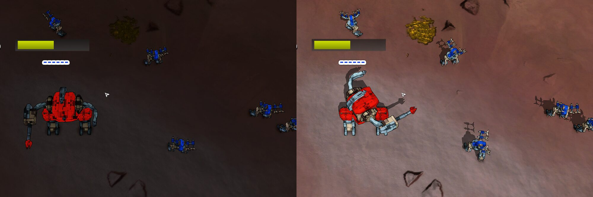

Both halves are frame 22,550 of the whole match of [In a real engine](#in-a-real-engine), paused, three seconds after a seek, from the same place. On the left the stage is switched off and every unit stands as its script made it. On the right the commander's torso and gun arm are turned to the rocket bots to its right, and each bot's launcher is raised and turned to the commander. The light differs because the game's day and night follow the engine's own clock (issue #4013).

#### How a piece is posed

One path poses a piece of a unit with a COB script and of one with a Lua script. The spike on issue #3791 ran it on both. The runs below pose Splinter Faction's units and Balanced Annihilation's `armpw`, `armstump` and `armllt`, which have COB scripts.

```lua
Spring.UnitScript.CallAsUnit(unitID, function()
	Spring.UnitScript.Turn(piece, axis, angle)   -- radians, at once
	Spring.UnitScript.Move(piece, axis, offset)  -- elmos from rest, at once
end)
```

- `axis` is 1, 2 or 3. The six values of a pose key are passed as the track has them, for both kinds of unit. `Turn` and `Move` go straight to `CUnitScript::TurnNow` and `MoveNow`, past the sign changes a COB script's own numbers get. There is no difference between COB and Lua units to handle.
- An angle of the track is in 65,536ths of a turn and is not reduced to one turn. The stage takes the whole turns off before it makes radians of it, since the engine's numbers are 32 bit floats.
- `piece` is the script's number for the piece, `Spring.GetUnitScriptNames(unitID)[name] + 1`. It is not the model's number from `Spring.GetUnitPieceMap`, which differs on a COB unit.
- The stage makes one `CallAsUnit` for a unit and poses all its pieces inside it, with a function made once.
- `Spring.SetUnitPieceMatrix` is not used. It is in the table's avoid list and a test fails if a file uses it.

#### When

The unit's own script goes on running, and would turn an aiming piece back. In a frame the engine runs the gadgets' `GameFrame`, then the unit scripts, then the gadgets' `GameFramePost`. The spike measured it: set from `GameFrame`, a pose held for 4, 4 and 64 of 69 frames on three aiming units, and set from `GameFramePost` for 69 of 69 on each. So the stage poses in `afterSim`, which is `GameFramePost`, on every frame: paused, playing either way, at any speed, and on the first frame a seek is shown. Where that call does not reach the player it poses in `place`, which is `GameFrame`, and logs the line [The call at the end of a frame](#the-call-at-the-end-of-a-frame) has.

After a seek the units stage makes its units over several frames ([A seek over frames](#a-seek-over-frames)). A unit that is not there yet gets no pose. The stage looks up a unit's piece numbers in `place` in the frame the units stage made it, which is timed with the frame's work, and poses it at the end of that same frame.

#### Which pieces

The pieces the track names for the unit's definition (`info.posedPieces`), and no others. Legs, wheels and anything else are the script's.

- The recorder watches each weapon's muzzle piece and every parent up to the root. Where it took a piece on a leg for a muzzle (issue #3941), the leg's chain is among the posed pieces and is posed as it was recorded. `fedstorm` of the match below has `rfoot`, `rleg` and `rthigh` among its 14. The turns its walk makes of those are left to its script once a unit of it has walked ([A walk's pieces and the aim stage](#a-walks-pieces-and-the-aim-stage)).
- A piece that the track names and has no pose track for in a window is at rest for the whole of that window, which the format page says. The stage sets it to no turn and no offset, so a piece the script turned comes back to rest.
- A piece name the unit's script does not have is logged once for the definition, `the script of <unit> has no piece called <piece>, which the track has poses for, so that piece is left to the unit's own script`, and skipped. The unit's other pieces are still posed.
- Piece numbers are looked up once for a unit, when it is made, and again for a unit that is destroyed and made again, which is another unit.

A model in a format that gives a piece a rest rotation, which Assimp and glTF models can have, has that rotation in the track's angles, and they are then not what to pass to `Turn` (the format page, pose tracks). The stage does not tell such a model apart. No unit with a posed piece in the matches recorded so far has one.

#### Units with no recorded poses

Issue #3796 asked for a unit with no recorded poses to be aimed by giving it the recorded target, which the spike did with `Spring.SetUnitTarget(unitID, enemyUnitID, false, true)`. The stage does not do that, for two reasons.

There is nothing left for it to aim. The recorder writes a piece's pose whenever its matrix changes, so a unit whose aiming pieces have no pose track did not move them in the match, and rest is where they were. The stage puts them at rest. In the whole match below, 17 units ever have a weapon target and all 17 have pose tracks. A unit of a definition the track names no pieces for is not touched.

And it cannot be done without the unit's weapons running. A unit only aims at its target while its weapons update (`CUnit::CanUpdateWeapons`, which `Spring.SetUnitUseWeapons(unitID, false, false)` makes false). Giving that back runs all of `CWeapon::Update` for every weapon on every frame: it fires when it is aimed and loaded (`UpdateFire`), so every weapon's reload would have to be pushed back on every frame to hold it. It picks targets of its own (`AutoTarget` in `SlowUpdate`). A shield is a weapon too, and its update pushes away the shots the projectiles stage holds. A stockpile builds. Each of those can be fought one by one, and a miss is a projectile the track does not have. The risk buys nothing while the track has the poses.

A track whose recorder wrote no poses at all would be the case for it. Whether one can still be played was not looked into. Coilbox takes a track from before recorder version 4 as stale and records the replay again. Issue #4023 has what aiming by target would take.

#### What it costs

One `CallAsUnit` for a unit, and three turns and three offsets for each posed piece, on every frame. A frame of play allocates nothing, which `tests/aim_test.lua` counts over 300 frames of 20 units.

Timed in a headless engine with the driver's aim plan, 1,474 frames of six seeks with 60 frames paused and 90 played each way after each, with the stage on and with it switched off. A frame's work is the player's `GameFrame` and `GameFramePost` together, in milliseconds, and the end of the frame is `GameFramePost` alone. One run of each, on a machine with a load average of 4 to 6.

| Track | Posed pieces a frame | Mean, off | Mean, on | End of frame mean, off | End of frame mean, on | Slowest frame, off | Slowest frame, on |
| --- | --- | --- | --- | --- | --- | --- | --- |
| the whole match, seeks into its fight, up to 54 units | 249 to 268 | 0.276 | 0.425 | 0.020 | 0.167 | 10.2 | 10.5 |
| a crowd of 400 of the match's 13 definitions, 123 of them posed | 773 | 1.098 | 2.006 | 0.008 | 0.899 | 18.2 | 18.8 |
| a crowd of 400 `fedstorm`, 14 posed pieces each | 5,600 | 1.404 | 6.741 | 0.009 | 5.357 | 85.2 | 91.9 |

So a posed piece costs about a microsecond a frame: 0.89 ms for 773 and 5.35 ms for 5,600. The whole match pays 0.15 ms a frame. A crowd of 400 units with the match's mix of buildings and units pays 0.9 ms, and 400 of the unit with the most posed pieces pay 5.3 ms, a sixth of a simulation frame, on every frame. The slowest frame is a seek in every row and is the same with the stage off.

The crowds are `crates/coilbox-track/tests/crowd.rs` with `COILBOX_CROWD_POSES`, which gives every posed piece a key every 30 frames. The third row's slowest frames, 80 to 87 ms with the stage on or off, are the reader loading a window with 173,600 pose keys in it, on each seek into another window. The whole match has 125,204 pose keys in all of its 26 windows. It is a made-up worst case, and it is what a recorded match with thousands of posed pieces would meet at every window edge (issue #4022).

The slowest end of a frame was 1.0 ms in the first row's run, 14.3 ms in the second's and 9.1 ms in the third's. What the second's one frame of 14.3 ms was, in a run whose mean was 0.9 ms, has not been looked into.

#### What has run

- `tests/aim_test.lua` and `tests/engine_test.lua` on the stand-in, which has unit scripts written from `rts/Sim/Units/Scripts/LuaUnitScript.cpp`.
- A headless engine, on the whole match and on Balanced Annihilation: [In a real engine](#in-a-real-engine).
- A window, twice, with the stage off and on, at frames 22,850, 22,550, 21,650 and 22,250 of the whole match, paused, three seconds after each seek. The picture above is from those. A commander still shows the right stage with its pieces posed: the `fedcommander_up2` of the fight shows the same pieces with the stage on as with it off, since a pose turns and moves a piece and does not show or hide one.
- Not run: play in a window, which the headless run measures and nobody has watched. A unit under construction with poses, a piece the script lacks, and a window with no track for a piece have only run on the stand-in.

### Unit animation

A unit of a playback is held under move control and put where the track has it, so its own script does not know that it moves, and the engine tells it nothing. A unit's own ground move type calls the script's `StartMoving` when its speed rises past 0.01 elmo a frame and `StopMoving` when it falls below (`CGroundMoveType::UpdateOwnerSpeed`), and a builder calls `StartBuilding` and `StopBuilding` as it starts and stops work (`CBuilder::ScriptStartBuilding` and `CBuilder::StopBuild`). The move type of a unit under move control calls no script function (`CScriptMoveType`, read in `rts/Sim/MoveTypes/ScriptMoveType.cpp` at `105.0` and `2026.07.04`), and no unit of a playback builds anything. So a unit slid with its legs still, and a builder did not turn to its work. The animation stage, `coilbox_player_animation.lua`, tells each script what the engine would have told it, from the track (issue #3797).

#### What a script is told

| Call | When | Arguments |
| --- | --- | --- |
| `StartMoving` | the track has the unit moving and play is going, either way | 1 when the unit moves against the way it faces, which is what the engine means by reversing, and 0 otherwise |
| `StopMoving` | the track has it stand still, or play pauses | none |
| `StartBuilding` | a builder starts work, works on something else, or is shown after a seek | the heading from the unit's front to the work and the pitch up to it from the unit's middle, worked out as `CBuilder::ScriptStartBuilding` does: radians for a Lua script, 65,536ths of a turn cut to a whole number for a COB one. A factory gets no arguments, as `CFactory` gives none |
| `StopBuilding` | the builder has no work | none |

- A unit moves when its velocity in the track is above 0.01 elmo a frame, the engine's own line.
- A script is told on a change and never on every frame. It is told in `GameFrame`, before the engine runs the unit scripts of that frame.
- A unit under construction is told nothing.
- A unit's place runs in a straight line between two keys (the format page, transform keys), so its velocity is the slope of that line, which the reader gives with `window:sampleVelocity`. A unit's keys hold no velocity of their own.

#### Lua and COB scripts

Nothing is asked of the game.

- A Lua unit script exists because the game's script framework handed its call-ins to the engine with `Spring.UnitScript.CreateScript` when the unit was created. The engine keeps them where Lua cannot reach. The gadget wraps that call in the table every gadget shares as its file loads, and keeps each unit's table. A call-in is then run with `Spring.UnitScript.CallAsUnit`, which is how the engine runs one. The engine's own framework (`cont/base/springcontent/LuaGadgets/Gadgets/unit_script.lua`, which Splinter Faction includes) looks the call up each time it creates a script, so the wrap sees every script. A framework that copied the call into a local in a file that loads before the player's is not seen, and its units are told nothing.
- Any other unit is asked for the number of each function with `Spring.GetCOBScriptID`, which gives nothing for a unit with no COB script and for a function the script lacks. A function it has is run with `Spring.CallCOBScript`, which raises for a unit with no COB script.
- `Spring.UnitScript.GetScriptEnv`, which the spike on issue #3791 used, comes from the game's framework and not from the engine. It is not used.
- A script that raises is logged once for the definition, `the script of <unit> raised in StartMoving, so that function of that unit is not run again`, and that function of that unit is not run again.

#### Velocity

A unit has the velocity it is shown moving at: the track's times the direction and the speed of play, and nothing while paused, with `Spring.MoveCtrl.SetVelocity`. It is set when it changes, so a unit walking a straight line between two keys costs one call. The engine moves a unit under move control by its velocity on every frame unless it is told not to (`CScriptMoveType::Update`), and the track owns a unit's place, so each unit is told not to once, with `Spring.MoveCtrl.SetExtrapolate(unitID, false)`. The headless runs below read every unit's place back as the track's with velocities set.

What reads the velocity, in `rts` at `2026.07.04`:

- A COB script's `GET CURRENT_SPEED` (`CUnitScript::GetUnitVal`) and anything that asks `Spring.GetUnitVelocity`, such as a Lua script that scales its walk by its speed.
- What a script emits with `EmitSfx`, which starts with the unit's speed, a sound's place and speed, and the ripples a unit makes in water drawn as `DynWater`.

What it does not touch:

- Where a unit is drawn between two frames. At `2026.07.04` that is a blend of its place on the frame before and now (`CWorldObject::GetDrawPos`). At `105.0` to `2026.07.01` the field's comment says `pos + speed * timeOffset`, and the stage gives the speed the unit is shown moving at, so either way the unit is drawn on its path.
- Track marks on the ground. The engine adds one when a unit's place changes (`UnitMoved` from `GeneralMoveSystem`), which it did before this stage too.
- A ground unit's dust and wake. Those are made by the ground move type, which does not run under move control.

#### Paused, backward, seeks and speed

| Play | What a script gets |
| --- | --- |
| Paused | The time stands still, so a moving unit is told it stopped and has no velocity. A script cannot be held in the middle of a step, so its legs go back to rest the way the script stops them. |
| Backward | A unit moves against the way it faces, so it is told it moves and that it reverses. A script cannot be run backward. One that has an animation for reversing plays that, and one that has none plays its walk while the unit goes backward. Turning play round while a unit moves tells it again. |
| A seek | Nothing by itself. What a unit is told follows from where the track has it after, so a unit that walks on both sides of a seek is not told again. A builder at work is told `StartBuilding` again, since the seek may have turned it. |
| 0.5x to 32x | The same calls. The script's animation runs at the engine's pace, and the velocity says how fast the ground goes by, so a script that times its steps by its speed keeps up. Splinter Faction's walk takes its pace from the definition's top speed and does not keep up at 8x. |
| A builder | Its work follows the track and not the clock: paused and backward it is what the track has at the time shown. A paused builder goes on facing its work. |

#### Builders' work

A builder's recorded work is published in unit rules parameters for a game's own build effect to read, with `Spring.SetUnitRulesParam` and no access argument. The names are `Animation.PARAMS` in `coilbox_player_animation.lua`.

| Parameter | Value |
| --- | --- |
| `coilbox_rewind_work_command` | what `Spring.GetUnitWorkerTask` gives first in a match: minus the unit definition's id while building it, `CMD.REPAIR` once it is finished, `CMD.RECLAIM`, `CMD.RESURRECT`, `CMD.CAPTURE`, `CMD.RESTORE` for terraforming, and 0 for no work |
| `coilbox_rewind_work_target` | what it gives second: the playback's unit id, or the playback's feature id plus `Game.maxUnits`. -1 for none, and while the playback does not have it, as during a seek that has yet to make it |
| `coilbox_rewind_work_power` | the build power in use, from 0 to 1, in fifteenths as the recorder reads it |
| `coilbox_rewind_work_x`, `_y`, `_z` | where the work is, in elmos, when the command or the target last changed. Use the target's own place for one that moves |

A parameter is set when it changes. A unit that never works in the track has none of them. A game's build effect that asks the engine (`Spring.GetUnitWorkerTask`, `Spring.GetUnitIsBuilding`, `Spring.GetUnitCurrentBuildPower`) gets nothing in a playback, since no unit builds, and reads these instead. The parameters are set in synced Lua, so a widget and the unsynced half of a gadget read them with `Spring.GetUnitRulesParam`.

The stage also hands each change of a builder's work to the unsynced half of the gadget, which draws the builder's stream of build particles ([Build particles](#build-particles)).

#### Build particles

A builder at work shows its stream of build particles, from its nano pieces to its work, as the engine draws it in a match (issue #4029). The player draws it, in the unsynced half of the gadget (`coilbox_player_stream.lua`), because the engine's own stream cannot be shown without the builder really building.

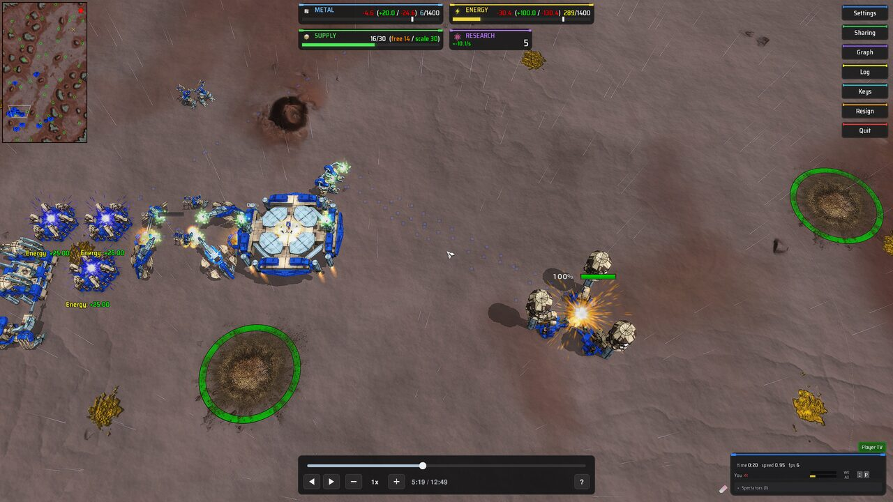

##### Why the engine's own stream is not used

The owner's rule for playback is that the engine's own state is the recording's, so that each game's own effects work with nothing special. For the stream that would mean giving a builder a real order on its recorded work, with its build speed set to nothing. Read in the engine at `6e5c5a0`, that cannot show a stream without changing the world:

- `CBuilder::UpdateBuild` makes a particle only when the build speed is above nothing and `CUnit::AddBuildPower` gives true, and `AddBuildPower` gives true for a build only after it has used the team's resources, asked the game's gadgets with `AllowUnitBuildStep` and moved health and build progress on, finishing the unit when progress reaches 1. A repair is the same, and gives false for a unit at full health, which every wounded unit is for the middle of a frame ([Nothing heals](#nothing-heals)).
- A reclaim at no speed passes `-0.0`, which `AddBuildPower` takes as a build or a repair. At real speed it turns a finished unit back into a nanoframe and kills it at none.
- A factory builds only a unit its own queue made it create (`CFactory::StartBuild`), and no call hands it one that exists.
- `Spring.GetUnitCurrentBuildPower` is the share of the last 15 frames on which the builder made a particle (`NanoPieceCache`), so a game's effect that reads it needs particles made too.

A headless run on the Splinter Faction match, paused at frame 9,570, gave a `fedengineer_up1` `CMD.REPAIR` on the geothermal plant the track has it building, a nanoframe at 0.996 build progress, and read the engine before the player's end of the frame:

| Build speed | Worker task | Build power | Build progress each frame | Health each frame | Team metal each frame | Builder moved |
| --- | --- | --- | --- | --- | --- | --- |
| 0, every kind, for 60 frames | the build, `-77` and the nanoframe | 0.000 | +0 | +0 | +0 | 0 elmos |
| 8, its own, for 60 frames | the same | 1/15 more each frame, to 1.000 | +0.000631 | +2.05 | -0.41 | 0 elmos |

The order was taken under move control and the builder stood where the track has it, but at no speed nothing is drawn, and at real speed the world moves each frame and the nanoframe would have finished in 7 frames. A factory at work in the track gave no task and no power. A resurrect, a capture and a terraform would make particles at no speed, read in the source and not run, which leaves a build, the commonest work, without one.

##### What is drawn

The engine's own particle (`AddNanoParticle` in `rts/Sim/Projectiles/ProjectileHandler.cpp` and `NanoProjectile.cpp`):

- It starts at one of the builder's nano pieces, picked at random, where `Spring.GetUnitPiecePosDir` has it. A builder the engine has no nano piece for makes none, as in the engine.
- A builder's goes along the line to the middle of its work, spread by a random vector in the unit ball times the target's radius over the distance, at 3 elmos a frame, and lives `int(distance / 3)` frames. The radius is half the target's for a build or a repair and 0.7 of it for a reclaim, a resurrect and a capture. A reclaim's starts at the work and comes back, and so does half of a resurrect's. A terraform's goes to the recorded place with no spread, since the track has no radius for it.
- A factory's goes about 1 elmo a frame with a spread of 0.15 and lives `int(distance)` frames.
- A frame makes one when a random number falls under the recorded build power, which is the share of frames the engine made one on.
- It is a square 6 elmos across facing the camera, through the game's particle texture: its `gfxtexture` from `gamedata/resources.lua`, or `circularthingy`. The colour is the team's at an alpha of 20 in 255, or the definition's `nanoColor` at 20 in 256 with the `TeamNanoSpray` setting off. It is blended one and one less the alpha, with no depth written.
- `MaxNanoParticles` caps it, and at 0 nothing is drawn. The engine makes a particle with a chance of one less the share of 95% of that already alive. The stream keeps each with the share the engine settles at, `L / (c + L)` with `L` 95% of the setting and `c` the particles the drawn frame before would have had, which does not flicker, and never draws more than `L`.

Splinter Faction's `circularthingy` is a lit square with a shadow, with no alpha, so its stream is small blue squares in the team's colour that dim the ground under them a little, as the engine draws its own.

Not the engine's: the engine turns each particle as it flies, which a round texture hides and Splinter Faction's square does not, the engine starts a particle at the piece's raw place, and a particle here follows its builder and its target when they move.

##### Paused, backward and seeks

A particle's place is worked out on every drawn frame from the time of the track: which frames since the work began made one, and how far each has gone since. So the stream needs nothing kept from frame to frame.

| Play | The stream |
| --- | --- |
| Forward, any speed | Flows as in the match. At 4x it flows four times as fast, as the engine's does in a replay at that speed. Between simulation frames a particle is drawn where the time between has it |
| Paused | Stands still, every particle where it was, as a paused match shows them |
| Backward | Each particle goes back the way it came and into the piece it left |
| A seek, or a builder a seek makes in a later frame | The whole stream is there at once |
| Work that starts while playing forward | One particle a frame from its first frame |
| Work that stops | No more are made, and those in the air fly on until they have lived their frames |

Played backward into a span of work from its end, the whole stream shows, and it shows whole until the play passes the work's first frame, since the player only learns where the work began when it gets there. That is up to a particle's life too many particles near the start of the work.

##### A game's own build effect

A game that draws its own stream sets `MaxNanoParticles` to 0, as Beyond All Reason does, and the player then draws none. Its own effect asks the engine what a builder is doing, which in a playback is nothing. So the gadget's unsynced half wraps `Spring.GetUnitWorkerTask` and `Spring.GetUnitCurrentBuildPower` in the `Spring` every gadget's unsynced half shares, as its file loads, before a game's gadget that copies them into a local loads. A builder at work is answered with its recorded command and target, and with its recorded power while playing forward and 0 paused and backward, so that a game's stream, which flows on the engine's own clock, stands still with the time. Any other unit gets the engine's answer. The synced half is left alone, since a game's synced gadgets act on what they read.

In Beyond All Reason the wrap reaches the game's gadget, `gfx_nano_particles_gl4.lua`, and the gadget makes its stream from the answers. Nothing of the playback drops a builder. Why the stream did not show at first is the gadget's renderer on this machine (issue #4042).

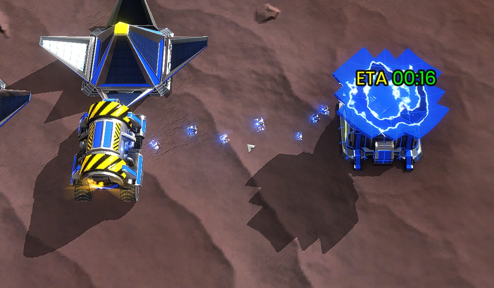

What was found, in six windowed launches on 14 October 2026 on engine `2026.07.01-102-g6e5c5a0` and `test-30922-8064a43`, five of the playback and one of the real replay. A scratch gadget wrapped the steps of the game's builder scan through `debug.setupvalue` and counted what each passed on:

- Every step passes builders on. Over 151 engine frames of play from frame 20,000 of the track, the build power call answered more than 0 59 times, every one of those builders had its information and its target, and the gadget spawned 106 particles, with 18 alive at the end. It is in the handler's `DrawWorld` list, its `DrawWorld` runs on every drawn frame, its shader binds and its own culling finds the particles in view.
- Its line of sight filter does not apply: the playback's spectator has the full view (`Spring.GetSpectatingState` gives true, true).
- Its particles are right. Read out of its instance buffer, each was alive at the frame drawn, between the nano piece and the work, and on the screen.
- None of them draws. Forty still white particles put into its buffer through its own `spawnParticle` in the middle of the view did not draw either, and nor did its draw called a second time at the end of the pass. A plain quad drawn from a LuaRules `DrawWorld` at the same place did draw.
- The gadget draws each particle as a cube made by a geometry shader. It also has a path with no geometry shader, which it takes for AMD on Linux. Made to take that one, by its `Platform` saying so while it set itself up, the white particles and the builders' streams drew, in the team's colour, from the nano piece to the work.

So the geometry shader path compiles on this Mac, whose renderer the game's `Platform` reads as Mesa on macOS, and draws nothing. That is the game's renderer and this machine, and not the playback: the real replay of the same match on the same engine showed no spray either, at a commander building with a build power of 1. The red lines from a unit to its work in that replay are the game's command lines (`gui_commands_fx.lua`). Whether the geometry shader draws on another machine was not looked at. The player changes nothing in the gadget.

On the path with no geometry shader the playback's stream was what the answers say: it flowed playing forward at 1x, was gone 2.5 seconds after a pause and 2.5 seconds into playing backward, and was back 2.5 seconds after playing forward again (`milestone-80-gallery/114-...` to `117-...`). The gadget flows on the engine's own clock, so particles already in the air when the time stops or turns fly on until they have lived their frames: the gadget gives one the distance over 4 elmos a frame, which for that builder, 124 elmos from its work, is 31 frames.

An adapter can draw its own stream from the unit rules parameters of [Builders' work](#builders-work) instead.

##### Nano pieces

The engine keeps a builder's nano pieces and fills that list by asking the script with `QueryNanoPiece` each time it makes a particle, so in a playback it has none. A script can give its own with `Spring.SetUnitNanoPieces`, as Splinter Faction's do as their units are created. For one that has not, the animation stage asks the script the engine's way the first time a unit works, until 30 asks in a row give no new piece (`MAX_QUERYNANOPIECE_CALLS`), turns each script piece into the model's with `Spring.GetUnitScriptPiece`, and gives the engine the list. A game's own effect that reads `Spring.GetUnitNanoPieces` gets them too. A script that raises is logged once and the engine keeps what it gave before.

##### What it costs

Nothing in a frame of the player's work: the stage hands a change of a builder's work on with one `SendToUnsynced`, and asks a script for nano pieces once for a unit. The drawing is in `DrawWorld`, timed by a scratch gadget round the player's whole `DrawWorld`, which draws the arrival effect too, over three windowed launches on Splinter Faction from the game's start to the end of the run: a mean of 0.087 ms and a slowest of 1.41 ms over 1,917 draws, 0.189 and 1.30 ms over 1,852, and 0.246 and 4.45 ms over 733, the last with a load average of 22 after the launch. A draw allocates nothing, which `tests/stream_test.lua` counts over 300 draws of twenty streams. Headless, the module drew 25 to 61 particles for 3 or 4 builders at work in the match.

##### What has run

- `tests/stream_test.lua` on a stand-in for `Spring` and `gl`, `tests/animation_test.lua` for the nano pieces and the work handed on, and `tests/gadget_test.lua` and `tests/engine_test.lua` for the wrap and the rows.
- Headless, engine `2026.07.01-102-g6e5c5a0`: the run of a real order above, the module drawing the Splinter Faction match through a stand-in `gl`, and the wrapped calls in Beyond All Reason.
- Five windowed launches on 14 October 2026, three on Splinter Faction and two on Beyond All Reason, with a scratch widget seeking, pointing the camera at a builder at work and taking the engine's own screenshots. Splinter Faction's streams showed paused after a seek, playing, at the air plant and backward, and switching `MaxNanoParticles` to 0 took them away. Beyond All Reason's own did not show, which [A game's own build effect](#a-games-own-build-effect) explains. The pictures are in `docs/reports/milestone-80-gallery/` from 100, which is gitignored.
- Not looked at in an engine: a reclaim, a resurrect, a capture and a terraform, and any engine older than `2026.07.01-102-g6e5c5a0`. Those have only run on the stand-in.

#### A walk's pieces and the aim stage

The aim stage sets every piece the track has poses for at the end of every frame ([Aim poses](#aim-poses)), and a walk can turn one of those. `fedstorm` of the match below has its right leg among its posed pieces (issue #3941), and its walk turns both legs. Left to the aim stage, the right leg followed the recording and the left followed the script, out of step whenever the walk had not started on the frame the match's did, which is after every seek into a walk, and always while paused or played backward.

So the first time a unit of a definition is told that it moves, the stage asks which turns and moves of the posed pieces the script started in answer, with `Spring.UnitScript.IsInTurn` and `IsInMove` before and after the call. Those are the walk's, and the aim stage leaves them to the script from then on, for every unit of the definition. The rest of each piece's pose is the track's. The player logs it once for the definition:

```
COILBOX_REWIND_PLAYER the walk of fedstorm turns rfoot, rleg, rthigh, which the track has poses for, so those turns are left to the unit's own script and the rest of each piece's pose is the track's
```

- Only what the script starts as it is told is taken. Splinter Faction's walk turns its feet, legs and thighs at once and its pelvis a step later, so the pelvis, the root of the turret, stays the track's. A turn that was already running, such as a turret coming back after work, is not taken.
- A unit of the definition that has not walked yet in the run has its leg posed. One that stands after a walk has its leg where its script put it.
- A script whose walk turns an aiming piece as it starts would lose that piece's aim on that axis. None in the two games run here does: Balanced Annihilation's `armpw` logged no such line.

#### What it costs

For each unit that can move, one velocity sample and a comparison on every frame. For each builder that has work in the window, one sample of its work and of what it works on. A script is called only on a change, and the call costs whatever the script does: a Lua walk starts a thread, which allocates. A frame of play allocates nothing in the stage, which `tests/animation_test.lua` counts over 300 frames of 20 walking units and 5 builders at work.

Timed in a headless engine with the stage on and with a stage that does nothing in its place, one run of each, on a machine with a load average of 3 to 6. A frame's work is the player's `GameFrame` and `GameFramePost` together, in milliseconds, as in [Aim poses](#aim-poses). The first three rows are the driver's aim plan of 1,474 to 1,488 frames, and the last its animation plan of 2,332 frames, which starts and stops every unit many times.

| Track and plan | Mean, off | Mean, on | End of frame mean, off | End of frame mean, on | Slowest frame, off | Slowest frame, on |
| --- | --- | --- | --- | --- | --- | --- |
| the whole match, aim plan | 0.466 | 0.510 | 0.182 | 0.195 | 10.9 | 10.3 |
| a crowd of 400 of the match's 13 definitions that walk 60 elmos out and back, aim plan | 2.110 | 2.314 | 0.894 | 0.908 | 22.9 | 23.5 |
| the same crowd standing still, aim plan | 1.959 | 2.262 | 0.861 | 0.952 | 20.8 | 22.4 |
| the whole match, animation plan | 0.349 | 0.502 | 0.138 | 0.180 | 10.1 | 12.8 |

So the stage costs 0.04 to 0.3 ms a frame in these runs. The standing crowd paid more than the walking one, which the stage's work does not explain, since a unit that stands costs the same sample as one that walks, and one run of each cannot say how much of it is the machine. No run logged a slow frame. The crowds are `crates/coilbox-track/tests/crowd.rs` with `COILBOX_CROWD_POSES=track`, and the walking one with `COILBOX_CROWD_WALK=60`.

#### What has run

- `tests/animation_test.lua` and `tests/engine_test.lua` on the stand-in, whose units have COB and Lua scripts written from `rts/Lua/LuaSyncedCtrl.cpp` and `rts/Sim/Units/Scripts/LuaUnitScript.cpp`.
- A headless engine, `2026.07.01-102-g6e5c5a0`, on the whole match and on a Balanced Annihilation crowd of COB units: [In a real engine](#in-a-real-engine). Every call came on the frame the track has it, and none came that it does not.
- A window, four times on the whole match at frames 9,570 to 9,742, with the stage on, twice with it off, and with a walk's pieces not left to the script, and once on the Balanced Annihilation crowd. With the stage on, six `fedstorm` walk with their legs in stride, played forward and backward, and stand with their legs at rest when paused. With it off they slide with their legs still. Two `fedengineer_up1` and the air factory beside them show Splinter Faction's green build glow at their nano points, which they do not with the stage off. Balanced Annihilation's `armpw` walks. The headless runs, and not the pictures, show that a builder's heading is the engine's own. The Balanced Annihilation pictures missed the commander at work, since the camera was pointed wrong.
- Not run: an engine older than `2026.07.01-102-g6e5c5a0`, a script that raises, a game whose framework copies `Spring.UnitScript.CreateScript` early, terraforming, reclaiming and resurrecting. Those have only run on the stand-in.

### Projectiles

No weapon fires in playback, so the projectiles stage creates each shot of the track with `Spring.SpawnProjectile` and decides where it is on every frame. A piece of debris, which the track stores with no weapon, is left to the engine, which makes its own when a unit dies with its death effect.

What the stage does follows from how the engine treats a projectile, read in `rts/Sim/Projectiles` and `rts/Lua/LuaSyncedCtrl.cpp`:

- `Spring.SetProjectileMoveControl` only stops the engine moving a projectile. On every frame `CProjectileHandler::CheckCollisions` still looks for a unit or a feature from where the projectile is to where its speed would take it, and takes a projectile under the ground to have hit it. The look comes before the move. So the last frame a track has a shot on is the frame the engine found its hit on, and the place and speed recorded there are all it takes to find the hit again.
- Every kind of projectile counts its time to live down under move control. A shell bursts when it reaches nothing left, a bolt stops or fades, and a missile only bursts if its weapon has `selfExplode`.
- A beam or a bolt of lightning (`BeamLaser`, `LightningCannon`) never moves and is never looked at for a hit. Its weapon does the damage when it fires, and the projectile is what is drawn. The track has where it starts and, as its velocity, the way to where it ends.

#### Held

A shot the track has in the air at `t` is a projectile under move control. On every frame it is put where the track has it and given a speed of one position step (an eighth of an elmo) along the recorded velocity. That keeps its direction, which is all the engine draws a held projectile from, and reaches nothing. It is created at the recorded speed, because a laser bolt keeps the speed it was created with as its length. Its time to live is 16,777,216 frames, the largest whole number the engine's Lua numbers count to, which is six days.

Three places are not the track's, each because the engine would otherwise land the shot during a seek or a pause:

- A shot under the ground is held one position step above it, or above the water for a weapon that is not a water weapon.
- A shot on its last frame is held the track's tolerance (half an elmo) short of where the track has it, along its flight. The playback's units can be that far from the match's.
- A laser bolt stops on the frame it hits and stays there while it fades, which the track has as a velocity of nothing. From the frame before it stops it is held one frame of its flight short of there. A bolt first created in the frames it fades in is pointed by the last frame the track has it moving on.

A shot is held at any speed and in either direction, paused included, so it is the same projectile from its first frame to its last.

#### Let go

Played forward at 0.5x, 1x or 2x, a shot is let go on the frame its flight ends: its last frame, or for a bolt the last whole frame before it stops. It is put where the track has it on that frame, at the speed the track has. The engine's own look then finds what the match's did and makes the game's impact effect and its sound.

No frames of free flight are needed, so none are given. Measured on the whole match below, with 195 rockets and 83 laser bolts: at 1x and at 0.5x all 278 landed, a mean of 0.09 elmo from the last frame of flight the track has for them. At 2x 277 landed. The one that did not was let go on the frame before its last, because play at 2x passed over the last, and the unit it hit was a frame short of where it was hit.

What letting go means depends on the kind and on the engine:

| Kind | Let go |
| --- | --- |
| `Cannon`, `AircraftBomb`, `LaserCannon`, `EmgCannon`, and a `MissileLauncher` with `selfExplode` | Move control off and one frame to live, with `Spring.SetProjectileTimeToLive`. The engine has it from there. A shell that hits nothing bursts one frame's flight on, and a bolt goes on to stop and fade as it did in the match |
| `MissileLauncher`, `StarburstLauncher`, `TorpedoLauncher`, `Flame`, `DGun` | It stays under move control for the engine's one look, and is deleted on the next frame if it hit nothing |
| Any kind on an engine before `2025.03.9`, which has no `Spring.SetProjectileTimeToLive` | As the row above. `Projectiles:release` is the one place the call is used |

Only a rocket and a laser bolt have been let go in a real engine. The other kinds are read from the engine source and run on the stand-in.

#### Fired once

A beam cannot be steered, so it is fired once as play passes its first frame going forward, from where the track has it to where its velocity says it ends, for the frames the track has it divided by the speed of play. The engine fades it. At 4x and over only the beams born on the last frame of each step are fired, which is as many a frame as the match had. A seek and play backward fire none, so a beam is not among what is in the air when paused. The whole match below has no beam, so this has only run on the stand-in.

A shot whose whole flight is inside one step of play at 2x is created and let go at once.

#### No damage

Every projectile is created and then given `Spring.SetProjectileDamages` with nothing for every armour type, `craterMult`, `craterBoost`, `impulseFactor` and `impulseBoost`. That changes the projectile's own copy of its damages and nothing of the weapon. So the engine works out no damage, no crater and no push for it, and nothing rests on the gadget's `UnitPreDamaged`, which another gadget after it could overrule.

Two things follow from it:

- An impact effect is given the damage as a number it can scale by (the `d` of an explosion generator), and that number is now nothing. Splinter Faction's two weapons below look as they do in a match.
- The engine kills a unit that has no health left the next time anything hits it, for no damage too. So the units stage keeps a unit the track has alive one step of health, a 65,535th of its maximum, above none.

A weapon's `fireStarter` is not on the projectile, so a shot that lands on a burnable feature can still set it on fire. The features stage makes a feature the fire destroys again.

#### Sound

A shot born while play is watched plays its weapon's fire sound where it was born, with `Spring.PlaySoundFile` on the battle channel at the weapon's volume. A unit's shots of one weapon on one frame make one sound. A weapon with `soundTrigger` makes one for a burst: no second sound within `(salvoSize - 1) * salvoDelay` frames of the first, or within `beamtime` for a beam. A weapon with several sounds plays them in turn. A shot carried into a window from the one before is not a birth there, so a shot born on the last frame or two before a window's end, 900 frames apart, makes no sound.

Nobody has heard it. The headless engine has no sound and the runs with a window had it off.

#### What is not there

- A weapon the game does not have, or one of a kind that makes no projectile, is logged once by name and its shots are left out.
- The engine can still end a held shot, when the playback's world is not the match's. The stage notices, because a projectile it holds has a time to live nothing else has, logs the first, and does not make the shot again until a seek, a turn or the next window. The engine tells Lua of a projectile's death only for weapons a gadget has asked to watch, a list the base game's gadgets change, so the stage asks and does not listen. In the whole match below the engine ended none.
- A shot the engine has been handed, or has ended, is not in the air for the rest of its frames. Pause while a bolt fades and it finishes fading.

### The slow frame line

The unsynced half of the gadget times each frame's work and writes a line to the log file ([The log file](#the-log-file)) when it took longer than one simulation frame lasts, which is 1000 divided by `Game.gameSpeed` milliseconds, 33.3:

```
COILBOX_REWIND_PLAYER slow frame: the work of frame 4521 took 41.0 ms, and a simulation frame lasts 33.3 ms. 3 slow since the last line, the slowest 52.0 ms
```

A frame's work is what the player does in `GameFrame` and in `GameFramePost` together, since the aim stage poses in the second (issue #3796). A frame that was slow before its end is counted once.

After a line, slow frames are counted and not logged for 30 frames. Synced Lua has no clock, so the synced half calls `SendToUnsynced("coilbox_rewind_work", 0, frame)` before the work and with a 1 after it, and with a 2 and a 3 round the work at the end of the frame, and the unsynced half reads `Spring.GetTimerMicros` where the engine has it, which is 2025.01.1 and later, and `Spring.GetTimer` otherwise, which gave whole milliseconds in the runs below. Measured in four runs of the real engine run below, on a track of 5 units and 30 features, 460 frames each: a mean between 0.087 and 0.117 ms, and a slowest frame between 3 and 13 ms, which was the first frame every time.

A whole match of 23,091 frames with up to 54 units, in the run [In a real engine](#in-a-real-engine) describes, over 2,236 frames of work: a mean of 0.305 ms and a slowest frame of 27 ms without the projectiles stage, and 0.321 ms and 26 ms with it. The slowest is a seek that creates the match's units. The shots plan, 13,929 frames of mostly play through the fight, had a mean of 0.220 ms and a slowest frame of 26 ms. None of those runs logged a slow frame. Two earlier runs of the shots plan logged one each, of 36 ms on a seek and of 59 ms in the middle of play, on a frame where the log shows nothing else happening. The timer reads the wall clock, so another process taking the processor shows up as a slow frame, and whether that is what those two were is not known.

In an engine with a window the first seek from the start of that match to its last minutes took 39 and 41 ms in two runs, and logged the line. Timed stage by stage in the second: 33.3 ms for the units, 6.2 for the terrain, 1.5 for the projectiles and 0.1 for the features. The same seek later in the run took 20.3 ms for the units. That was issue #3988, and [A seek over frames](#a-seek-over-frames) is what became of it.

### A seek over frames

A seek can need hundreds of units made or removed, and in Splinter Faction the engine takes 0.2 to 0.5 ms for each. Before issue #3988 the units stage did all of them in the frame the seek was shown in, so a seek across 400 units took 130 to 166 ms of one frame in a window and 120 to 215 ms in a headless engine. The stage now does a seek over as many frames as the engine's time allows.

- A frame makes at most `makeBudget` units and removes at most `removeBudget`. Making and removing have a budget each, because they cost the engine different amounts.
- While a removal is left, nothing is made. The frame that does the last removal makes as many as the rest of its share allows. A removal uses `1 / removeBudget` of a frame's share, a creation `1 / makeBudget`, and a frame has one share. So removals still come before creations, now across frames as well as across stages.
- A unit that is in the track both before and after the seek is put where the track has it at the time shown from the first frame. The ground changes over the first frames, then the units that go are removed and then the units that arrive are made ([The ground of a seek](#the-ground-of-a-seek)). Features and the shots whose shooter is in the world are the time shown from the first frame.
- A unit a seek removes goes quietly in every frame it takes, as it did when a seek was one frame.
- A seek that arrives while another settles needs nothing special. Every frame works out what the track has at the time shown from nothing, so the units the new time does not have are removed first and the ones it has are made.
- Play goes on while a seek settles. The clock moves in every frame, and a unit made late is put where the track has it at the time of the frame it is made in.
- A shot waits for its shooter. A shot made before its unit would have no owner for good, so the projectiles stage leaves a shot whose shooter is in the track and not yet made, and makes it in the frame the shooter is there if it is still in the air.
- The adapter's `unitPlaced` hook is called when a unit is made, which can be several frames after the seek.
- A seek into another window reads that window in its first frame, and does nothing else of the seek in it ([The start of a seek](#the-start-of-a-seek)).
- `coilbox_rewind_settled` is 0 from a seek's message until the world is the track at `coilbox_rewind_frame`, and 0 before the first frame. A test or a widget that waits for a seek waits for the frame and then for this.

#### How many a frame

The player cannot time itself, because synced Lua has no clock. The synced half of the gadget tells the unsynced half, which has one, how many units the frame made and how many it removed, the budgets the frame worked to, and how many of its units were the first of their definition in the run. The unsynced half works out how many of each fit in half a simulation frame, 16.7 ms, and sends the numbers back as a `coilbox_rewind_budget:` message. Half, because the rest of the frame is the engine's own simulation and drawing, and the slow frame line is what says whether that left enough. The rules are `judge`, `fits` and `retune` in `luarules/gadgets/coilbox_rewind_player.lua`:

- Both budgets start at one.
- A frame that used the whole of the budget it worked to sets it to what fits in half a frame, with the rest of the frame's work counted in so that it errs low. It is judged against the budget the synced half says it had, and not the last one sent, which may still be on its way. There is no limit on how far a budget grows in one message (issue #4016).
- What a unit costs rises as a seek fills the world (issue #4015, [The first seek in a window](#the-first-seek-in-a-window)). The rise is a straight line through what a unit cost against how many the seek had made, over its frames that used their whole budget, each weighted by how many it made. The new budget is what fits at the cost the line gives after the units made at the old budget while the new one is on its way, as many frames as the last message took to arrive, and after the new budget's own. The line is taken no further than the units it was read over, since the timer's noise on two frames of one unit is not a trend.
- A frame that made the first unit of a definition is left out of the line ([The first time of a definition](#the-first-time-of-a-definition)). It still sets the budget, from its own cost.
- A frame that used less of a budget leaves it alone, unless the frame took longer than half a frame, and then cuts it.
- A frame that made and removed nothing sets both back to one and forgets the line. What a unit costs moves with how many there are, from 0.28 to 0.5 ms to make and from 0.13 to 0.37 ms to remove in a headless run as the count went from none to 400 and from 400 to none. So the budget a seek ended on is wrong for the start of the next, and a first version that kept it logged frames of 33 to 58 ms. With no limit on growth, the second frame of a seek already has what its first frame's cost allows.
- A frame that did both changes neither, because it says what neither costs.
- Every frame is taken to have lasted one tick of the timer longer than it read: a microsecond, or a millisecond for the timer of whole milliseconds, which reads less than one as none.

No count of units is written in the code. The only numbers are half a frame, one to start from and the timer's tick.

Before issue #4016 a budget at most doubled with each message. Each message waits behind every simulation frame the server has already sent: `Spring.SendLuaRulesMsg` hands it to the server, which queues it after the frames it made while the client was behind (`CGameServer::Update` and `CreateNewFrame` in `rts/Net/GameServer.cpp`, at most 30 frames ahead of the local client), and the client reads them in order in `CGame::ClientReadNet`. So a message arrives as many frames later as the client was behind when it was sent. Measured with the probe below, the longest any budget took was one frame in every headless seek, 3 to 5 frames in a window on Balanced Annihilation and Beyond All Reason, 4 to 7 frames on later seeks of Splinter Faction, and 7 to 11 frames on its first seeks. A budget that doubles takes as many trips as doublings, which was 49 frames for a seek on Balanced Annihilation, where the engine drew 4 to 7 frames a second. Nothing the gadget does can shorten a trip, so each one now carries the whole of what fits.

Which units a seek makes first follows the viewer. [Which units first](#which-units-first) has how.

The ground has a budget of its own, in corners, worked out by the same `judge` from frames that set only ground ([The ground of a seek](#the-ground-of-a-seek)). Unlike the unit budgets, a frame with nothing to do keeps it. What a corner costs is the engine's work round it, and in the runs below it did not move with what else was in the world: a whole seek's ground took 33.1 to 40.7 ms in one frame headless however many units stood on the map. A frame that took too long still cuts it.

#### The ground of a seek

Issue #4025. The terrain stage set every change between the two times in the frame the seek was shown in, reading the terrain chunk of every window in between and calling `Spring.SetHeightMapFunc` once for each window. On the Beyond All Reason match below that took 166 to 218 ms of one frame headless. Timed by a scratch patch, a seek across the match of 76,293 rows in 92 windows spent:

| Part | Time |
| --- | --- |
| reading and unpacking the windows' terrain chunks | 21.7 to 42.6 ms |
| the Lua that sets each height | 12.2 to 23.6 ms |
| the engine's work after each of the 85 calls | 133.8 to 139.6 ms |

The engine's work is `CBasicMapDamage::RecalcArea` (`rts/Map/BasicMapDamage.cpp`), run once at the end of each `SetHeightMapFunc` over the rectangle round every corner the call set: the centre heights, the mip maps, the face normals and the slope map (`CReadMap::UpdateHeightMapSynced`), the features over it, the smoothed ground, line of sight and the pathfinder. It grows with the rectangle's area, about 3.5 to 3.8 ns a corner in these runs. A window's craters are spread over the map, so its rectangle was most of it, 36.3 million corners over the 85 calls on a map of 985,000. The last window alone, 79,591 rows in one call over 919,000 corners, took 3.2 ms in the engine. `SetHeightMap` itself only writes a height and widens the rectangle.

What the stage does now:

- It reads every window's rows once, when it is made, into lists by corner and by tile, and reads nothing in a frame. On the match below that took 149.7 ms while the game loaded, against 0.5 ms before.
- A tile is 32 corners a side (`Terrain.TILE`), and each tile is its own `SetHeightMapFunc` call, so the engine works out a tile's rectangle and no more. 16, 32 and 64 were timed, each setting a whole seek's ground in one frame headless: 33.1 to 40.1 ms in 1,107 to 1,265 calls, 34.6 to 39.3 ms in 472 to 512 calls, and 39.0 to 40.7 ms in 192 to 197 calls.
- A seek marks the tiles that have a row between the two times, and sets every corner of a marked tile to its height at the time shown, found in that corner's own list. So a seek needs the ground at the new time and none of the changes in between. 106,282 corners change in the match.
- A frame of a seek sets marked tiles until it has set its budget of corners, at least one tile. The ground takes its share of the frame first. The units stage adds its removals and creations to what is left, so the ground of a seek is in place before any unit is made on it, and the units that stay are put at the track's height every frame. A unit under move control is not moved by a change of the ground (`CScriptMoveType::Update` with `trackGround` false and `gravityFactor` 0), and a feature is lifted out of or dropped onto the ground by the engine (`CFeature::UpdatePosition`), as in a match.
- `coilbox_rewind_settled` is 0 while a tile is still marked.
- A frame of play that is not a seek or a step sets the tiles its rows change in that frame, whatever the budget, so a crater is in the ground on its frame forward and is gone on the frame before it backward. That work is not counted against the budget, which is for seeks.
- The engine skips a rectangle of no area, so corners in one row or one column would never be worked out again. The stage touches a corner beside them with `SetHeightMap(x, z, 0, 0)`, whose fourth argument scales the change to nothing, which widens the rectangle. The argument is there at `105.0`.
- A corner before its first change takes the map's own height from `Spring.GetGroundOrigHeight`, read once a corner when the stage is made. The track holds it in position steps, half a step at most from the map's, and a seek back used to leave that half step.
- Every corner of a marked tile is set, whether or not its height moved, so a crater the playback's own engine made there, from a death explosion, is put right too.

#### Measured

The engine was `2026.07.01-102-g6e5c5a0` with Splinter Faction, on a Mac with other work running, so the load average was 3 to 6 in these runs. A window was 1,280 by 720. The timers were microseconds. Each stage is timed on its own by a scratch patch that is not in the repository, and every figure is the slowest frame of the seek in milliseconds. A seek is from the first frame to frame 22,791, the last ten seconds of the match. "Later" is the second such seek in the same run. One run of each, so a figure carries the noise of one.

The whole match is the 23,091 frame match of [In a real engine](#in-a-real-engine), which has 53 units at frame 22,791. The crowd is described below, with 400 units from frame 300 on.

| Track | Engine | Player | Seek | Frames to settle | Terrain | Features | Units | Projectiles | Slowest frame | Slow frame lines |
| --- | --- | --- | --- | --- | --- | --- | --- | --- | --- | --- |
| whole match | headless | before | first | - | 2.54 | 0.08 | 22.80 | 0.06 | 25.49 | 0 |
| whole match | headless | before | later | - | 2.37 | 0.07 | 19.37 | 0.04 | 21.85 | |
| whole match | headless | after | first | 8 | 2.62 | 0.08 | 6.82 | 0.07 | 9.55 | 0 |
| whole match | headless | after | later | 7 | 2.52 | 0.09 | 6.38 | 0.04 | 8.16 | |
| whole match | window | before | first | - | 6.89 | 0.08 | 22.29 | 0.06 | 29.33 | 0 |
| whole match | window | before | later | - | 2.58 | 0.08 | 16.84 | 0.05 | 19.55 | |
| whole match | window | after | first | 26 | 8.11 | 0.08 | 7.19 | 0.06 | 15.41 | 0 |
| whole match | window | after | later | 7 | 2.50 | 0.08 | 5.54 | 0.05 | 8.16 | |
| crowd of 400 | headless | before | first | - | 2.60 | 0.07 | 166.61 | 0.01 | 169.30 | 3 |
| crowd of 400 | headless | before | later | - | 2.45 | 0.08 | 172.27 | 0.01 | 174.81 | |
| crowd of 400 | headless | after | first | 15 | 2.46 | 0.09 | 18.50 | 0.02 | 18.56 | 0 |
| crowd of 400 | headless | after | later | 16 | 2.45 | 0.10 | 19.09 | 0.01 | 19.15 | |
| crowd of 400 | window | before | first | - | 4.40 | 0.08 | 161.16 | 0.01 | 165.65 | 3 |
| crowd of 400 | window | before | later | - | 2.48 | 0.08 | 150.63 | 0.01 | 153.20 | |
| crowd of 400 | window | after | first | 38 | 3.88 | 0.09 | 21.35 | 0.01 | 21.38 | 0 |
| crowd of 400 | window | after | later | 20 | 2.61 | 0.09 | 22.51 | 0.01 | 22.60 | |

The slow frame lines are for the whole run of eight seeks, which also go back to the first frame and to the last, and not for the one row. There is no figure for frames to settle before the change, since the world was whole in the frame the seek was shown in. The slowest frame in all eight seeks of the windowed crowd run was 27.2 ms, and of the windowed whole match run 15.4 ms. Going back to the first frame removed 400 units in one frame of 141.45 ms before, and over 24 frames with a slowest of 13.56 ms after.

The whole match run today did not reproduce the issue's 39 and 41 ms. The first windowed seek before the change took 29.3 ms, with the units at 22.3 ms where the issue measured 33.3. The issue's runs were on a different day and nobody else's load is known. What the table shows for the whole match is that the first seek is now 15.4 ms, and that its units stage went from 22.3 to 7.2 ms.

##### The crowd

No replay on the machine that wrote this has more than 54 units at once, and Beyond All Reason is not installed. `crates/coilbox-track/tests/crowd.rs` builds a track from the recorded track of the whole match. It keeps the match's info, features and terrain, drops the projectiles, and writes 400 units of the 13 unit definitions the match used, taken in turn, standing still at places where the match's units stood, in rings of eight 40 elmos apart round each place, at the height of the place. Half exist from 300 frames in and half from the middle of the match, to the last frame. None exists at the first frame, so the first seek makes all of them and the first time of each definition is in it. The units are not Beyond All Reason's, and a Beyond All Reason match has more kinds of unit than 13.

```sh
COILBOX_CROWD_SOURCE=whole-match.cbtrack COILBOX_CROWD_OUT=crowd.cbtrack COILBOX_CROWD_UNITS=400 \
  cargo test -p coilbox-track --test crowd -- --ignored --nocapture
COILBOX_PLAYBACK_TRACK=crowd.cbtrack  # then run the test below, with the variables of the whole match tests
```

`COILBOX_CROWD_DEFS` is a list of unit definition names with commas between them. The crowd then uses those in place of the match's own, in turn, which makes a crowd for another game than the one the match was played on. The crowd of 400 Balanced Annihilation units in [The arrival effect](#the-arrival-effect) was made with `armcom,armpw,armsolar,armllt,armmex,armlab,armvp,armstump,armflash,armrad,corcom,corak,corllt` and played with `COILBOX_PLAYBACK_GAME` naming Balanced Annihilation V15.9.8. The ignored test below passed on it in a headless engine: 400 units at each stop and no slow frame.

The ignored test `a_seek_across_a_whole_match_settles_in_frames_that_fit` plays eight seeks across a match with the driver's seeks plan, waits for `coilbox_rewind_settled` after each, and checks that the engine has the track's units and features at each stop and that the log has no slow frame line and no Lua error. It passed on the whole match and on the crowd of 400 in a headless engine. `COILBOX_PLAYBACK_TRACK` names a track to play instead of the one recorded from the replay.

#### Where it stops holding

The same seeks on crowds of 1,000 and 2,000 units in a headless engine, with the player after the change:

| Units | Frames to settle | Slowest frame of the units stage | Slow frame lines |
| --- | --- | --- | --- |
| 400 | 12 to 16 | 19.09 ms | 0 |
| 1,000 | 37 to 55 | 43.35 ms | 1 of 43.4 ms |
| 2,000 | 122 to 175 | 30.46 ms | 0 |

A seek of 2,000 units takes 4 to 6 seconds to show. Each frame with every unit in place and nothing to do costs 1.0 ms at 400 units, 2.3 ms at 1,000 and 4.8 ms at 2,000, the median of the units stage, so about 2.4 microseconds for each unit in the world. That cost is not spread and is in every frame of play. At that rate it reaches half a frame at about 7,000 units, which is arithmetic on three points and has not been run. The one slow frame at 1,000 units is one frame of 43.4 ms in a run whose other seeks had no frame over 24.6 ms. A crowd of 400 shows the same thing in headless runs on a machine with a load average of 7 to 9: of three runs, one logged a frame of 42.4 ms, one of 76.5 ms and one none, and in each the frame was 39 to 44 creations whose calls to `Spring.CreateUnit` took 41 and 76 ms against 17 to 19 ms for the same number in the frames either side. A run of the ignored test on that machine logged frames of 39.3 and 110.5 ms. These are single frames in which the engine's calls alone were slow, which looks like the machine's other work, and the figures do not show that it was. The test can fail on one when the machine is busy. The acceptance of issue #3988 holds in the runs above for a crowd of 400 in a window, and in a headless engine for 1,000 and 2,000 with that one frame in 1,000 as an exception. It was not run in a window above 400.

The features stage has no budget. It took 1.0 ms to make the match's 162 features in the first frame. A match with thousands of features has not been timed. The terrain stage has had one since issue #4025 ([The ground of a seek](#the-ground-of-a-seek)).

#### The first time of a definition

The first unit of a definition costs more than the next ones. In the first windowed crowd run, before the change, with the 13 definitions the first seek made, the first unit of `fedcommander_up1` took 8.00 ms against a median of 0.46 ms for the later ones, `f1landfac` 2.34 against 0.39 and `fedmetalextractor_up1` 0.94 against 0.33. The other ten were within 0.25 ms of their later median. Summed over the 13 definitions the extra was 10.3 ms, which is the gap the issue saw between 33.3 and about 20 ms. The median of all later creations was 0.36 ms.

The engine already loads every model while the game loads (`PreloadModels` in `rts/Rendering/WorldDrawer.cpp`, on by default, which calls `SolidObjectDef::PreloadModel` for every unit, feature and weapon definition), so the cost is not the model. What it is was not measured. `Spring.PreloadUnitDefModel(unitDefID)` exists in unsynced Lua (`rts/Lua/LuaUnsyncedCtrl.cpp`, since 2015) and does the same thing for one definition, so it adds nothing unless a player has switched `PreloadModels` off.

The player does not create one unit of every definition while the game loads, which the issue suggested. The extra was 10.3 ms in all for 13 definitions, once. With a budget of one, then two, then four, the first units of a seek are few, and in the crowd all 13 definitions were among the first 15 units, made in frames of one, two, four and eight. A unit made and destroyed at load would also run the base game's gadgets for a unit that is not in the track.

Issue #4015 timed each `Spring.CreateUnit` of the crowd's first seek in a window. The first unit of the run took 3.98 ms, of which 1.33 ms were the synced gadgets, Splinter Faction's Lua unit script framework the most of them, and 2.59 ms were the engine and LuaUI, against 0.62 ms for those headless. The first units of the other 12 definitions took 0.4 to 1.9 ms each. Two things in the engine are done once for a definition: a COB script is read and parsed on its definition's first unit (`CCobFileHandler::GetCobFile` in `rts/Sim/Units/Scripts/CobFileHandler.cpp`), and a game's Lua unit script framework loads the script file then. What else makes the first unit in a window dearer was not read.

Since issue #4016 a budget can grow to what fits in one message, so a frame of many units can hold several first units. The units stage counts them in each frame, and the unsynced half leaves such a frame out of the rise in what a unit costs ([How many a frame](#how-many-a-frame)), since its extra is once and not a trend. The frame still sets the budget from its own cost, which errs low for one message. A cost of its own for a first unit, measured and charged like a removal, was looked at and not done: in the windowed runs below the first units of all 13 definitions were made in the first 4 to 8 frames of the first seek, while the budget was still small. The dearest such frame was 33 units with two first units in 21.3 ms. On Balanced Annihilation one frame made 11 first units among 28 in 4.5 ms.

#### The first seek in a window

Issue #4015. The first seek of a run in a window logged slow frames late in the seek, at 0.8 to 1.15 ms a unit where the frames that set the budget had cost 0.36 to 0.41. A scratch probe timed every frame of the seeks on the crowd of 400 in a window: each stage, each `Spring.CreateUnit`, the synced gadgets' `UnitCreated` and `UnitFinished` together, and each unsynced gadget's and each widget's. What a frame of a seek spent its time on:

- `Spring.CreateUnit` was 90 to 95% of the work of a frame that made more than a few units.
- Inside it, the synced gadgets' call-ins took 0.17 to 0.24 ms a unit early in a seek and 0.4 to 0.63 ms late. The engine and LuaUI took 0.13 to 0.32 ms a unit, the widgets 0.06 to 0.09 of that, most of it Splinter Faction's two "How is my build" widgets. The unsynced gadgets took 0.01 ms a unit, `cus_gl4.lua` among them.
- The aim and animation stages took at most 0.22 ms of a frame, the end of the frame at most 0.03 ms, and the sort and the arrival effect's asks were over by the dear frames. The arrival effect is drawn in `DrawWorld`, outside the timed work.
- The engine collects Lua garbage before it calls `GameFrame` (`CGame::SimFrame` in `rts/Game/Game.cpp`) and stops the collector between times (`CLuaHandle::CollectGarbage`), so garbage collection is not in the timed work.

The synced gadgets' share is what grows. Timed gadget by gadget in a headless run, Splinter Faction's `UnitMorph` gadget took 0.07 ms in its `UnitCreated` for each unit made with about 100 units in the world, and 0.28 ms with about 380, on the first seek and on later ones alike. Over a seek a unit's cost rose from 0.34 to between 0.56 and 0.66 ms, headless and in a window. The cost is the game's.

What the first seek in a window adds is time. A budget waits behind the simulation frames the server has already sent ([How many a frame](#how-many-a-frame)). In a window the first seek's draw frames are the longest of the run, 288 to 408 ms at the longest against 209 to 279 ms for later seeks, so the client falls further behind and the longest wait for a budget was 7 to 11 frames, against 4 to 7 later and 1 headless. A budget set while units were cheap stayed in force through that many dearer frames. In one run, late in the first seek, all three parts of a creation, the synced gadgets, the engine and LuaUI, got 1.5 to 2 times dearer together for six frames, from one frame to the next. The Lua timers cannot put that on any one of them.

So the budget takes the rise in what a unit costs over the seek, and how long the last budget took to arrive, into account ([How many a frame](#how-many-a-frame)). A rise from one frame to the next that no line through the seek shows, as in that run, is not foreseen. The half frame the budget aims at leaves it twice its cost before a frame is slow.

Measured on 14 October 2026 with engine `2026.07.01-102-g6e5c5a0`, in a window of 1280 by 720 points, with the probe, one launch for each row group. A seek is from the first frame to frame 22,791 on the crowds and to frame 82,196 on the Beyond All Reason match, and later seeks go back to the first frame in between. "Frames" is the frames that made units, "wait" the longest any budget took to arrive. The load average is read before and after each launch. The rows from issues #4015, #4016 and #3801 are the runs those issues give, with how they counted.

Splinter Faction 0.1.89's playback game on the crowd of 400:

| Run | Player | Load | Seek | Frames | Slowest frame | Wait | Slow frame lines |
| --- | --- | --- | --- | --- | --- | --- | --- |
| #4015, four runs | before | 3.5 to 17.6 | first | 19 to 23 | 21.5 to 46.1 ms | not read | 0 to 3 a run, in 3 of 4 |
| #4015, four runs | before | 3.5 to 17.6 | later | 15 to 18 | 20.5 to 25.7 ms | not read | 0 |
| w1 | before | 4.8, 5.7 | first | 20 | 26.2 ms | 7 | 0 |
| w1 | before | | later, two | 20, 20 | 21.9, 21.0 ms | 5, 7 | 0 |
| w2 | a first version, the rise from the last two frames | 3.7, 3.9 | first | 19 | 26.8 ms | 8 | 0 |
| w2 | | | later, two | 16, 15 | 20.7, 18.9 ms | 5, 5 | 0 |
| w3 | after, with no limit on how far the rise is taken | 4.5, 5.5 | first | 18 | 28.9 ms | 10 | 0 |
| w3 | | | later, two | 15, 14 | 18.3, 23.1 ms | 6, 6 | 0 |
| w6 | after | 4.8, 19.1 | first | 17 | 30.8 ms | 11 | 0 |
| w6 | | | later, two | 14, 15 | 22.0, 21.3 ms | 6, 4 | 0 |

Balanced Annihilation V15.9.8 on the crowd of 400 of its own units:

| Run | Player | Load | Seek | Frames | Slowest frame | Wait | Slow frame lines |
| --- | --- | --- | --- | --- | --- | --- | --- |
| #4016 | before | not read | first | 49 | 13.4 ms in the run | not read | 0 |
| #4016 | before | | later | 21 to 25 | | not read | 0 |
| w4 | after, with no limit on how far the rise is taken | 4.4, 4.3 | first | 8 | 13.7 ms | 3 | 0 |
| w4 | | | later, two | 12, 11 | 17.5, 15.3 ms | 3, 5 | 0 |

Beyond All Reason `test-30922-8064a43` on the match of 674 units, with its idle frame limiter switched off by a scratch file. Its seeks set ground first, so the frames that set only ground are counted apart, and the time from the seek to the player saying it settled is given too:

| Run | Player | Load | Seek | Frames | Ground frames | Whole seek | Slowest frame | Wait | Slow frame lines |
| --- | --- | --- | --- | --- | --- | --- | --- | --- | --- |
| #4015, after #4036 | before | 4.9 to 5.4 after | first | 31 frames to settle in all | | 1,105 ms | 27.7 ms | not read | 0 |
| #4015, after #4036 | before | | later, six | 21 to 26 to settle in all | | 718 to 857 ms | 12.0 to 20.2 ms | not read | 0 |
| w5 | after | 5.1, 7.3 | first | 20 | 6 | 1,012 ms | 25.0 ms | 4 | 0 |
| w5 | | | later, two | 12, 16 | 2, 2 | 554, 731 ms | 27.8, 41.3 ms | 4, 5 | 0, 1 |

The one slow frame line on Beyond All Reason, 41.2 ms, was the first frame of a later seek, before any unit was made: 28.5 ms of ground and 12.8 ms of the units stage's start of a seek, which no budget covers. The old rule would have sent that frame the same ground budget. Issue #4037 gave that start a frame of its own ([The start of a seek](#the-start-of-a-seek)).

Headless after the change, on the same three tracks and two later seeks each: Splinter Faction 16, 15 and 15 frames with a slowest of 18.7 to 19.5 ms, Balanced Annihilation 7 frames each with a slowest of 17.4 to 17.9 ms, and Beyond All Reason 9, 7 and 7 frames and 2 ground frames each, with a slowest of 25.8 to 28.1 ms, which was each seek's first frame. Every budget arrived on the next frame. None logged a slow frame line.

What this shows and does not:

- The first seek now settles in about as many frames as later ones: 17 against 14 and 15 on Splinter Faction, 8 against 11 and 12 on Balanced Annihilation, and in 1,012 ms against 554 and 731 on Beyond All Reason. Balanced Annihilation's first seek went from 49 frames to 8.
- No first seek logged a slow frame line, in four launches with the change and one before it. The first seek's slowest frames were 25.0 to 30.8 ms, under a simulation frame and well over the half the budget aims at. One launch of a kind is a small sample, and the issue's own runs before the change had none in one launch of four.
- The rows after the change are three versions of the rule, as the work went, and only w5 and w6 are the rule as it is. The limit on how far a rise is taken only changes a budget early in a seek, where a rise has been read over few units.

Issue #4015 asked for five first seeks in a window on the crowd of 400 with no slow frame line. With the rule above and the start of a seek of issue #4037, five launches on 14 October 2026, each one first seek and one later seek, on the same engine, game and window, with the machine's load average read before and after each:

| Launch | Load | First seek, frames | Slowest frame | Longest wait for a budget | Whole seek | Later seek, frames | Slowest frame | Slow frame lines |
| --- | --- | --- | --- | --- | --- | --- | --- | --- |
| f1 | 5.1, 5.4 | 15 | 26.4 ms | 10 | 774 ms | 15 | 20.4 ms | 0 |
| f2 | 5.4, 5.7 | 15 | 24.7 ms | 7 | 814 ms | 15 | 21.7 ms | 0 |
| f3 | 5.7, 5.6 | 17 | 26.9 ms | 11 | 899 ms | 14 | 23.4 ms | 0 |
| f4 | 5.6, 6.1 | 16 | 24.9 ms | 8 | 922 ms | 13 | 24.0 ms | 0 |
| f5 | 5.9, 6.3 | 19 | 25.8 ms | 11 | 1,079 ms | 15 | 21.1 ms | 0 |

No line in any of the five, and the first seek's slowest frame was 24.7 to 26.9 ms. The first seeks made their units in 15 to 19 frames, against 17 in w6, before the start of a seek had a frame of its own.

#### The start of a seek

Issue #4037. A seek into another window starts with work no budget covers. Timed part by part with a scratch probe on the Beyond All Reason match headless, the first frame of a seek to frame 82,196 spent:

| Part | Time |
| --- | --- |
| reading the window, `track:seek` in the units stage | 8.5 to 9.4 ms |
| the view's sort of the units to come | 1.3 to 1.5 ms |
| the terrain stage marking the tiles to set | 0.45 to 0.53 ms |
| the stages' `resync` and the window's index | 0.1 to 0.3 ms |

The ground then took its whole budget on top, which was learned from frames that only set ground, so the frame came to 26.8 to 28.4 ms headless and 41.3 ms once in a window. A seek back to the first frame reads a small window, 0.6 ms.

The window cannot be read in parts, and the synced half has no clock to count it against the ground's share. So the units stage reads the window in `resync`, before any stage moves anything, and a frame that read another window does nothing else of the seek: no ground is set, and no unit is made or removed. The ground and the units start on the next frame with their budgets. The synced half says so with each frame, and the unsynced half neither judges a budget by that frame nor takes it for the end of a seek. A seek inside the window already read, the playback's first frame, which reads the first window with a budget of one unit, and a seek with no budget start at once as before. It costs a seek into another window one frame.

In a window, on 14 October 2026, the Beyond All Reason match, one launch before and one after:

| Run | Player | Load | Seek | First frame | Frames after it, slowest | Frames | Ground frames | Whole seek | Slowest frame | Slow frame lines |
| --- | --- | --- | --- | --- | --- | --- | --- | --- | --- | --- |
| w5 | before | 5.1, 7.3 | first | 20.0 ms | | 20 | 6 | 1,012 ms | 25.0 ms | 0 |
| w5 | before | | later, two | 27.8, 41.3 ms | | 12, 16 | 2, 2 | 554, 731 ms | 27.8, 41.3 ms | 0, 1 |
| w7 | after | 6.0, 6.4 | first | 16.3 ms | 10.2 ms of ground | 18 | 8 | 1,173 ms | 30.6 ms | 0 |
| w7 | after | | back, two | 10.3, 6.8 ms | 16.7, 15.1 ms of ground | 12, 10 | 2, 2 | 618, 438 ms | 24.6, 18.6 ms | 0 |
| w7 | after | | later, two | 14.1, 15.2 ms | 18.5, 18.5 ms of ground | 13, 14 | 2, 2 | 680, 687 ms | 22.7, 20.3 ms | 0 |

The first seek's slowest frame, 30.6 ms, made 61 units, after the start and the ground. Headless, on a machine with a load average of 7 to 12, the start frames took 11.5 to 22.8 ms. That run logged two slow frames of the seeks' own budgets, 289 removals in 103.4 ms where the next frame did 289 in 10.8 ms, and 39.6 ms of ground, which is the machine.

### Which units first

After a seek the units the viewer is looking at are made first (issue #4008).

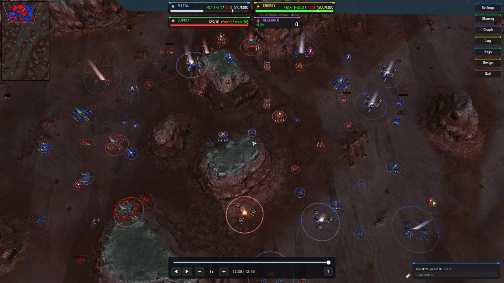

The same seek at the same moment with no view sent and no effect, which is how the player made its units before:

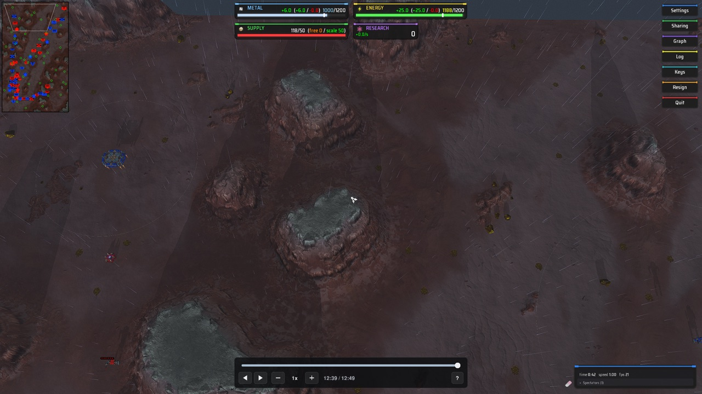

- The synced gadget cannot see the camera. Its unsynced half looks at it once a simulation frame, before the frame's work is timed, and sends what it finds as a Lua message, `coilbox_rewind_view:`, the way it sends the budget. `luarules/rewind_player/coilbox_player_view.lua` works it out.
- The view is the place on the ground in the middle of the screen, then the places on the ground at the screen's four corners, going round, each as an x and a z in whole elmos: `coilbox_rewind_view:4000 3000 3200 3450 4799 3450 4799 2551 3200 2551`. That is five calls of `Spring.TraceScreenRay`. Each is made with `onlyCoords`, so the engine walks the heightmap along the ray and looks at no unit and no feature, and with `ignoreWater`, because the engine takes a ray that ends above the water plane to have missed the ground too (`TraceRay::GuiTraceRay` in `rts/Game/TraceRay.cpp`).
- A corner whose ray leaves the map is where the ray meets the level of the middle. A corner that looks at the sky is nowhere, and the message is then the middle alone: `coilbox_rewind_view:4000 3000`. A camera whose middle looks at the sky sends `coilbox_rewind_view:none`.
- A view is sent again when its middle or a corner has moved by more than a sixteenth of the distance from the camera to the middle (`View.SHARE`), or when it gains or loses its corners. The share is a choice and not a measurement. A smaller one follows the camera more closely and makes the player sort more often while a seek settles.
- The units stage keeps the last view. While a seek's units are arriving it puts the units still to be made in order once: those inside the four corners first, and in each group the nearest the middle first. Two as near are in the order of the window's list. A frame makes the next ones of that order as far as its budget goes. With the middle alone, every unit counts as inside.
- The order is worked out again when a view arrives while the seek settles, when another seek arrives, when the window changes, and when play has brought in a unit the order does not have. So the units still to come follow a camera that moves.
- A frame of play never sorts. The stage only sorts between a seek and the frame that makes the seek's last unit.
- With no view the order is the window's list, as it was before: until the first message arrives, on an engine without the calls, and after `coilbox_rewind_view:none`.
- The world at the end of a seek is the same, and removals still come before creations.

A refused view logs `COILBOX_REWIND_PLAYER the message "..." was refused:` and leaves the last good one.

What the sort costs was timed in a headless engine on a crowd of 2,000, with a scratch mark either side of it: 3.7 to 4.5 ms for 1,740 to 2,000 units over 14 sorts, and 0.59 to 0.81 ms for 289 to 318 units over 6. That includes sampling where each unit stands. It is inside the frame's timed work, so the budget that is worked out from the frame counts it. A camera that scrolls while a seek settles makes the stage sort once for each sixteenth of the camera's distance it moves. A headless engine has a camera, with a view of 8 by 8 pixels, so the headless runs make their units in view order too.

In an engine with a window, on the crowd of 400, with the view of 2560 by 1440 pixels read from the engine once a simulation frame by a scratch gadget, which takes a unit to be in view when its middle is on the screen:

- Before, 288 to 304 of the 360 to 368 units outside the view were made in an earlier frame than the last unit in view, in three seeks of one run.
- Now, 0 to 7 of the 320 outside were, in 20 seeks over four runs. Each of those was within 115 pixels of the edge of the view. The four corners are joined by straight lines on the ground, and the edge of a view over hills is not straight, so a unit beside the edge can fall on either side. So the rule that every unit in view exists before any unit outside it holds but for units at the edge.
- Now, the last of the 79 units in view was there 260 to 549 ms after the seek was sent, and the whole seek took 615 to 1,114 ms. Before, it was 567 to 759 ms of 605 to 942 ms, with 31 to 39 units in view, because the camera had moved in that run.

[Measured in a window](#measured-in-a-window) has the frames.

### The arrival effect

A unit that a slow seek makes gets a short effect where it appears, so that it arrives and does not pop into place (issue #4009).

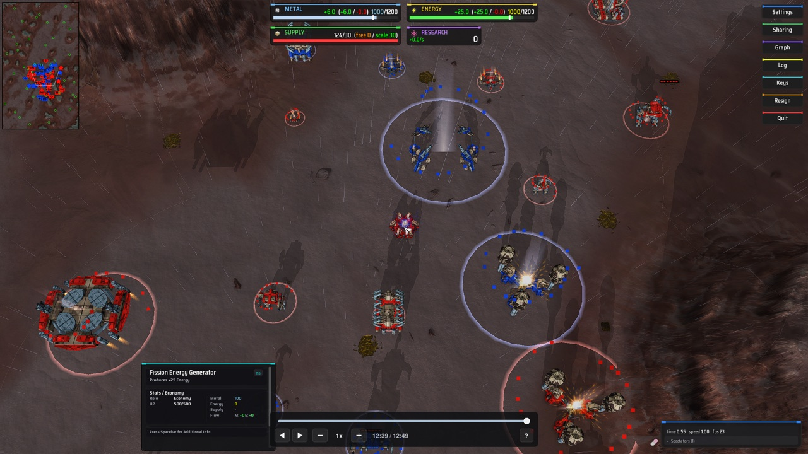

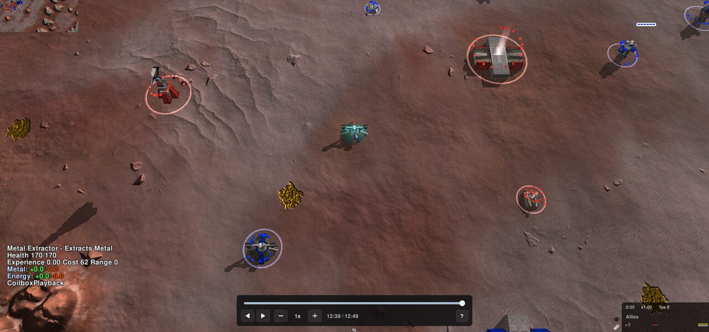

Which units get one is the units stage's to say:

- A unit made in a later frame than the frame that showed the seek, while the seek's units are still arriving. That is what slow means here. A seek that is shown in one frame gets none. With a budget that starts at one, a seek that makes more than one unit takes more than one frame.
- Only a unit inside the view's four corners. With a view that has no corners, or no view, every unit counts as inside.
- None while the timeline's knob is being dragged, which the `drag` message says. A drag sends many seeks a second. When the drag ends, the units still to come get one.
- None for a unit a seek removes, and none in plain play. A unit that play brings in while a seek is still settling does get one.

The stage asks with `context.arrive(unitID, x, y, z, team)`. The gadget hands that to its unsynced half with `SendToUnsynced("coilbox_rewind_arrive", ...)`, which is a call and costs no frame, and the unsynced half draws from `gadget:DrawWorld`. `luarules/rewind_player/coilbox_player_arrival.lua` is the effect.

#### What is drawn

A column of light that fades, a ring on the ground that closes on the unit, and 16 dots in the team's colour that fall into it, over 0.9 seconds of the frame timer's clock. The lengths are in the unit's radius, from `Spring.GetUnitRadius`, so a larger unit has a larger effect, and the colour is the team's, from `Spring.GetTeamColor`. The dots are plain squares with a little difference in shade from one to the next. The lengths and the 0.9 seconds are choices of how it looks, made by looking at it in six runs.

It is drawn with `gl.BeginEnd`, `gl.Vertex` and `gl.Color` as quads, with `gl.Blending`, `gl.DepthTest`, `gl.DepthMask` and `gl.Texture(false)` round them. It has no texture, no shader and nothing from the game, and it never touches how a unit is drawn. An effect is a row in lists made once, and a draw allocates nothing.

#### Why the player draws it

The other way would be a particle effect of the engine's, an explosion generator, which the player could start with `Spring.SpawnCEG`. Read in the engine source at commit `212c369b4c`, it cannot be made to work in every game:

- The engine reads every definition from one file, `gamedata/explosions.lua`, and takes the game's own before the engine's (`CExplosionGeneratorHandler::ParseExplosionTables` in `rts/Sim/Projectiles/ExplosionGenerator.cpp`). The engine's file lists `gamedata/explosions/` and `effects/` in every archive, so a file the playback game added there would be read. A game that ships its own `gamedata/explosions.lua` decides what is read. None of Splinter Faction 0.1.89, Balanced Annihilation V15.9.8, Metal Factions v2.58 and THIS does.
- A particle needs a texture, and the textures are the game's. The atlas is built from the game's `gamedata/resources.lua` (`CProjectileDrawer::Init` in `rts/Rendering/Env/Particles/ProjectileDrawer.cpp`), and the engine's base content has no projectile bitmap. A particle whose texture the atlas lacks is not drawn (`CSimpleParticleSystem::Draw`). No name is in every game.

Drawing from a gadget needs the game's gadget handler to pass `DrawWorld` to the unsynced half. Splinter Faction and Balanced Annihilation have handlers of their own and both pass it, as the engine's does, which Metal Factions and THIS use. Each lists the call-ins it knows, and a gadget that defines one is called with nothing to register. A game whose handler does not pass `DrawWorld` gets no effect and no error.

#### A game's own effect

A game's adapter can show the game's own spawn or warp effect in its `unitPlaced` hook ([Hooks](#hooks)). The hook's fifth argument is whether the player is about to show its effect for the unit, and a hook that gives true has shown its own, so the player shows none. The name below stands for one of the game's own explosion generators.

```lua
unitPlaced = function(unitID, unitDefID, t, clock, effect)
	if effect then
		local x, y, z = Spring.GetUnitPosition(unitID)
		Spring.SpawnCEG("mygame_warp_in", x, y, z)
		return true
	end
end,
```

A hook that gives nothing leaves the player's effect, and so does one that raises. The hook is still called for every unit the player makes, whatever `effect` is.

#### What it costs

- Asking is inside the frame's timed work: one `SendToUnsynced` and, in the unsynced half, `Spring.GetUnitRadius` and `Spring.GetTeamColor`. The budget counts it.
- Drawing was timed by a scratch gadget that held 16, 64, 256 and 1,024 effects half way through their lives and timed the module's draw, in three runs in a view of 2560 by 1440 pixels, two in Splinter Faction and one in Balanced Annihilation: 13.4 to 16.0 microseconds for each effect in each drawn frame. 64 effects drew in 0.91 to 0.94 ms, 256 in 3.5 to 3.8 ms and 1,024 in 13.8 to 14.9 ms.
- So there is a cap. No more than 256 effects are alive at once (`Arrival.MOST`), and a unit that arrives past that has none. The cap is a choice of how much of a drawn frame to spend, 3.8 ms at the worst measured. The crowd of 400 had 79 units in view.
- While a seek of the crowd of 400 settled, the engine drew 9 to 10 frames a second with the effect and 8 to 11 without, in three of the runs below.

#### Measured in a window

The engine was `2026.07.01-102-g6e5c5a0` with Splinter Faction, in a window of 1,280 by 720 points, which is 2560 by 1440 pixels, on 14 October 2026. Another agent was building and running engines on the same machine, so the load average is given for each run. The track is the crowd of 400 and the seek is from the first frame to frame 22,791, with the camera over the place most of its units are. The first seek of a run is the first row and later ones follow. A scratch gadget read the player's own measure of each frame's work. "Frames" is the frames that made a unit. "In view by" is when the last unit in view was there, after the seek was sent, and "whole seek" is when the player said it was settled.

| Player | Run, load | Seek | Effect | Frames | Slowest frame | In view by | Whole seek | Slow frames |
| --- | --- | --- | --- | --- | --- | --- | --- | --- |
| before | 1, 5.6 | first | none | 21 | 28.04 ms | 759 ms | 942 ms | 0 |
| before | 1, 5.6 | later | none | 16 | 19.67 ms | 567 ms | 605 ms | 0 |
| before | 1, 5.6 | later | none | 16 | 22.84 ms | 590 ms | 617 ms | 0 |
| now | 2, 5.2 | first | on | 22 | 39.06 ms | 549 ms | 1,114 ms | 1 |
| now | 2, 5.2 | later | on | 18 | 23.72 ms | 322 ms | 768 ms | 0 |
| now | 2, 5.2 | later | on | 17 | 21.20 ms | 324 ms | 779 ms | 0 |
| now | 2, 5.2 | later | off | 16 | 24.25 ms | 347 ms | 642 ms | 0 |
| now | 2, 5.2 | later | off | 15 | 21.74 ms | 260 ms | 692 ms | 0 |
| now | 3, 17.6 | first | on | 19 | 46.13 ms | 433 ms | 963 ms | 2 |
| now | 3, 17.6 | later | on | 16 | 24.32 ms | 315 ms | 747 ms | 0 |
| now | 3, 17.6 | later | on | 18 | 23.28 ms | 374 ms | 690 ms | 0 |
| now | 3, 17.6 | later | off | 16 | 24.02 ms | 331 ms | 625 ms | 0 |
| now | 3, 17.6 | later | off | 17 | 25.65 ms | 390 ms | 654 ms | 0 |
| now | 4, 4.4 | first | on | 23 | 21.54 ms | 415 ms | 925 ms | 0 |
| now | 4, 4.4 | later | on | 17 | 23.40 ms | 373 ms | 814 ms | 0 |
| now | 4, 4.4 | later | on | 17 | 23.83 ms | 344 ms | 647 ms | 0 |
| now | 4, 4.4 | later | off | 17 | 22.30 ms | 366 ms | 853 ms | 0 |
| now | 4, 4.4 | later | off | 16 | 22.25 ms | 300 ms | 734 ms | 0 |
| now | 6, 3.5 | first | on | 22 | 39.92 ms | 487 ms | 1,028 ms | 3 |
| now | 6, 3.5 | later | on | 18 | 21.16 ms | 358 ms | 714 ms | 0 |
| now | 6, 3.5 | later | on | 17 | 20.52 ms | 404 ms | 731 ms | 0 |
| now | 6, 3.5 | later | off | 16 | 23.94 ms | 377 ms | 715 ms | 0 |
| now | 6, 3.5 | later | off | 16 | 24.38 ms | 341 ms | 615 ms | 0 |

"Off" is the same seek sent between a `drag 1` and a `drag 0`, which asks for no effect. A first seek with the effect off was not run. Run 5 was Balanced Annihilation.

What the table shows and does not:

- A later seek logged no slow frame in any run, with the effect or without, and its slowest frame is the same before and now.
- The first seek of a run logged a slow frame in three of the four runs now, of 36.6 to 46.1 ms, and not in the one run before, whose slowest was 28.0 ms. One run before is not enough to say the first seek was safe before.
- In the two runs that have each frame, the slow frames came late in the seek, after every unit in view had been made. Going by run 4, where the first unit of all 13 definitions was made in the first seven frames, the first units of the definitions were over too. They were frames of 40 and 46 units that took 0.80 to 1.15 ms a unit, where the frames that set the budget had taken 0.36 to 0.41 ms a unit. The sort and the asks for an effect were over by then. It did not show in a headless engine, where three first seeks before and three now had a slowest frame of 18.4 to 21.9 ms. Issue #4015 found why: [The first seek in a window](#the-first-seek-in-a-window).
- A screenshot was taken part way through 13 more seeks, and one of those logged a slow frame of 33.8 ms.
- In a headless engine on the same machine the ignored test of the crowd of 400 passed twice and failed twice on one slow frame, of 41.4 and 36.5 ms, with a load average of 4 to 7. That is the test [Where it stops holding](#where-it-stops-holding) says can fail on a busy machine. The scratch gadget's run of seeks, three times with the player of `origin/main` and three times with this one, logged a slow frame in one run of each: 42.3 ms before, and 39.9 and 53.9 ms now in a run with a load average of 12.9.

In Balanced Annihilation, in run 5, the same crowd as its own units logged no slow frame and no Lua error, with a slowest frame of 13.4 ms. The engine drew 4 to 7 frames a second there, and the budget was slow to grow: the first seek took 49 frames, 25 of them at two units a frame, and the later ones 21 to 25 frames. Issue #4016 found why the budget was slow there, and [How many a frame](#how-many-a-frame) has it. Balanced Annihilation's gadget handler logs `UpdateCallIn: GameFramePost is not implemented`, so the player never hears the end of a simulation frame there (issue #4002).

### What the base game does

A game's adapter ([Game adapters](#game-adapters)) is where a game says what to switch off. For a game with no adapter, and for what an adapter leaves, the player undoes what it can and says what it cannot, each in one line of the log:

- The base game takes an empty team for a beaten one. Splinter Faction's `game_end.lua` and `game_team_com_ends.lua` call `Spring.KillTeam`, and the engine creates nothing on a dead team again. The guard gadget replaces `Spring.KillTeam` and `Spring.GameOver` as its file loads, and logs the first ask of each. It has to load before the gadget it guards against, because `game_end.lua` copies both calls into locals as it loads. Gadget files load in the order the engine's `VFS.DirList` sorts them, and the guard's name starts with `!`, which sorts before every letter, digit and underscore. A gadget whose file sorts before that, or anything outside the gadgets, keeps the real call. A team that dies anyway is logged.
- `Spring.CreateUnit` gives nothing, with no error, for a dead team or one at its unit limit. That is logged once for each team, and the unit is tried again after the next seek and not on every frame.
- A unit or a feature that the track does not have is removed on the next frame. That covers the map's own features, a unit the game spawns and a feature a base game gadget creates, as Splinter Faction's `unit_deathContainerSpawn.lua` does where a unit dies.
- A unit or a feature of the track that something else destroys is made again on the next frame.
- The engine asks before it leaves a wreck, and is refused, because the track has every wreck of the match.
- Nothing takes damage: `UnitPreDamaged` gives every hit no damage and no push. Health that changes anyway is set again on the next frame, and the first time it does the player logs one line saying so. [Nothing heals](#nothing-heals) has the rest: the engine's own healing never gets to heal a unit, and a game's gadget that heals belongs in the game's adapter.
- A nanoframe nobody is building decays, and the engine kills it when its progress or health reaches zero. A unit under construction has both set on every frame, and held above one step of that decay.
- A unit with no health left is killed by the next hit, and the track can have a living unit at none. A finished unit keeps one step of health.
- A unit that dies with its death effect explodes, and that explosion reaches the features round it (`CGameHelper::Explosion` to `CFeature::DoDamage` in `rts/Game/GameHelper.cpp` and `rts/Sim/Features/Feature.cpp`). The engine asks `FeaturePreDamaged` first, and the gadget answers no damage and no push, as it does for units (issue #3987). A tree does not fall and a wreck stays. The explosion's effect and sound do not depend on the damage done, so they still show. [Death explosions](#death-explosions) has what else was checked.

A track's team is the same number in the game, because the start script carries the replay's teams. A team the game does not have as a team of its own is Gaia, read from `Spring.GetGaiaTeamID()`.

Not handled: on an engine before `2025.03.9` a finished unit cannot be turned back into a nanoframe, so the stage destroys it and creates it again as one. That path has only run on the stand-in, since no such engine is installed here.

### Nothing heals

The recording owns health, so no unit's health changes in a playback except when the player sets it. Every way the engine or a game can move a unit's health or build progress with nothing simulated, as read in the engine source at commit `212c369b4c`, and what the player does about each:

| What | In the engine | What the player does |
| --- | --- | --- |
| `autoHeal` and `idleAutoHeal` | `CUnit::SlowUpdate` (`rts/Sim/Units/Unit.cpp`) adds both to a unit whose health is below its maximum. It runs between `GameFrame` and `GameFramePost`, and the engine tells nobody | Stopped. See below |
| Repair by a builder | `CUnit::AddBuildPower` refuses when `health >= maxHealth`. A builder looks for something to repair only while it carries out an order (`CBuilderCAI`), and the player gives a unit no order but on and off | Stopped by the same maximum. An idle builder does not repair on its own |
| A repair pad | No code for one in `rts/Sim`. A game does it in a gadget that sets health | The game's adapter |
| A nanoframe's decay | `CUnit::SlowUpdate` takes progress and health off a unit under construction that nobody is building, and kills it at none | Set again on every frame, held above one step of decay, as before |
| Shields recharging | `CPlasmaRepulser::Update` raises shield power, which is not health. Weapons only update when `CUnit::CanUpdateWeapons` is true, and the player switches them off | Nothing needed. The track holds no shield power either |
| Paralysis wearing off | `paralyzeDamage` falls in `CUnit::SlowUpdate`. Nothing sets it in a playback | Nothing needed |
| A game's gadget that sets health | Splinter Faction's `unit_auto_health_regeneration.lua` and `unit_area_heal_radius.lua`. Neither raises `UnitDamaged` | Splinter Faction's adapter switches both off. Any other is put right in the frame it acts in and logged once |

The engine has no switch for healing on one unit. The numbers are in the unit definition, which Lua reads and cannot change. `restTime` is not reachable from Lua. A stunned unit does not heal, but `SlowUpdate` returns early for it, so it also stops making resources. A depending game cannot change the definitions either: `CGame::Load` runs the one `gamedata/defs.lua` that the top archive has, a game's own is a single file that the playback game would have to replace, and `VFS.Include` from Lua cannot reach the file that one hides.

So the player takes away what the heal acts on. `SlowUpdate` heals only when `health < maxHealth`, so after it has put a wounded unit's health in place, the player gives the unit a maximum equal to that health (`Spring.SetUnitMaxHealth`). The engine then finds nothing to heal, and nothing to repair. `GameFramePost` is the end of the simulation frame, where the player gives every unit its maximum back and looks at its health once more. Health never moves, so a read at any point of any frame finds the track's value. A unit at full health, and a unit under construction, are left alone. If a held unit's health has changed by then, or a gadget of the game raised health before the player's frame, the player sets it again and logs one line starting `COILBOX_REWIND_PLAYER the health of a unit of the track changed with no damage to hear of`. A game that logs it needs its healing gadget in its adapter.

A lowered maximum is only safe if the engine calls back at the end of the frame, and it does not for every gadget ([The call at the end of a frame](#the-call-at-the-end-of-a-frame)). So a unit is held only in a frame that follows one the call came after (issue #4002):

- In the first frame nothing is held, since nothing has said yet that the call comes. If the engine heals a unit in that frame, the call at its end puts the health back without a line in the log.
- A frame that ends without the call, after frames that ended with it, has every held unit's maximum given back at the start of the next frame, and nothing is held again until the call has come back.
- Where the call never comes, no maximum is ever touched. Health the engine adds in a frame is taken off on the next, which is what the player did before issue #3986, and the player logs `GameFramePost does not reach the player, so a wounded unit keeps its maximum health, and health the engine's own healing adds in a frame is taken off again on the next`.
- A unit that is destroyed and made again is a new unit with its own maximum. Playback that is refused holds nothing, since no player is made. The gadget's `Shutdown` gives back whatever is held if the gadget is removed in the middle of a frame.

What a viewer can notice: for the part of a frame between the player's `GameFrame` and `GameFramePost`, a wounded unit reports a maximum equal to its health. A gadget of a higher layer than the player's, which is 0, that reads a unit's health in its `GameFrame`, sees it as whole in that frame. Nothing is drawn in that time. A widget reads between frames, when the maximum is whole again.

### The call at the end of a frame

Three stages lean on `gadget:GameFramePost`, the engine's call when a simulation frame is over: the units stage gives back a wounded unit's maximum health there, the resources stage puts the teams' numbers back, and the aim stage sets its poses. The call does not reach every gadget (issue #4002).

- The engine may not make it. It is missing at the tags `105.0` and `105.1.1` and present from `105.1.1-2590`, read in `rts/System/Events.def`.
- The game's gadget handler may not pass it on. Splinter Faction's does. Balanced Annihilation V15.9.8's and Complete Annihilation's do not.

Nothing in a global says which. So the player finds out by behaviour, in `lookBack` in `coilbox_player.lua`: at the start of a frame it knows whether the frame before ended with the call. `context.post.arrives` is that, and a stage reads it on every frame.

1. The first frame knows nothing, and nothing leans on the call in it.
2. The first frame that follows one with no call asks the gadget to install the call-in. That is frame 2 in a game whose handler does not pass it on.
3. The install has the frame it was made in to show. If that frame ends with the call, the player logs `the game's gadget handler does not pass GameFramePost on, so the player installed it, and the engine's call now reaches the player`, and everything works as it does in Splinter Faction from frame 3.
4. If that frame ends without the call too, or nothing could be installed, every stage is told. Each logs one line of what it does without the call, and the player logs `GameFramePost does not reach the player. The player installed the call-in itself and still none came, so this engine does not make the call. Engine 105.1.1-2590 and later do`.
5. A call that stops coming later is asked for again the same way, at the cost of one frame.

The install is `installFramePost` in the gadget, and is what the spike on issue #3791 ran:

```lua
local g = gadget
_G.GameFramePost = function(frame) g:GameFramePost(frame) end
Script.UpdateCallIn("GameFramePost")
```

A handler gives a gadget its own global table as `_G`. The engine calls a call-in when that table has a function of its name and it has been told to look, which is all `Script.UpdateCallIn` does (`CLuaHandle::UpdateCallIn` in `rts/Lua/LuaHandle.cpp`). On an engine with no such call-in the name is not in the engine's list and nothing happens, with no error (`CEventHandler::InsertEvent`).

What Balanced Annihilation logs as its gadgets load, `Error: UpdateCallIn: GameFramePost is not implemented`, is the handler's own line and not the engine's. Its `luarules/gadgets.lua` takes the list of call-in names from the engine's `LuaGadgets/callins.lua`, which has `GameFramePost` on this engine. So it keeps a list of the gadgets that have a function of that name, finds the player in it, finds that it has no `gadgetHandler:GameFramePost` of its own to pass the call on with, logs the line, clears the global and tells the engine, which then calls nothing. The handler does not refuse a name. It does the same again for every call-in each time a gadget is added or removed, which clears a global somebody else put there. That is why the player installs after the first frame and not as its file loads, and why it asks again when the call stops. The handler's own `gadgetHandler:UpdateCallIn(name)` for a gadget goes through the same function, so it cannot install the call either.

What each stage does without the call:

| Stage | With the call | Without it |
| --- | --- | --- |
| Units | a wounded unit's maximum is its health for the middle of a frame, so the engine heals nothing | no maximum is touched. Health the engine adds in a frame shows until the next frame takes it off |
| Resources | what a team holds, its storage and its share level are put back before the frame is drawn | what a team holds reads one frame of the playback's own economy off, and its share level reads 1 on a frame the engine sums up on |
| Aim | a piece has the track's pose when the frame is drawn | the pose is set in `GameFrame`, and a unit's own script can move the piece again before the frame is drawn |

The `frameEnd` row of the engine table is the install's call, `Script.UpdateCallIn`. Without it nothing is installed, and a game whose handler passes the call on works as before.

What ran, on engine `2026.07.01-102-g6e5c5a0`, with the test `aim_poses_follow_the_track_in_the_engine` ([In a real engine](#in-a-real-engine)):

- Balanced Annihilation V15.9.8, whose handler does not pass the call on. The player logged the install line at frame 2, and the call reached it on 2,843 of the run's 2,844 frames, which is every frame but the first. A third of the 60 units were wounded. At the start of each of 2,823 frames looked at, no unit had a maximum other than its definition's, and no finished unit's health was off the track's, including 2,100 frames stood paused, which is past the 1,800 frames (`idletime`) that game's `armpw` stands idle for before the engine heals it.
- The same with the engine kept from being told of any function called `GameFramePost`, which the test's `nocall` does by wrapping `Script.UpdateCallIn`. That stands in for an engine without the call. The player logged the four lines once, at frame 2, and no call came in 2,844 frames. No unit's maximum was other than its definition's on any frame. In the 2,100 frames stood paused, a unit's health was off the track's 1,374 times at the start of a frame, by up to 0.0083 of its maximum, which is the engine's idle healing of the frame before, and the player took it off in that frame. Of 338,100 pieces looked at in those frames, 21,000 were off the track's pose at the start of the next frame, by up to 0.052 radians, where the unit's own script had moved them after the player's `GameFrame`. With the call there, none was.

No engine without the call is installed, so the second run is as near as this machine gets to one. It shows the fallback's logic in a real engine and not what a 105.0 engine does with the rest of the player.

### Team resources

A playback simulates nothing of the match, so left alone each team's economy is whatever the units the player placed happen to make. The resources stage, `coilbox_player_resources.lua`, makes the engine's own numbers the recorded match's (issue #3982). Nothing is hidden and no panel is changed: a resource bar, another widget and a gadget all ask the engine and all get the match.

What can be set was read from the engine at commit `212c369b4c`, in `rts/Sim/Misc/Team.cpp`, `TeamHandler.cpp` and `rts/Lua/LuaSyncedCtrl.cpp`. `Spring.GetTeamResources` gives nine numbers for a resource.

| Number | How the player makes it the match's | How true |
| --- | --- | --- |
| held | `Spring.SetTeamResource(team, "m", value)` on every frame and in `GameFramePost` | the track's value, as the 32 bit float the engine holds |
| storage | `Spring.SetTeamResource(team, "ms", value)`, the same | exact when the frame is over. Set before what is held, since the engine cuts what is held to the storage |
| share level | `Spring.SetTeamShareLevel`, the same | exact, except for part of one frame in 30 (below) |
| income | `Spring.AddTeamResource` on the frames the engine sums up on | the match's, or the playback's own where that is more |
| expense | `Spring.UseTeamResource` of an amount the team holds | the same |
| pull | `Spring.UseTeamResource` of an amount the team does not hold | the same |
| excess | `Spring.AddTeamResourceExcessStats`, on engines from `2026.07.01` | the match's. The playback's own on an older engine, and the larger of the two on an engine with no `GameFramePost` |
| sent, received | not set | the playback's own, which is nothing |

No call sets income, expense or pull. The engine keeps a running sum of each, and on every frame that divides by 30 (`TEAM_SLOWUPDATE_RATE`) `CTeam::ResetResourceState` makes the sums the numbers it reports and starts them again from nothing. `AddTeamResource` adds to the income sum as well as to what is held, and `UseTeamResource` always adds to the pull sum and adds to the expense sum when the team holds the amount. So on those frames the stage, for each resource of each team:

1. Sets storage to twice what is about to go through it, so that nothing added runs over into excess.
2. Sets what is held to 0 and adds the income that is missing. A team with an income multiplier in the start script has the amount divided by it first, since the engine multiplies what a gadget adds too.
3. Sets what is held to the expense that is missing and uses exactly that, which goes through.
4. Sets what is held to 0 and uses the pull that is missing, which does not go through and counts as a pull only.

Then storage and what is held are set to the track's, as on every frame. All of it happens inside one call of the gadget, so nothing else sees the steps.

"Missing" is the track's number less the playback's own. The playback's own sum for the 30 frames that are running cannot be read, since the engine only gives the sums of the 30 before. The stage reads those when the engine has summed up, takes off what it added itself, and uses the rest as its guess for the next 30. That guess is right while the same units stand in the world. After a seek it is wrong twice: the first sum still has what the units of the frame before the seek made, and the second is guessed from that one. So the numbers settle on the third of the engine's sums after a seek, which is up to three seconds, and can read too high or too low until then. They change once in 30 frames, as they did in the match, and a playback's 30 frames do not start where the match's did, so a number can be one sum behind.

The sums only go up. Where the playback's own economy makes or uses more than the match did, the number reads as the playback's. That happens for a moment after the match's income went up. The engine reports the 30 frames before, so the track's income at frame 10,262 of the Splinter Faction match is 18.4 metal, from before a metal extractor was finished. The extractor stands finished in the playback at that frame, and held there the engine's own income is 28.1.

The same goes for excess, and there the stage can do something. A team that is nearly full wastes what its units make, and the engine counts that as excess, which can be more than the match wasted: 396.7 energy against the track's 174.7 at frame 20,525. So at the start of a frame the stage gives a team room for all the playback makes in 30 frames, on top of the track's storage, and takes it away again in `GameFramePost`. The playback then wastes nothing itself and the excess is the track's. It does this only in a frame that follows one the engine made a `GameFramePost` call after, since without the call the storage would be drawn with the room in it.

Production cannot be switched off at its source. `CUnit::SlowUpdate` adds a unit's `resourceMake`, takes its upkeep and adds what an extractor, a windmill or a tidal generator makes, all from the unit definition, which Lua reads and cannot change. `Spring.SetUnitResourcing` only reaches the amounts a gadget gave a unit itself. A team's income multiplier comes from the start script, and one of 0 would also stop the stage adding what is missing.

What a team sent and received would take a transfer between two teams for each amount, through `Spring.ShareTeamResource`, which adds to one team's sent sum and the other's received sum. The stage would have to pair each team that sent with one that received. It does not do that yet, and both read as nothing. It is issue #4011. A team's running totals for the end of game statistics (`TeamStatistics`) have no call that sets them.

#### When in a frame

The engine's order in a frame is the gadgets' `GameFrame`, its own units, its teams and then the gadgets' `GameFramePost` (`CGame::SimFrame`). The units make and use resources, and the teams sum up and hand excess to allies, after the stage has set everything. So the stage sets storage, share level, what is held and the rules parameters again in `GameFramePost`, and that is what is drawn.

It does not depend on that call-in, which an engine before `105.1.1-2590` does not make and a game's gadget handler may not pass on ([The call at the end of a frame](#the-call-at-the-end-of-a-frame)). Without it the stage logs `GameFramePost does not reach the player, so what a team holds reads one frame of the playback's own economy off`, with the rest of this paragraph in it. Nothing is put back before the frame is drawn, so what a team holds reads one frame of the playback's own economy off, and never more, since the next frame sets it again. The sums are then read at the start of the next frame, which gives the same numbers.

On a frame the engine sums up on, it also hands what a team holds above its share level to its allies (`CTeam::SlowUpdate`, with the game's `nativeExcessSharing`). The match did that once already. So on those frames the stage sets the share level to 1, where the engine has nothing to hand over, and `GameFramePost` sets it back. Without `GameFramePost` the share level reads 1 until the next frame.

#### Old tracks

A track from before recorder version 4 has no team's resources. The stage is not made for one, the player logs `the track is from recorder version 3, which did not record the teams' resources, so the resource bars show the playback's own economy`, and coilbox takes the track as stale: it refuses to play it and records the replay again.

### Death explosions

What else a unit's death explosion does, read in `CGameHelper::Explosion`:

- It starts no fire. `CFeature::StartFire` has two callers, a weapon projectile's collision with a feature (`fireStarter`) and a fire projectile (`rts/Sim/Projectiles/FireProjectile.cpp`). A death explosion is neither.
- It can crater. The ground is deformed when the weapon's `craterMult` is above 0, and no call-in answers that. The death weapons of the match in this folder's runs, `commnuke_up1`, `commnuke_up2` and `smallexplosiongeneric`, have a `craterMult` of 0, and the driver's `death_ground` lines show the ground round all 4 explosions of the whole match run and all 55 of the fight run within 0.019 elmo of the track's. A game whose death weapon does crater would have it cratered at the frame the unit goes, and the terrain stage puts the track's heights on the corners the track changed.
- A gadget of the game with a higher layer than the player's can overrule the answer, since the handler calls the lowest layer first. In Splinter Faction none did: the driver, which is called first and so sees the engine's own damage, counts the hits it would have done and the damage that was done after all the gadgets.

## Game adapters

An adapter is a small Lua file for one game. It says what the game does that fights a recording, so the player stays the same for every game. Without an adapter nothing is switched off, nothing is hidden and the match still plays.

```lua
return {
	name = "Splinter Faction",
	shortname = "SF",
	versions = { min = "0.1.80", max = "0.1.99" },

	gadgets = { "game_end.lua", "game_team_com_ends.lua" },
	widgets = { "gui_static_resourcebar.lua" },
	units = { "armcom_start" },
	features = { "grave_marker" },

	teamParams = { "supplyUsed", "supplyMax" },
	gameParams = { "wave" },

	hooks = {
		started = function() end,
		unitPlaced = function(unitID, unitDefID, t, clock) end,
		afterFrame = function(t, clock) end,
	},
}
```

Every key is optional except `shortname` in an adapter that coilbox ships. A key that is not in this table is refused, so a misspelling cannot switch nothing off without saying so.

| Key | Value | Does |
| --- | --- | --- |
| `name` | text | the name the log line shows. `unnamed` without it |
| `shortname` | text | the game's `shortname` from its `modinfo.lua`, compared without regard to case. Used to match a shipped adapter to a game, and ignored in a game's own |
| `versions` | `{ min = "...", max = "..." }` | the versions a shipped adapter is for, both ends included, either end optional. Without it every version matches |
| `gadgets` | list of file names | gadgets to switch off, as paths inside `luarules/gadgets/`, such as `game_end.lua` or `sub/folder/other.lua` |
| `widgets` | list of file names | widgets to switch off, as paths inside `luaui/widgets/` |
| `units` | list of names | unit definitions the player never creates |
| `features` | list of names | feature definitions the player never creates |
| `teamParams` | list of names | team rules parameters that are the recording's to set, see [Rules parameters](#rules-parameters) |
| `gameParams` | list of names | the same for game rules parameters |
| `hooks` | table of functions | see [Hooks](#hooks) |

The file is run by `coilbox-springlua`, the sandboxed Spring Lua evaluator that reads a game's other config, so the lists can be worked out in Lua. It has no `io`, no `os` and no way to read another file. Coilbox reads everything but `hooks` from it before the engine starts, and the player reads the same file again in the engine, for `units`, `features`, `teamParams`, `gameParams` and `hooks`.

### Where an adapter lives

- Coilbox ships adapters in `lua/rewind-player/adapters/`. A file there is picked up by the next build and needs no change to the Rust, the way a gadget under `luarules/gadgets/` is.
- A game can ship its own at `coilbox_rewind/adapter.lua` in its primary archive. Coilbox reads it through unitsync, from the archive of the version being played, and not from archives that game depends on.

A game's own adapter wins. It applies whatever its `shortname` and `versions` say, since it is in the archive of the version being played. If it cannot be used, because it does not run or has a key that is not in the table, the launch carries on with a shipped adapter if one matches and with none otherwise, and the player's log line says why.

Of the shipped adapters, the first in file name order that matches wins. Give two adapters for one game ranges that do not overlap.

Whichever adapter is chosen, the playback game holds it at `coilbox_rewind/adapter.lua`, written on every launch, which is where the player reads it. When no adapter applies, that file returns `false`, and so a file at that path in the base game never reaches the player.

### Matching

A shipped adapter matches a game when its `shortname` equals the game's, without regard to case, and the game's version is inside `versions`.

A version is the numbers it starts with. Coilbox skips whatever comes before the first digit, reads numbers joined by single dots, and stops at anything else. Numbers are compared one at a time, and a missing number counts as 0.

| The game declares | Is read as |
| --- | --- |
| `0.1.89` | 0.1.89 |
| `V15.9.8` | 15.9.8 |
| `v2.58` | 2.58 |
| `stable-8405` | 8405 |
| `test-30922-8064a43` | 30922 |
| `1.7 (Beta 10.1)` | 1.7 |
| `$VERSION`, `KRE $VERSION`, nothing | no version |

An adapter with a `versions` range is for no game that has no version. A game folder under development declares `$VERSION`, so only an adapter without `versions`, or the game's own, applies to it. `min` and `max` are read the same way, and one with no number in it is refused. `max = "0.1"` means up to 0.1.0, so write `max = "0.1.99"` for every 0.1 release.

### What switching off does

For each name in `gadgets` and `widgets`, coilbox writes a file at that path in the playback game, `luarules/gadgets/<name>` or `luaui/widgets/<name>`. A depending game's file takes precedence over the same path in the game it depends on, and the engine's file names are not case sensitive, so the base game's file is never read. The shadow is a comment and `return false`.

The handlers read for this treat a file that returns `false` as one that asked not to be loaded, and load nothing for it. Those are the engine's own gadget and widget handlers, Splinter Faction's (run in the engine, see [In a real engine](#in-a-real-engine)), THIS's widget handler and Beyond All Reason's gadget and widget handlers (`luarules/gadgets.lua` and `luaui/barwidgets.lua` of `test-30922-8064a43`, read and run). An empty file is not the same:

- Splinter Faction's gadget handler loads it as a gadget with nothing in it, and the log still lists the gadget.
- Splinter Faction's widget handler refuses it with `Failed to load: <file>  (no GetInfo() call)`.

Coilbox does not write a shadow over one of its own files, and refuses an adapter that names one.

### Hide and skip

The player never creates a unit of a definition in `units` or a feature of one in `features`. Names are compared without regard to case. The track still has them, so a seek has no effect on them, and the log has no line about a name the game lacks, since leaving them out is the point. A name that is in the list and not in the track is harmless. A unit the base game creates by itself, and a feature it creates, are still removed on the next frame as before.

### Rules parameters

A game keeps numbers of its own in rules parameters: supply, research points, a score. Neither the recorder nor the player can tell which of a game's parameters a viewer reads, so the adapter names them, as the game spells them. `teamParams` are the ones a gadget sets with `Spring.SetTeamRulesParam` and `gameParams` the ones it sets with `Spring.SetGameRulesParam`. Each list is names with no name twice.

The lists are read in two places.

- Before a recording run, `analysis.rs` in `tauri-plugin-coilbox-content` chooses the game's adapter the way a playback launch does and writes both lists into the recorder's request file, `luarules/configs/coilbox_rewind_request.lua`. The recorder writes each parameter when its value changes, and the track's info chunk has the names (`lua/rewind-recorder/README.md` and the format page).
- In the engine, the resources stage sets each parameter that the track has and the adapter in use names. The track's names are what was recorded, and the adapter's are what the game says may be written over, so it takes both.

The two can differ, since a track outlives the adapter it was recorded with. The player logs one line for each case and plays on:

```
COILBOX_REWIND_PLAYER the track has rules parameters the game's adapter does not name, so they are left to the game: supplyUsed
COILBOX_REWIND_PLAYER the game's adapter names rules parameters the track was recorded without, so they are the playback's own. A new recording of the replay has them: supplyMax
```

Coilbox does not take a track as stale when an adapter gains a name. The track has to be cleared and the replay recorded again.

A parameter is set on every frame and again in `GameFramePost`, so a gadget of the game that writes the same parameter during the frame is written over before anything is drawn. A parameter with no value at the time showing had not been set yet in the match, and the player leaves it as the game has it. `Spring.SetTeamRulesParam` is called with no access argument, which keeps whatever access the game gave the parameter, and gives a parameter the game never made the engine's default of private. A spectator with the full view reads those too.

### Hooks

A hook is an optional function in `hooks`. The player calls these and no others, and logs a name in `hooks` that is not one of them or is not a function, since it is most likely a misspelling. A hook that raises is logged once and not called again, and the player carries on.

| Hook | Called | Arguments |
| --- | --- | --- |
| `started` | once, when the player has opened the track, before the first frame and so before anything of the track is in the world | none |
| `unitPlaced` | after the player created a unit and put it in place, and again for a unit made again after a seek | the engine's unit id, the unit definition's engine id, the track frame, the clock, and whether the player is about to show its arrival effect for the unit. A hook that gives true has shown the game's own effect, and the player shows none ([A game's own effect](#a-games-own-effect)) |
| `afterFrame` | at the end of every simulation frame, after every stage | the track frame, the clock |
| `drawQueuedBuilding` | not the player's. The ghosts widget calls it in `DrawWorld` for each queued building, in its own Lua state ([An adapter's own drawing](#an-adapters-own-drawing)) | the unit definition's engine id, the team, x, y, z, the facing |
| `queuedBuildingsDrawn` | not the player's. The ghosts widget calls it at the end of every pass of `DrawWorld` and when it shuts down | how many buildings the pass drew |

The clock is the player's, and a hook only reads it. `clock.jumped` says the frame was reached by a seek or a step, `clock.direction` is 1 or -1 and `clock.speed` is how many frames of the track a simulation frame covers.

The player's three hooks run in synced Lua, in the gadget's environment, and a frame of play allocates nothing in the player, so a hook that is called every frame should not either. These are the only hook points. They are the smallest set that issues #3797 (a build spray effect that reads a builder's recorded work, which is in unit rules parameters, [Builders' work](#builders-work)), #3800 (a team's storage, which had to be set before any unit was placed until the track held it, issue #3982), #3801 (a warp in effect for a unit that appears, and dropping a shape the game's helper keeps) and #3804 (replacing ghost drawing) are known to need, and a hook point is added by the issue that needs one.

### The log line

The player logs which adapter it has, once, when it starts:

```
COILBOX_REWIND_PLAYER adapter loaded: Splinter Faction. 2 gadgets and 1 widgets are switched off by the playback game, 1 unit definitions are hidden, 1 feature definitions are skipped, hooks: afterFrame, unitPlaced
COILBOX_REWIND_PLAYER adapter loaded: none
COILBOX_REWIND_PLAYER adapter loaded: none. the game's own adapter could not be used: the adapter is not in the format: unknown field `gadget`, expected one of ...
```

A gadget that an adapter switches off is not in the engine's `Loaded SYNCED gadget:` lines, and a line the player or the guard logged because of it does not appear.

### Writing one for a game

1. Play a recorded match with no adapter and read the `COILBOX_REWIND_PLAYER` lines. Each says something the base game did that the track does not have. Then list the gadgets in the engine's log, `Loaded SYNCED gadget:  <name>  <file>.lua`, and read the ones that end a game, spawn units or kill teams.
2. Put the file names in `gadgets` and `widgets`, and the definitions in `units` and `features`.
3. For a game coilbox ships an adapter for, add `lua/rewind-player/adapters/<anything>.lua` with a `shortname` and, if it only holds for some releases, `versions`. For a game's own, add `coilbox_rewind/adapter.lua` to the archive.
4. Run `cargo test -p tauri-plugin-coilbox-content`. It reads every shipped adapter and fails on one with a key that is not in the table, a file name that is not a `.lua` file inside its folder, or no `shortname`.
5. Run `scripts/rewind-playback-headless.sh` and read the log for the same lines. `lua/rewind-player/tests/headless/fixture_adapter.lua` is an adapter that the run uses, and `tests/headless/adapter_probe.lua` is a widget that says what was loaded and created.

The team guard and the player's removal of units and features that the track does not have stay in place, whatever an adapter says. An adapter makes them unnecessary for a game, and they are the safety net for a game with none.

### Splinter Faction

`adapters/splinter_faction.lua` is the adapter for Splinter Faction (issue #3800). It has no version range. The archives of 0.1.88 and 0.1.89 and the game's repository at its commit of 24 August 2026 all hold every file it names, and a range would leave a game folder under development, which declares `$VERSION`, with no adapter.

What a whole match did with no adapter, on engine `2026.07.01-102-g6e5c5a0`, and what the adapter does about it:

| What went wrong | Where it came from | With the adapter |
| --- | --- | --- |
| A team with no units was asked to be killed, at frame 182 in a window and 303 headless | `game_end.lua` and `game_team_com_ends.lua`, which also logged a `[com_ends]` line 7 to 28 times | both gadgets are switched off |
| A commander the track does not have was created for each team at frame 181 and removed a frame later | `game_spawn.lua`, which runs the start of a match: it waits for a faction and a start position, picks both when nobody answers and spawns | the gadget is switched off |
| The faction picker and the start position picker of a match's first seconds | `gui_static_factionchooser.lua` and `gui_static_placement.lua` | both widgets are switched off |
| A container was left where a unit died, picked at random, and also where a seek removed a unit | `unit_deathContainerSpawn.lua`. The track has the containers the match left | the gadget is switched off |
| A menu that gives units and resources to another team | `gui_static_sharemenu.lua` | the widget is switched off, and the menu's Sharing button then does nothing |
| A strip of buttons for the selection drew under the timeline | `gui_static_selected_units_buttons.lua`, which sits at the bottom centre of the view | the widget is switched off |
| The time left over a building under construction was not the match's, and read `???` while paused | `gui_build_eta.lua`, which works the time out from how fast build progress moved between the frames it watched. A playback's build progress moves as the track has it, at the speed of play, backward too, and not at all while paused | the widget is switched off (issue #4029). Build progress still shows |
| A wounded unit healed while the time stood still | `unit_auto_health_regeneration.lua`, which sets a commander's health once a second. The game turns the engine's own healing off in `alldefs_post.lua` | the gadget is switched off. The player stops the engine's healing for every game ([Nothing heals](#nothing-heals)) |
| A heal station healed the units round it and drew the heal effect on each | `unit_area_heal_radius.lua` | the gadget is switched off |
| A feature of the track was destroyed a moment early | the death explosion of a unit that died while the match was watched | nothing needed. The player's `FeaturePreDamaged` gives it no damage ([Death explosions](#death-explosions)) |

With `game_spawn.lua` off, a team would keep the engine's own storage of 1,000,000 and the resource bars would read 0/1000000. The adapter had a `started` hook that gave each team what that gadget gave it. The track now has each team's storage and the resources stage sets it on every frame, so the hook is gone and the adapter has no hooks.

The adapter names three team rules parameters, `supplyUsed`, `supplyMax` and `researchPoints`. `gui_static_resourcebar.lua` reads all three for its supply and research panels. `unit_supply_requirement.lua` writes the first two on every unit event and `game_researchpoints_ledger.lua` the third in `GameFrame`. Both gadgets stay, because the game's build menu asks them what a team may build, and in a playback they count the units the player has placed. The recording has the last word: the stage sets the three after every unit is in place and again in `GameFramePost`.

What stays, because it tells a viewer about the match: the resource bars, the tooltip with a unit's description, the minimap, the players list, health bars, build progress, the metal and geothermal spot markers, and the game's own effects, lights and weather. Two things stay for want of a way to take them out (issue #3983):

- The menu at the top right is one widget, `gui_static_menu.lua`, with Settings, Keybinds, Economy, Graph, Log and Quit in it, so it stays whole. Its Resign button sends the engine's `spectator` command, which does nothing for somebody who already is one.
- The build menu and order buttons of a selected unit, `gui_static_buildordermenu.lua`. A spectator's orders go nowhere. Switched off, the engine's own command menu takes its place and `game_buildHotkeys.lua` raises, both seen in a window.

What the kept panels show was not all the recording's until issue #3982. A track held no team resources, so everything on the resource bars was the playback game's own economy, run by the engine on the units the player had placed. The track now has them and the resources stage sets them ([Team resources](#team-resources)). Measured in the same match for team 0: in the real replay, in the playback before the stage, and in the playback now. The first two columns are from the look of issue #3800 and the third from the look of 14 October 2026, paused at the frame, on engine `2026.07.01-102-g6e5c5a0` and Splinter Faction 0.1.89.

| At frame | Number | In the match | In the playback before | In the playback now |
| --- | --- | --- | --- | --- |
| 6,927 | metal storage | 1100 | 1100 | 1100 |
| 6,927 | metal income, expense | +9.1, -7.0 | +9.1, -0 | +9.1, -6.9 |
| 6,927 | metal held | 1028 | 171, and rising for as long as the playback runs | 1028, and it stays |
| 6,927 | energy income, expense | +100, -23.1 | +100, -12.6 | +100, -23.0 |
| 6,927 | supply used | 3 | 2 | 3 |
| 6,927 | research points | 216 | 0 | 216 |
| 12,000 | metal storage | 1700 | 1700 | 1700 |
| 12,000 | metal income, expense | +27.7, -24.6 | +27.7, -0 | +27.7, -24.6 |
| 12,000 | metal held | 87 | 640, and rising | 87, and it stays |
| 12,000 | energy income, expense | +450, -161.9 | +450, -88.2 | +450, -161.9 |
| 12,000 | supply used | 30 | 29 | 30 |
| 12,000 | research points | 86 | 0 | 86 |

The real replay showed a metal expense of 7.0 at frame 6,927 and the track has 6.9114 there, which the playback now shows. Why the two differ by 0.1 was not looked into.

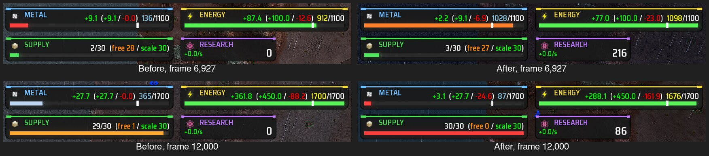

The left column is the playback with the track marked as one that has no resources and the adapter as it was, which is the playback before the stage. The right is the same launch with the track as recorded. Both are the engine's own screenshots of a window, cut down to the bars, taken paused seven seconds after the seek.

Two things on screen are still the playback's and not the match's. The clock in the players list is the engine's, which starts at nothing whenever the playback is opened. And the game's day and night and its weather follow that clock, so a moment that was dark in the match can be light in the playback (issue #4013). Neither can be set from the gadget, since no Lua call sets the engine's frame number.

A player's name comes from the start script and no Lua call sets it, so it is the script that carries the match's names (issue #4012). The script lists every player of the replay under the name and number it had, and each team's leader is its player of the replay. [Player names](#player-names) has what the engine does with a player who never connects, and what each game shows.

The game's gadgets hear of the player's shots as they would of a match's. In the whole match, whose two weapons are a rocket (`fedstorm_rocket`, a `MissileLauncher`) and a laser bolt (`fedcommander_up2_particlebeamcannon_up2`, a `LaserCannon`), none raised and none changed what the track has:

- `gfx_explosion_lights.lua` lights an explosion and, for a cannon or a laser, the place a projectile is created. Both stay, being the game's own look. A bolt that the player creates after a seek is created where the track has it, in the air, so the light for a barrel flashes there. A held bolt carries the game's light for as long as it is held, which paused is a red glow that stays.
- `lups_projectiles.lua` draws on projectiles of the weapons it lists. It ran with no error.

Splinter Faction has more gadgets that act on a shot: `weapon_cluster_missiles.lua` and `game_airburst_weapons.lua` create projectiles of their own, `unit_turretLauncher.lua` creates a unit where a shot lands, `game_heat_weapons.lua` can destroy a unit, and `unit_area_timed_damage.lua` leaves an area that damages. The match fires none of their weapons, so what they do to a playback has been read and not seen, and the adapter switches none of them off (issue #3989).

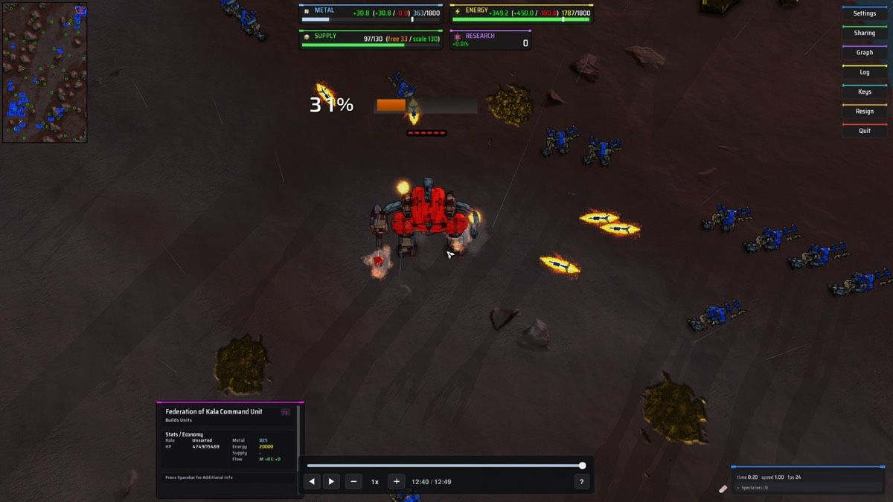

Paused, four rockets hang where the track has them, each with the game's own flame. Below, the same fight playing forward at 0.5x: the rockets have their trails, and one has just landed on the commander with the game's impact effect.

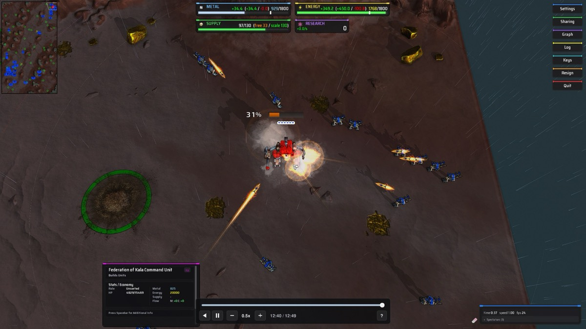

A commander shows the right stage after a seek with nothing done for it. Each stage is a unit definition of its own, `fedcommander_up1` and `fedcommander_up2` in the match that was played, with a script of its own that hides the pieces the stage does not have when the unit is created. A morph destroys one unit and creates another, so the track has two units with two definitions, and the player creates each by its definition.

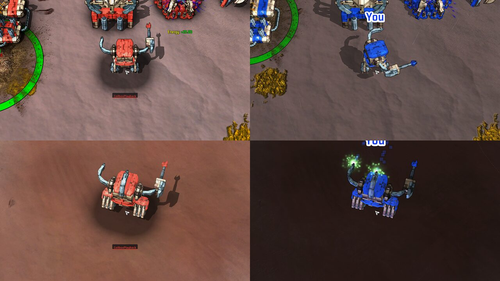

The left column is the playback and the right the real replay, at the same two frames and from the same place. The colours differ because the playback takes each team's from the replay's start script, and the game recolours them for whoever is playing. The pose and the build spray differ because the picture is from before the aim stage (issue #3796), the animation stage (issue #3797) and the build stream (issue #4029, [Build particles](#build-particles)).

### Beyond All Reason

`adapters/beyond_all_reason.lua` is the adapter for Beyond All Reason (issue #3801). It has no version range: the game has a new version most days and a replay is played on the one it was recorded on, so a range would leave nearly every replay with none. A name a version lacks switches nothing off, since its shadow returns `false` and nothing else. The file names were read from the rapid package of `test-30922-8064a43` (`~/.spring/packages/ded9b29714a05164e4b4523b09809af2.sdp` on the machine that wrote this), which is the version the match below was played on.

The match is the one made for the spike of issue #3778: two of the game's `SimpleAI` against each other on All That Glitters v2.2.3, Armada against Cortex, 82,496 frames, on engine `2026.07.01-102-g6e5c5a0`. It was recorded through coilbox's own analysis run and reproduced. The engine run took 141.6 to 171.6 s in four recordings, the dump was 664,493,194 to 664,510,536 bytes, the debug build of the tests took 135 to 140 s to thin it, and the track was 5,225,661 to 5,226,071 bytes with the adapter's five team parameters and 5,222,496 without them. Recordings of the same replay differ in their terrain rows, as the spike of issue #3778 found. At its busiest frame the track has 685 units, and it has 168,736 changes to the ground.

What the match did with no adapter, and what the adapter does about it. The gadget names in the second column come from a scratch gadget that wrapped the engine's calls and read the caller's gadget from its environment:

| What went wrong | Where it came from | With the adapter |
| --- | --- | --- |
| A team was asked to be killed before the first frame | `game_end.lua` and `game_team_com_ends.lua` | both switched off |
| A commander the track does not have was created for each team when the match started, hidden and paralysed, and removed by the player a frame later | `game_initial_spawn.lua` | switched off. Its `startUnit` and `validStartUnits`, which the game's widgets read, are set by the `started` hook, and the track has `startUnit` from its first frame |
| A gravestone was left where each of those commanders was removed, and would be where any commander a seek removes was | `unit_tombstones.lua` | switched off. The match's own gravestones are features of the track and stand where the match had them |
| Every building the player made part way through its construction was destroyed on the next frame, so at seeks the engine had 347 of 383, 454 of 492 and 576 of 607 of the track's units, with health off by up to 0.38 of a unit's maximum | `unit_prevent_lab_hax2.lua`, which destroys a unit created unfinished with no builder | switched off |
| An extractor the track has was destroyed and its team paid for it | `unit_mex_upgrade_reclaimer.lua` | switched off, with the same for geothermal generators |
| A feature the track has was destroyed where the player made a building | `unit_footprint_clearance.lua`, with an effect and a sound each time | switched off. Features still go when the match's did, with no effect |
| The commander stood there from the first frame, where the match hid it until frame 90 and showed the game's warp in effect at frame 60 | `game_initial_spawn.lua` was not running it, the player was placing it | the `unitPlaced` and `afterFrame` hooks hide every commander before frame 90, whichever way the time went, and play at 0.5x to 2x that passes frame 60 shows the game's `commander-spawn` effect, its lightning and its sound |
| With a unit selected, the order menu reached under the timeline and the build menu offered buildings to a spectator | `gui_ordermenu.lua` and `gui_gridmenu.lua` | both switched off. Nothing took their place, unlike Splinter Faction's |
| A Player View button above the players list, which follows a player's camera, and a playback has no players | `camera_player_tv.lua` | switched off (issue #4033) |

The rest of the adapter's 32 gadgets are switched off for what they do when the match has what they act on, and none was in this match: gadgets that replace a finished unit with two (`unit_attached_con_turret.lua`, `unit_attached_con_turret_mex.lua`), make wildlife or drones (`game_critters.lua`, `unit_carrier_spawner.lua`), act on a shot (`unit_explosion_spawner.lua`, `unit_custom_weapons_cluster.lua`, `unit_custom_weapons_behaviours.lua`, `unit_custom_weapons_overpen.lua`, `unit_lightning_splash_dmg.lua`, the three `unit_juno_*` gadgets), move a commander caught in a blast (`game_preventcombomb.lua`), or create units and features under a mod option (`game_quick_start.lua`, `game_assistdronespawn.lua`, `game_commander_builder.lua`, `game_coop_ii.lua`, `unit_scenario_loadout.lua`, `unit_zombies.lua`, `unit_evolution.lua`, `unit_respawning.lua`, `unit_xmas.lua`, `game_easter_eggs.lua`, `ai_ruins.lua`). Those were read and not seen.

With the adapter, the scratch gadget saw no gadget of the game create, destroy, move or damage anything in the whole match plan or the shots plan. The one call left is `game_team_resources.lua` setting each team's storage as the match loads, which the track's storage replaces.

What the issue expected, against what the game's files and the runs showed:

- Game end, initial spawn and commander death: true, the three gadgets above. Start setup: `game_ffa_start_setup.lua` only shuffles the start boxes of a free for all, and only `game_initial_spawn.lua` reads what it makes, so it is left on.
- Start commanders hidden until they warp in, with an effect: true, as above. The commander's health bar still shows while it is hidden, from the game's health bar widget.
- A Legion construction turret on an extractor is two units: true. `legmohocon` is the shape while it is built, and when it is finished `unit_attached_con_turret_mex.lua` destroys it and makes `legmohoconin`, the extractor, and `legmohoconct`, the turret, attached to it. The extractor is made unselectable and stealthy and is drawn, not hidden. The track has all three as units of their own, so the gadget is switched off. The match has no Legion unit, so this was read and not seen.
- No gravestones where commanders fell: the gadget is off, so the playback adds none. The match's own are in the track and do appear.
- Build spray: the game draws it in `gfx_nano_particles_gl4.lua`, which asks the engine every frame for a builder's `Spring.GetUnitCurrentBuildPower` and `Spring.GetUnitWorkerTask`. The player answers both from the recording ([A game's own build effect](#a-games-own-build-effect)), and the gadget makes its stream from them. On this Mac its geometry shader draws nothing, in a playback and in the real replay alike, and on its path with no geometry shader the stream shows playing forward and stops paused and backward.
- Queued buildings with the game's shape helper: true, see [An adapter's own drawing](#an-adapters-own-drawing).

Healing: the game has no gadget that heals a unit over time in a match like this one. `pve_areahealers.lua` heals only with raptors or scavengers, `unit_carrier_spawner.lua` heals drones and is switched off, and the game has no repair pad gadget. The engine's own healing is the player's to stop. In the whole match plan the wounded unit's health did not move in 450 frames, and the player's line about health that changed was not logged, with or without the adapter.

Rules parameters. The game's widgets a spectator sees read five team parameters that come from the match: `startUnit`, each team's commander, which the top bar and the players list take a faction from, and `mmLevel`, `mmCapacity`, `mmUse` and `mmAvgEffi`, the energy converters' level, capacity, use and efficiency, which the top bar and the converter panel show. `game_energy_conversion.lua` stays, since it is also what makes a converter convert, and the recording has the last word. `enemyComCount` is recounted from the placed units by `game_com_counter.lua`, so it needs nothing. Game parameters of the raptor, scavenger and territory modes and of lava maps were left out, see below. The real replay was read by a scratch widget at three frames, and the playback by the driver's resources plan. Team 0, Armada:

| At frame | Number | In the match | In the playback |
| --- | --- | --- | --- |
| 12,000 | metal held, storage | 304.26, 1250 | 304.26, 1250 |
| 12,000 | metal income, expense | 7.51, 15.76 | 7.51, 15.76 |
| 12,000 | energy held, storage | 1588.41, 1603.5 | 1588.41, 1603.5 |
| 12,000 | energy income, expense | 318.29, 159.94 | 320.14, 159.94 |
| 40,000 | metal held, storage | 1289.51, 1575 | 1289.51, 1575 |
| 40,000 | metal income, expense | 14.86, 36.14 | 14.86, 36.14 |
| 40,000 | energy income, expense | 694.86, 240.03 | 711.80, 240.03 |
| 70,000 | metal held, storage | 2005.30, 8500 | 2005.30, 8500 |
| 70,000 | metal income, expense | 123.55, 162.95 | 123.55, 162.95 |
| 70,000 | energy held, storage | 12683.05, 12740 | 12683.05, 12740 |
| 70,000 | energy income, expense | 2450.56, 1913.33 | 2667.20, 1913.33 |
| all three | `startUnit`, `mmLevel` | 52, 0.75 | 52, 0.75 |

Team 1 was the same but for energy income, which read 307.19, 551.45 and 1646.40 where the match had 306.10, 528.32 and 1404.22, and its metal held at frame 40,000, 1949.97 where the match had 1949.77, which is the track's value and inside its tolerance. Pull and excess were within 0.15 of the match's at all three. Energy income reads high because the sums only go up ([Team resources](#team-resources)): the playback's own units make more energy than the match's did. That the cause is the wind, which the playback's engine draws for itself, is a guess that was not measured. The match has no energy converter, so the four converter numbers were 0 in both. The top bar showed the playback's numbers in a window (`milestone-80-gallery/58-...`).

The timeline in Beyond All Reason. The game's widget handler loads it and the ghosts widget out of the playback game, 192 widgets in all in a window. It draws at the bottom centre between the game's unit panel at the bottom left and its players list at the bottom right, and with the order menu switched off nothing else draws there. Its keys are under [Keys](#keys): all but Minus, Equals and the keypad's Plus reach it.

Seeks on this match, from the first frame to frame 82,196 with 674 units and back, and to the last frame, timed by a scratch patch round the terrain stage, before and after the ground had a budget (issue #4025, [The ground of a seek](#the-ground-of-a-seek)). The slowest frame is a frame's work in `GameFrame`, and the terrain column is the stage's time in that frame. Each figure is the range over the seeks of one run.

| Engine | Ground | Seeks | Frames to settle | Slowest frame | Terrain stage in it | Slow frame lines |
| --- | --- | --- | --- | --- | --- | --- |
| headless | before | 7 across the match | 23 to 25 | 171.3 to 213.7 ms | 168.8 to 202.9 ms | every seek |
| headless | after | 7 across the match | 18 to 23 | 8.5 to 17.6 ms | 0 to 7.5 ms | none |
| window | before | 6 across the match | 24 to 30 | 179.6 to 240.6 ms | 174.4 to 223.8 ms | every seek |
| window | after | 7 across the match | 21 to 31 | 12.0 to 27.7 ms | 0 to 7.0 ms | none |

After, no frame of the terrain stage took more than 13.5 ms in the window or 7.5 ms headless, and the slowest frame was the units stage making units. The window's settled seeks took 718 to 1,105 ms of wall time. The headless rows before are the issue's runs and a run of 14 October 2026, the window row before is the issue's, and the rows after are runs of the same day on the track recorded for them, which has 106,282 changed corners. The window was 1,280 by 720 points, with a load average of 4.9 to 5.4 read just after the run, and the game's idle frame limiter was switched off for that run by a scratch file, since nobody moved the mouse.

The ignored test `a_seek_across_a_whole_match_settles_in_frames_that_fit` passed on this match headless after the change, with the driver reading every one of the 106,294 changed corners of that recording back out of the engine after each of its eight seeks: none was off the track's height.

Making and removing units is cheap here: 195 creations took 14.8 ms and 256 removals 6.4 ms in a headless frame, and the budget kept every frame of units under a simulation frame.

Shots, on frames 59,400 to 60,900 with the driver's shots plan given that span (the whole match would play 82,496 frames five times over): 29 of 29 shots held where the track has them, paused, for 150 frames, and 19 of 20 seeks had every shot. Played forward, 442 of the 450 shots that ended landed at 1x, 440 at 0.5x and 445 at 2x, a mean of 1.15, 0.89 and 3.17 elmos from the end of their flight. No shot did damage. One landed at 4x and three playing backward, which the shots plan says should not happen. Issue #4026 is about those. The engine also ended a held shot of `corpun_plasma` once while playing backward at 32x.

Issue #4033 took the panel at the bottom right for the game's replay controls. They are three widgets, read in `test-30922-8064a43` and seen in a window:

- The pause, next, note and speaker buttons and the two sliders are the music player, `gui_advplayerslist_music_new.lua`. Its pause pauses the music (`Spring.PauseSoundStream`) and its sliders set the music's and the sound's volume. It stays, since it fights nothing.
- The line with the time, `x1.00`, the frame rate and the clock is `gui_advplayerslist_gameinfo.lua`. It offers nothing to press, so it stays. Its time and speed are the engine's, which the playback cannot set (issue #4013). It also hides the engine's own clock, with the engine's `clock 0` command as it starts: switched off in a window run, the engine's clock showed at the top right instead.
- The Player View button is `camera_player_tv.lua`, switched off as above.
- `gui_replaybuttons.lua`, the game's real replay buttons, only starts in a replay (`Spring.IsReplay()`), and a playback is not one.

The engine's own pause and speed are handed to the timeline whatever the game ([The engine's own pause and speed](#the-engines-own-pause-and-speed)). In a window, `pause 1` sent twice left the engine running and paused and then played the timeline, and `setspeed 2` and `setspeed 0.5` left the engine at 1 and moved the timeline to 2x and back to 1x, each read 1.5 seconds after the command.

What has run, on engine `2026.07.01-102-g6e5c5a0` and `test-30922-8064a43`:

- The whole match plan, headless, with no adapter and with the adapter, which is the ignored test `a_whole_beyond_all_reason_match_plays_with_its_adapter`. With the adapter the engine had the track's units and features at both ends of play, at ten seeks, past a death and after the wounded unit was held. No Lua raised after the first frame in either.
- The seeks plan and the resources plan headless with the adapter, the shots plan headless on the span above, and the real replay headless with a scratch widget reading its numbers.
- Two launches with a window, one with no adapter and one with it. The pictures are in `docs/reports/milestone-80-gallery/`, numbered from 50. In both, the game's own `gui_flowui.lua` raised from a display list, a line on the console. It is not the playback's, and was not looked into.

Not covered. Raptors, scavengers, territorial domination and lava maps were not played back. Their spawner gadgets only run for a team whose AI is the raptors or the scavengers, and the playback has no AI, so their panels do not load. The territory and lava gadgets do run and work from the playback's own clock. Issue #4028 is about them.

## Where the reader runs

The two reader files are plain modules for `VFS.Include`. They use `VFS.Unpack*` and `VFS.ZlibDecompress`, which exist in synced and unsynced Lua, and nothing else from the engine. They work in synced Lua, which has no `io`.

- `luarules/rewind_player/coilbox_track.lua` reads the track.
- `luarules/rewind_player/coilbox_track_fetch.lua` has the ways to get bytes out of a file.

```lua
local Track = VFS.Include("luarules/rewind_player/coilbox_track.lua")
local Fetch = VFS.Include("luarules/rewind_player/coilbox_track_fetch.lua")

local fetch, why = Fetch.fromVFS()
local track, why = Track.open(fetch)
local window = track:seek(frame)

local out = { 0, 0, 0, 0, 0, 0, 0 }
for i = 1, window.unitCount do
	if window:unitExistsAt(i, frame) then
		window:sampleTransform(i, frame, out)
		-- out[1], out[2], out[3] is the place, out[4] to out[7] the rotation
	end
end
```

Where the generated game keeps the track is `Fetch.PATH`, which is `coilbox_rewind/track.cbtrack`. Issue #3793 puts it there.

## The playback game

Coilbox writes a game called `coilbox-replay-playback.sdd` under the content root's `games/` for each playback, and replaces it every time (`crates/tauri-plugin-coilbox-content/src/demo/playback.rs`). It depends on the game the replay was recorded on and holds:

- every `.lua` file under `luarules/` and `luaui/` in this folder, at the same path
- the track at `coilbox_rewind/track.cbtrack`, as a hard link to the stored file, or a copy where the filesystem refuses a link
- a `modinfo.lua`
- the game's adapter at `coilbox_rewind/adapter.lua`, and a file for each gadget and widget it switches off ([Game adapters](#game-adapters))

The list of files is made by `crates/tauri-plugin-coilbox-content/build.rs` when coilbox is built, so a gadget added under `luarules/gadgets/` or a widget under `luaui/widgets/` ships with no change to the Rust. A file with another extension, and `tests/`, stay out. A new file is picked up by the next build.

The start script has the replay's players, none of whom connects, one spectator who does, and no AIs. Each team's `teamleader` is its player of the replay, see [Player names](#player-names). Team and ally team numbers are the replay's own. Mod options and map options are the replay's. The script sets `recorddemo=0`, and `gamestartdelay=0`, which takes away the engine's four second countdown before the first frame. The timeline is on screen during a countdown and takes a seek, and the world cannot show it, since the player moves only on frames. The engine adds the Gaia team, so read its number from the engine and do not assume it.

The base game's own gadgets run, except those the game's adapter switches off. A game with no adapter that creates starting units or ends the match when a team has no units will try to during playback. [What the base game does](#what-the-base-game-does) has what the player does about it.

`contentReplayPlaybackLaunch` in `src/content/bindings.ts` writes the game and script and launches the engine.

### Player names

Every player of the replay is in the start script with its own number, name, team and the other keys it had, except its password, and `isfromdemo=1`. The one spectator who connects, `CoilboxPlayback`, is numbered after all of them, and is renamed with underscores added if a player of the replay already has that name. A team's `teamleader` is its player's number from the replay, and the spectator's where the replay's leader is no player. The names are read from the replay's own start script, which coilbox already reads for the teams. The track's leader names (columns 178 and 179 of the format page) come from `Spring.GetPlayerInfo` in the recording run, which reads the same script, and name only each team's leader.

A player in the script who never connects makes the engine wait. `CGameServer::CheckForGameStart` in `rts/Net/GameServer.cpp` does not start until every player after the first `numDemoPlayers` has connected, and gives up on one only 30 seconds after the server started. A player marked `isfromdemo=1` counts towards `numDemoPlayers` and is skipped, and `CGameServer::Update` does not time it out either. The first `numDemoPlayers` places in the list are the ones skipped, which is why the connected spectator comes last. `gamestartdelay=0` and `startpostype=1` are as before.

Measured on 14 October 2026 in a headless engine on the Splinter Faction replay, the same playback with the `isfromdemo` lines taken out of the script and with them in:

| Script | First simulation frame |
|---|---|
| `isfromdemo=1` removed from the player | 33.5 s after the engine started |
| as written | 10.3 s after the engine started |

What the engine then reports, from a gadget in the game: `Spring.GetPlayerInfo` gives the replay's name, `active` false and the replay's `spectator` and team. The connected spectator is reported `active` false too while the game loads, since a player is marked active when its name arrives over the connection. `Spring.GetTeamInfo` gives the replay's leader and a team that is not dead. A team whose leader never connected is not treated as dead by the engine. `CPlayerHandler::NumActivePlayersInTeam` counts only active players, and its only callers are the sharing and AI control commands. The playback still guards against a game that kills a team with no units, see [What the base game does](#what-the-base-game-does).

What each game shows, in a window:

- Splinter Faction 0.1.89. A commander's name tag reads the player's name, and the players list has the name with a red `dc` beside it, and the playback's spectator under Spectators. The `dc` is the game's mark for a player who is not connected.
- Beyond All Reason `test-30922-8064a43`. The players list has the name, and the spectator is counted under Spectators. No `dc` or other mark was seen. The replay used has one human, a spectator named `bench`, who leads both teams, so no commander name tag is of a player on a team.

The ignored tests `a_real_replay_is_played_back_in_the_engine`, and the whole match tests for Splinter Faction and Beyond All Reason, pass with this script. The first checks every player's name and every team's leader against the replay and that the first frame came before 30 seconds. The replay of Splinter Faction is the one in `COILBOX_ANALYSIS_REPLAY` for the other tests of the whole match, which needs the game's dev folder at the commit it was recorded on, exported with `git archive` to a scratch folder under `games/`. The Beyond All Reason replay needs the game's rapid packages in `COILBOX_ANALYSIS_DATA_DIRS`.

## Fetching bytes

The reader asks for bytes through one function, `fetch(block, length)`. It gives `length` bytes starting at `block * 64` in the file, or nil and a reason. The player picks the function its half of the engine allows.

| Function | Needs | Reads |
| --- | --- | --- |
| `Fetch.fromVFS(path)` | synced or unsynced Lua | a track the game holds, as one string. `path` defaults to `Fetch.PATH`. Gives nil and a reason if the game has no such file |
| `Fetch.fromString(data)` | nothing | a track already in a string, of any length the format allows |
| `Fetch.fromFile(file)` | `io`, so unsynced Lua | an open file, by seeking to the block. The caller opens and closes the file |

The gadget uses `fromVFS`. Synced Lua has no `io`, and the unsynced half, which has, cannot hand bytes to the synced half except as messages through the network.

The engine's Lua numbers are 32 bit floats, which hold a whole number exactly up to 16,777,216. A position in a Lua string is such a number, and `string.sub` counts from 1, so past that many bytes it cannot be told where to start. `fromString` therefore cuts a longer string into pieces of 16,777,152 bytes when it is made, and reads from inside a piece (issue #3971). Each piece is cut from the front of what is left, and what is left starts at byte 16,777,153 of what was left before, which a float holds. A track of one piece or less is not copied at all. A longer one is copied once as it is cut, and each cut copies everything after it, so opening a track of `n` bytes copies about `n * n / 33,554,304` bytes on top of the track itself. No part can be longer than a piece. The larger benchmark track is 4,805,376 bytes, which is one piece.

`fromFile` copies nothing and has no such cost, because a block number times 64 is exact up to a gigabyte.

## The track

`Track.open(fetch)` reads the header and the window index and nothing else. It gives the track, or nil and a reason when the file is not a track this reader can read.

| Call | Gives |
| --- | --- |
| `track.header` | the header's fields: `firstFrame`, `lastFrame`, `windowLength`, `windowCount`, `framesPerSecond`, `tolerance`, `positionShift`, `rotationBits` and the rest. `positionStep`, `velocityStep` and `rotationScale` are worked out from the shifts and bits |
| `track:windowOf(frame)` | the window number that holds the frame. A frame on the boundary between two windows is in both and this gives the later. A frame before the first is in window 0 and one past the last is in the last window |
| `track:loadWindow(k)` | window `k`, read if it is not the current one, and made the current one. Nil and a reason if it cannot be read, and the current window stays as it was |
| `track:seek(frame)` | `loadWindow(windowOf(frame))` |
| `track.window` | the current window, or nil |
| `track:info()` | names, teams and the map, read once and kept |
| `track:features()` | every feature of the match, read once and kept |
| `track:terrain(k)` | the terrain rows of window `k` |
| `Track.applyTerrain(rows, from, to, set)` | moves the ground from frame `from` to frame `to` |

Nil and a reason is the only way a bad part is reported. A part that fails to decompress, or whose columns do not agree, is an error for that part. The header, the index and every other window still read.

`info` has `engineVersion`, `game`, `map`, `writer`, `unitDefs`, `weaponDefs`, `featureDefs`, `posedPieces` (each `{ unitDef, pieces }`), `teams`, `unitFootprints` (empty in a track from before recorder version 3) and `mapSize`. A feature has `engineId`, `def`, `team`, `flags`, `firstFrame`, `lastFrame`, `position` and `rotation`.

Terrain rows are parallel lists named `frame`, `x`, `z`, `before` and `after`, with `count` rows. A height is in elmos and x and z count heightmap corners. `applyTerrain` takes one window's rows. A move across several windows calls it for each, in order going forward and in reverse order going back. Window 0 holds the rows on the track's first frame, so the first move forward starts from the frame before it.

## A window

A window is read into flat tables when it is loaded. Lists are counted from 1 and belong to the units, the projectiles, the target tracks, the pose tracks, the keys and the queue items.

A unit `i` has `unitId[i]`, `unitSerial[i]`, `unitDef[i]`, `unitTeam[i]`, `unitFlags[i]` (bit 0: it existed before the window, bit 1: it exists after) and `unitFirstFrame[i]` and `unitLastFrame[i]` as frames. `unitCount` is how many there are. A projectile `p` has `projectileSerial[p]`, `projectileWeapon[p]`, `projectileTeam[p]`, `projectileFlags[p]`, `projectileShooter[p]` (a unit's position in the list, or 0 for none), `projectileFirstFrame[p]` and `projectileLastFrame[p]`. `projectileCount` is how many there are.

The window also has `index`, `startFrame` and `endFrame`.

Sampling writes into a table the caller owns and allocates nothing. The table needs its slots before play, because writing past the end of an empty table makes it grow. Seven slots cover every call below.

| Call | Writes to `out` |
| --- | --- |
| `window:unitExistsAt(i, frame)` | gives true or false |
| `window:projectileExistsAt(p, frame)` | gives true or false |
| `window:sampleTransform(i, frame, out)` | 1 to 3: place in elmos. 4 to 7: rotation as a quaternion x, y, z, w |
| `window:sampleStatus(i, frame, out)` | 1: health from 0 to 1. 2: build progress from 0 to 1. 3: flags, bit 0 for switched on |
| `window:sampleTarget(track, frame, out)` | 1: kind. 2: reference. 3: build power. 4 to 6: place in elmos, for kinds 128 and 129 |
| `window:samplePose(track, frame, out)` | 1 to 3: turn about x, y, z in 65,536ths of a turn. 4 to 6: offset in elmos |
| `window:sampleProjectile(p, frame, out)` | 1 to 3: place in elmos. 4 to 6: velocity in elmos a frame |
| `window:projectileRange(frame)` | gives the positions `from, to` between which every projectile that exists at `frame` lies. Ask `projectileExistsAt` for each |
| `window:projectilesBorn(after, frame)` | gives the positions `from, to` of the projectiles whose first frame is after `after` and no later than `frame` |
| `window:sampleQueue(i, frame)` | gives the position of the first item and the number of items. The items are `queueItemDef`, `queueItemX`, `queueItemZ` (elmos) and `queueItemFacing` |

The two range calls search the first frames and walk nothing, so a frame of play looks at the shots in the air and not at the window's whole list. That needs the entries in the order they were born in. Coilbox's writer keeps that order and the format does not promise it, so a window says whether it holds in `projectileOrdered`, and when it does not both calls give the whole list. `projectileLongest` is the longest any projectile lasts in the window, which is how far back a projectile alive now can have been born. A projectile with bit 0 of its flags set was born in an earlier window, whatever its first frame here.

The sample calls give false when a curve has no key, which a good track never has. Call them for a unit only at a frame it exists.

A unit's target tracks are `unitTargetFirst[i]` for `unitTargetCount[i]` tracks, and `targetWeapon[track]` says which weapon (0 for builder work). Its pose tracks are `unitPoseFirst[i]` for `unitPoseCount[i]` tracks, and `posePiece[track]` is an index into the posed piece names of the unit's definition.

A target reference is a position in a list counted from 1, with 0 for none. For kinds 1, 16, 17 and 20 it is a unit in this window, for kind 4 a projectile in this window, and for kinds 2, 18 and 19 a feature in `track:features()`. A kind the reader does not know comes back as kind 0.

### Conventions

- A definition id, a team and a posed piece are counted from 0, as the file counts them. The name of unit definition `d` is `info.unitDefs[d + 1]`.
- Windows are counted from 0, as the format page does.
- A rotation is the quaternion the format page describes, with the dropped component worked out. Between two keys the sample blends them as the page says.
- A pose track's angles are not reduced to one turn, and are not comparable with an angle from another window.

### Cursors

Every curve keeps the key it last read. A sample first looks at that key and the ones next to it, so playing forward or backward one frame at a time does no search. A frame more than 8 keys away is found by a binary search, and `window.searches` counts those. It is also a way to see whether the player is jumping about.

## Precision

The engine's numbers are 32 bit floats and the tests run on LuaJIT's doubles. Nothing in a track is above 16,777,215, so every value read from the file is exact either way. The maths done on them afterwards is rounded to a float in the engine and not in the tests. A position of 16,000 elmos has a float step of 0.000977, well inside the track's tolerance of 0.5 elmo, but the sampled values will not equal the Rust reader's to the last digit. The stub rounds every value `VFS.Unpack*` returns to a float, so it checks what is read and not what is worked out from it.

## Tests

The tests need `luajit` and run with the other Lua suites from `scripts/mission-tests.sh`:

```sh
luajit lua/rewind-player/tests/reader_test.lua
luajit lua/rewind-player/tests/format_page_test.lua
luajit lua/rewind-player/tests/playback_test.lua
luajit lua/rewind-player/tests/stub_test.lua
luajit lua/rewind-player/tests/fetch_test.lua
luajit lua/rewind-player/tests/clock_test.lua
luajit lua/rewind-player/tests/rotation_test.lua
luajit lua/rewind-player/tests/player_test.lua
luajit lua/rewind-player/tests/aim_test.lua
luajit lua/rewind-player/tests/animation_test.lua
luajit lua/rewind-player/tests/projectiles_test.lua
luajit lua/rewind-player/tests/resources_test.lua
luajit lua/rewind-player/tests/settle_test.lua
luajit lua/rewind-player/tests/terrain_test.lua
luajit lua/rewind-player/tests/view_test.lua
luajit lua/rewind-player/tests/arrival_test.lua
luajit lua/rewind-player/tests/stream_test.lua
luajit lua/rewind-player/tests/gadget_test.lua
luajit lua/rewind-player/tests/adapter_test.lua
luajit lua/rewind-player/tests/engine_test.lua
luajit lua/rewind-player/tests/timeline_test.lua
luajit lua/rewind-player/tests/ghosts_test.lua
```

- `reader_test.lua` reads the fixture and compares every sampled value with what the Rust reader gives. It also checks a unit's velocity against how far its place moves in a frame. It plays forward, backward and in a fixed shuffle, and checks the errors and the three ways of fetching.
- `format_page_test.lua` builds the format page's worked example by hand and reads it. It checks the reader against the page and not against the Rust crate.
- `playback_test.lua` checks that sampling allocates nothing, that forward play does no search, and that a minute of play (1,800 frames over several windows) does not grow memory.
- `stub_test.lua` checks the engine stand-in against `rts/Lua/LuaVFS.cpp`.
- `fetch_test.lua` reads a string of 38,400,000 bytes and the fixture with every chunk moved past 16,777,216 bytes. It wraps `string.sub` to raise for a position a 32 bit float does not hold.
- `clock_test.lua` checks the clock and every message.
- `rotation_test.lua` checks the pitch, yaw and roll against the engine's own matrix arithmetic, in doubles and with every result rounded to a float.
- `player_test.lua` checks the stages on tracks made from a table (`tests/fake_track.lua`): what is alive at a time, removal before creation, a seek back past a construction, play in both directions, a missing definition, a nil from `Spring.CreateUnit`, terrain forward and back, that the engine's own healing (`world.heal` in the stand-in, run between a frame and its post frame) leaves a wounded unit's health alone and its maximum is whole again afterwards, that health which moved anyway is put right and logged once, and that a frame of play allocates nothing.
- `player_test.lua` also checks the call at the end of a frame (issue #4002): that nothing is held in the first frame, that with no call no unit starts or ends a frame with a lowered maximum and the line is logged once, that the install is asked for once and a unit is held once it works, that a call which stops is asked for again, and that a gadget removed in the middle of a frame leaves no maximum lowered.
- `aim_test.lua` checks the aim stage on a stand-in whose unit's own script turns pieces in the middle of every frame: the pose on the first frame after a seek, held for 60 frames paused and while playing each way, a piece the track does not name left to the script, an angle of 141 turns, half speed, a piece the script lacks, a piece with no track in a window, a seek that makes its units over several frames, a unit destroyed between a frame and its post frame, a unit under construction, an engine with no call at the end of a frame, the fixture through the real reader, and that 300 frames of posing 20 units allocate nothing.
- `animation_test.lua` checks the animation stage on a stand-in whose units have COB and Lua scripts: a unit that starts and stops is told once each, with its velocity and its place left alone, a unit with no script, pause, play backward and turning play round, seeks, a unit made again, 8x and half speed, a unit under construction, a builder's start and stop with its angles for a Lua and a COB script, a factory, every kind of work and its parameters, a factory that goes straight on to the next unit, a builder's nano pieces asked of its script once and given to the engine, the work handed on to the stream and when, a window with no track for the work, a target a seek has yet to make, the pieces a walk turns and the aim stage leaves to the script, a script that raises, a framework the wrap does not see, each row switched off, the fixture through the real reader, and that 300 frames of 20 walking units and 5 builders at work allocate nothing.
- `projectiles_test.lua` checks the projectiles stage: what is in the air at a time, stepping forward and backward, that a seek looks at the shots that can be alive and not the window's list, that a shot lands only while it is watched and with no damage, crater or push, a shell that ends in the air, a bolt that stops, a beam fired once, the fire sound and when it is not played, a weapon the game lacks, an engine with no `Spring.SetProjectileTimeToLive`, a shot the engine ended and an id handed out again, a shot alive across two windows, and that 300 frames of play with 40 shots in the air allocate nothing.
- `resources_test.lua` checks the resources stage on a stand-in whose teams follow `rts/Sim/Misc/Team.cpp` and whose frame runs in the engine's order, with the playback's own economy between the gadget's two call-ins: what a team holds, its storage and its share level at a frame, after a seek forward and backward, held for 400 frames and while playing each way, on an engine with and without `GameFramePost`, income, expense and pull after three of the engine's sums, a team with an income multiplier, excess, allied teams and the engine's own sharing, rules parameters with and without an adapter that names them, a track from recorder version 3, the fixture through the real reader, and that 300 frames allocate nothing.
- `settle_test.lua` checks a seek that needs more units than a frame may make or remove: that it settles over several frames, that removals use their own budget and come first, that a second seek while one settles starts again, that play goes on while it settles and units made late stand where the track has them now, what `coilbox_rewind_settled` says and when, how many of a frame's units were the first of their definition in the run, the budget message and the ones it refuses, that the first frame of a seek into another window makes and removes nothing (issue #4037), that a shot waits for its shooter, and that 300 frames of play with a budget allocate nothing.
- `terrain_test.lua` checks the ground of a seek (issue #4025) on tracks with craters across a map of 256 by 256 corners and a block of rows on the last frame: that a seek with a small ground budget takes several frames and no frame does more than its budget and one tile, that no call reaches past a tile and the corner beside it, that no call that moved a corner leaves the engine a rectangle of no area, that the ground is the track's after seeks both ways and after a seek that arrives while another settles, that a corner before its first change has the map's own height, that no unit is made while the ground still moves and the player is not settled until it stops, that a unit stands at the track's height before and after the ground under it arrives, that play at 1x forward and backward moves a crater on its frame while a seek's ground is still being set, the third number of the budget message, and that 300 frames of play through craters allocate nothing.
- `view_test.lua` checks the order a seek makes its units in: the list's with no view, nearest the camera's place first with one, inside the view's corners before outside, the rest following a camera that moves, the list's again after `coilbox_rewind_view:none`, removals still first, a unit born while a seek settles, the view messages it refuses, and that 300 frames of play with a view allocate nothing.
- `arrival_test.lua` checks which units the player asks an arrival effect for: each one a slow seek makes after its first frame, none for a seek shown in one frame, a removal or plain play, none during a drag until it ends, none outside the view, and none when the adapter's hook says it showed its own. Then the two unsynced modules on a stand-in (`tests/unsynced.lua`): the view's message, when it is sent again, a corner off the map and one in the sky, and what the effect draws, where, in which colour, for how long, how many at once, the state it leaves and that a draw allocates nothing. It does not show how the effect looks.
- `stream_test.lua` checks the stream of build particles on a stand-in (`tests/unsynced.lua`): every particle on the line from the nano piece to the work and within its spread, how many a builder and a factory have, the engine's colour, alpha, blending and texture, `MaxNanoParticles`, `TeamNanoSpray` and `showNanoSpray`, a builder with no nano piece, paused, backward, work that starts, stops and is seeked into, a reclaim, a resurrect on a feature, a target the playback does not have yet, half power, the answers to the two wrapped calls, which texture a game's `resources.lua` gives, and that 300 draws of twenty streams allocate nothing. It does not show how the stream looks.
- `gadget_test.lua` loads the two gadgets the way the engine does. That includes the gadget's answers of no damage for units and for features, its post frame, the unsynced half's working out of the three budgets from the time a frame's work took (growth to what fits in one message, a frame judged by the budget it had and not the last one sent, a rise in cost read over the seek and taken through as many frames as the last budget took to arrive and no further than it was read over, and a frame with a first unit of a definition left out of the rise), the lines going to the log file and not the engine's log, from the synced half, the unsynced half and the guard, and the engine's own pause and speed handed to the player once each.
- `adapter_test.lua` checks how the player reads an adapter, that it never creates a hidden unit or skipped feature and says nothing about either, that each hook is called with the right arguments and a hook that raises is switched off, the log line, and that 60 frames of play with hooks allocate nothing. It also runs Beyond All Reason's adapter on a stand-in for the engine and the game: the commanders hidden before they warp in and drawn after, the warp in effect only where play passes its frame, what the `started` hook sets, and the queued buildings handed to the game's shape widget once and dropped when they leave the queue.
- `engine_test.lua` is made from the engine table ([Engine calls](#engine-calls)). For every call of every row it takes the call out of the stand-in and plays the fixture track, and it checks the table against the source with `tests/scan.lua`. The widget's table is tested the same way in `timeline_test.lua`.
- `timeline_test.lua` checks the timeline on a stand-in for `Spring` and `gl`: the message for every key, that a key with Ctrl, Alt or Meta is left alone, the frame a drag seeks to at both ends and between, the time and speed shown, that everything drawn is inside views from 640 by 480 to 3840 by 2160, moving the panel, changing a key, marks, and that 300 draws allocate nothing. It also loads the widget file the way a handler does.

- `ghosts_test.lua` checks the ghosts on a track made from a table (`tests/fake_track.lua`, which has queues) against an answer worked out from the table. It plays the whole track forward and backward and seeks to 19 frames across window edges. It checks a building started within and beyond the 8 elmos, two builders with one item, a definition the game lacks, a window that does not read, what is drawn and how (the facing, the engine's build height asked with the definition and the facing, the identity loaded before the move), the footprint, the switch and the text command, the saved choice, an adapter's hook and one that raises, the hook that hears a pass is over, and that 300 frames allocate nothing. It runs the fixture through the real reader against the Rust reader's queues, loads the widget file, and holds the widget's files and the reader's to its table of engine calls.

`tests/support.lua` is the stand-in for the reader. Its `VFS.Unpack*` and `VFS.ZlibDecompress` follow the engine source, round what they return to a 32 bit float, and raise for a position or count a float could not hold. The zlib is the system's, through LuaJIT's FFI. Its synced environment has no `io`, so a reader that reached for it would fail the tests.

`tests/engine.lua` is the stand-in for the player: units and their script pieces, features, projectiles, the heightmap, teams and their resources, and rules parameters, each call written from the engine source it names. `world.gameFrame(gadget, how)` is a frame for a gadget in a game whose handler does or does not pass `GameFramePost` on, on an engine that does or does not make the call, with the handler's global table and `Script.UpdateCallIn` behind it. `world.step(frame, post)` runs one frame in the engine's order: the gadget's `GameFrame`, the engine's own economy as the test gives it in `world.economy`, the teams' sums on a frame that divides by 30, and the gadget's `GameFramePost`. `world.simulate()` is the engine's own frame for projectiles: it looks for a hit along a projectile's speed and under the ground, whether or not the projectile is under move control, and then counts its time to live down.

The tests cannot show that the player works in the engine. They show the logic, the reading and the addressing.

### In a real engine

```sh
scripts/rewind-playback-headless.sh
```

It needs a headless engine, Splinter Faction and the map, so CI does not run it. Run it after changing anything in this folder or the playback game. It plays a scripted match (`tests/headless/fixture_match.lua`) in which a building is built, a unit dies, features come and go and the ground changes, records it into a track, and plays the track back with a driver gadget (`tests/headless/playback_driver.lua`) that sends the player's messages the way a widget does and measures the engine against a reader of its own. The assertions are in the ignored Rust test `a_real_track_is_played_at_any_time` in `crates/tauri-plugin-coilbox-content/src/demo/playback.rs`. A second test, `the_timeline_drives_the_player_in_the_engine`, puts a probe widget (`tests/headless/timeline_probe.lua`) in the game. The probe finds the timeline in the game's own widget handler and calls its call-ins for each key and for a press on the bar. No file under `tests/headless/` ships in the playback game.

What it shows, on engine `2026.07.01-102-g6e5c5a0` and SplinterFaction 0.1.89:

- At ten seeks, forward and backward, the engine has the track's units and features, each unit where the track has it, turned as the track has it, with its health and build progress.
- A building is gone after a seek to before its construction, a nanoframe half way through it, and finished after it.
- The ground is the track's at the end, back at the map's own at the start, and the track's again.
- Play goes forward and backward and pauses at the last frame. A unit that dies during play at 1x explodes, and no unit removed by a seek does.
- No team is dead after the match has stood empty for 150 frames, though the base game asked to kill one.
- The mod options open the player at a frame, paused.
- The same again with every chunk of the track moved 19,200,000 bytes into the file.
- No error from the player's Lua in the engine's log.
- Splinter Faction's widget handler loads the timeline and turns it on. Space, End, Home, the arrows with and without Shift, Comma, Full stop, Minus, Equals, Plus and R each change the parameter they should, a press on the middle of the bar seeks to the middle frame, and Space with Ctrl is left alone and changes nothing. The handler still has the widget at the end, having asked it to draw 200 times in the run these lines come from.

The timeline's test also passed, run by hand with `COILBOX_PLAYBACK_GAME` naming the game, on Metal Factions v2.58, Balanced Annihilation V15.9.8 and THIS, with the Splinter Faction track. Those games have none of the track's units, so the world stays empty, and it is their widget handlers that the run is about. XTA 9.65 does not load on this engine: it stops on a model before any Lua runs.

A third test, `an_adapter_switches_things_off_in_the_engine`, launches the playback three times on Splinter Faction 0.1.89 with a probe widget (`tests/headless/adapter_probe.lua`) that reports at frame 320 of the track. With no adapter shipped, `game_end.lua` and `game_team_com_ends.lua` load, the guard logs that a team was asked to be killed, the widget `gui_static_resourcebar.lua` is one of 110 loaded, and the engine has 2 `lozscorpion`. With a fixture adapter (`tests/headless/fixture_adapter.lua`) that names the two gadgets, the widget and `lozscorpion`, neither gadget is in the log, no team is asked to be killed, the widget is one of 109, no `lozscorpion` exists and the other units are as before, no error names a shadowed file, and both hooks logged that they ran. A third launch with the shadow files emptied shows what an empty file does (see [What switching off does](#what-switching-off-does)). Switching off `game_end.lua` alone did not stop the team being asked to be killed, which is why the fixture names both gadgets.

A fourth test, `a_whole_splinter_faction_match_plays_with_its_adapter`, is not part of the script, because it wants a replay of a whole match and the script's is 1,100 frames. Give it one in `COILBOX_ANALYSIS_REPLAY` with the other variables the script sets. It launches the playback twice, with no adapter and with the one coilbox ships, and the driver plays the whole match forward at 32x, the whole match backward, seeks to ten times, plays through a death at 1x, holds a wounded unit paused for 450 frames and holds the empty start for 150.

It was run on a match of 23,091 frames on All That Glitters v2.2.3, with up to 54 units at the frames the driver looked at, recorded from a replay of 24 August 2026. Once on the game the replay was played on, which is the game's repository at that day's commit and declares `$VERSION`, and once on Splinter Faction 0.1.89 standing in for it. Both times:

- With no adapter the gadgets the adapter names load, a commander is spawned that the track does not have and a team is asked to be killed.
- With the adapter none of them loads, nothing is spawned, no team is asked for, the match is not asked to end, no team is dead and the engine does not hold the match to be over.
- At both ends of play, at the ten seeks, past the death and after the wounded unit was held, the engine has the track's units and features, each unit where and how the track has it.
- No Lua raised once the match was running, apart from `cus_gl4.lua`, the game's unit shader gadget. It calls `gl.SetUnitBufferUniforms` for every unit created, which a headless engine does not have, so it raised 664 times in a run. In an engine with a window it did not raise once.
- With the player as it was before this test, the wounded unit, at 8.5% of its health, was 4.3% of its maximum higher after the 450 frames.

Issues #3986 and #3987 added to this test and ran it again on Splinter Faction 0.1.89 standing in for the game, with the two gadgets of the adapter that heal now named in it. A second test gadget, `tests/headless/health_probe.lua`, has layer -50. It reads the held unit's health at the start of every `GameFrame`, which is after Splinter Faction's regeneration gadget (layer -100) and before the player's correction, and at the start of every `GameFramePost`, where the engine's own healing of that frame would show. It also reads the unit's maximum at each `GameFrame`. Over the 450 frames, for the unit at 1309.088 health:

| Player and adapter | Health changed at a `GameFrame` start | Changed at a `GameFramePost` start | Maximum not whole | The player's line |
| --- | --- | --- | --- | --- |
| Before, with the adapter as it was | 12 frames, 60 each, by the regeneration gadget | 0 | not read | none, the player put it back silently |
| Now, no adapter | 11 frames, 60 each, by the regeneration gadget | 0 | 0 | once |
| Now, with the adapter | 0 | 0 | 0 | none |

Splinter Faction turns the engine's own healing off, so none of those rows has the engine healing a unit. The test `the_engine_does_not_heal_a_wounded_unit` runs the same hold with no adapter on a scratch game on top of Splinter Faction 0.1.89 whose `Gamedata/alldefs_post.lua` is the game's with `autoheal` and `idleautoheal` at 20 (the unit definition then reads 10 for each) and whose two healing gadgets are files that return `false`. With the player as it was, the engine raised the unit's health by 20 on 30 of the 450 frames, seen at both readings, and the player put it back on the next frame. Now the engine raises it on none, the maximum is whole at the start of every frame, and the player logs nothing.

For a unit's death, the driver counts the hits a death's explosion makes on features before any gadget is asked and the damage that is done after all of them. In the whole match, the death at frame 9,514 reached 7 features. Before the gadget answered `FeaturePreDamaged`, all 7 were damaged, and 0 are now. The explosions the driver counts went from 0 to 2 across the death, so the effect still shows. In the fight of the shots test, a death reached 2 features in each pass at 1x, 0.5x and 2x and damaged none, and the line about a destroyed feature was not logged. The mean frame of work was 0.337 ms before and after in the whole match, with the slowest 29 ms before and 27 ms after.

A fifth test, `the_shots_of_a_whole_match_follow_the_track`, wants the same replay and runs the driver's shots plan on it with the shipped adapter (issue #3795). On the match above, whose shots are 195 rockets and 83 laser bolts fired between frames 20,256 and 23,048:

- Paused on frame 22,819, the frame with the most in the air, the engine has the track's 7 shots, and still has them after 150 frames. At 20 seeks to frames with shots in the air it has as many as the track each time. Every shot is where the track has it, to four decimal places of an elmo, or held short as [Held](#held) says, and points the way the track has it going.
- Nothing lands while paused or during the seeks.
- Played backward from the frame it landed on, a rocket is nearer where it was fired on each of 58 frames in a row.
- Played forward through the fight, all 278 shots land at 1x and at 0.5x, a mean of 0.09 elmo from the last frame of flight the track has for them, and 277 at 2x. At 4x and played backward none lands.
- No shot did damage to a unit or a feature, by the engine's own sum before any gadget was asked, and none left a crater. After each pass every unit has the track's health.
- The engine ended no shot the player was holding, no slow frame was logged, no team died and no Lua raised.

The first runs of the plan did not show that, and what they showed is why a shot is held short of where it ends, why a unit keeps a step of health and why a bolt lands on a whole frame.

A sixth test, `the_teams_resources_are_the_matchs_in_the_engine`, wants the same replay and runs the driver's resources plan (issue #3982). `COILBOX_PLAYBACK_RESOURCE_FRAMES` gives it frames to look at, as numbers with commas between them, and it adds eight more across the match. The driver's gadget runs before the player's on a frame, so what it reads is what the frame before left, which is what a widget draws. It launches the playback twice: with the track marked as recorder version 3, which the player takes as a track with no resources, and with the track as recorded. On the match above, at frames 6,927 and 12,000 and the eight others, for all three teams:

| | Track marked as version 3 | Track as recorded |
| --- | --- | --- |
| What a team holds and can store, furthest from the track at the 10 frames | 999,000, the engine's own storage | 0 |
| The same at 9 seeks backward | 999,000 | 0 |
| The same over 600 frames held paused at frame 10,262 | 999,000 | 0 |
| The same over 300 frames played forward and 300 backward at 1x | 999,000 | 0 |
| Lines, of 60 for a resource of a team at a frame, with income, expense, pull or excess not the track's | not counted | 1 |
| Supply used, supply available and research points, where the match had set them | supply 2 and research 0 at frame 6,927, where the track has 3 and 216 | the track's every time |

0 means equal to the track's value as the 32 bit float the engine holds, with what is held cut to the storage. The one line is team 0's energy income at frame 5,131: 75 where the track has 62.5, and the playback's own is 75 with the stage off. After the 600 frames at frame 10,262 team 0's metal income was 28.1 where the track has 18.4, which [Team resources](#team-resources) explains. No team died and no Lua raised. The player's work took a mean of 0.220 ms a frame in that run.

The first run of the plan waited two of the engine's sums after a seek and had 7 lines of 60 that were not the track's. One had an income of 112.5 at frame 6,927 where the track has 100, and was right a sum later, which is why the numbers are said to settle on the third sum. All 7 had more excess than the track, up to 396.7 where it has 174.7, which is why a team is given room for the playback's own income during a frame.

A seventh test, `aim_poses_follow_the_track_in_the_engine`, wants the same replay and runs the driver's aim plan (issues #3796 and #4002). `COILBOX_PLAYBACK_AIM_FRAMES` gives it frames to seek to. At each seek the driver reads every posed piece back out of the engine with `GetPieceRotation` and `GetPieceTranslation`: on the first frame the seek is shown, on each of 60 frames paused, and on each of 90 frames played forward and 90 played backward at 1x. Its gadget runs before the player's, so a look reads what the frame before left when it was over. A piece is wrong when it is further from the track's pose than half a step of what the track stores, which is 0.000048 radians and a 16th of an elmo. On the match above, with seeks to frames 20,400, 21,000, 21,600, 22,200, 22,791 and 23,000 of its fight:

- Of 1,446 looks, with up to 268 posed pieces in one, no piece was wrong, and the furthest any was from the track read as 0.0000000 radians and 0.00000 elmo.
- On the first frame of the first seek no unit with a posed piece has been made yet, and 22 are still to be made. They are made over the frames after, and every piece of a unit that is there has the track's pose in every look. The later seeks find their units there and have 249 to 268 pieces right on the first frame.
- No unit's maximum health was other than its definition's at the start of any of those frames, with wounded units in the looks of every seek, and no finished unit's health was off the track's.
- No Lua raised. With the stage switched off, which `COILBOX_PLAYBACK_AIM=off` does, the same looks find every piece that the track has away from rest wrong, so the looks can tell.

The same test ran on Balanced Annihilation V15.9.8 with `COILBOX_PLAYBACK_GAME`, whose gadget handler does not pass `GameFramePost` on. No Balanced Annihilation match is recorded on this machine, so the track is made up: `crates/coilbox-track/tests/crowd.rs` on the track of the match above, with `COILBOX_CROWD_UNITS=60`, `COILBOX_CROWD_DEFS=armpw,armstump,armllt`, `COILBOX_CROWD_POSES=armpw:torso+ruparm+luparm,armstump:turret+barrel,armllt:turret+sleeve+barrel` and `COILBOX_CROWD_WOUNDED=3`. That is 60 units of those three definitions standing still on All That Glitters, 20 of them at half health, each posed piece swinging a quarter turn to either side with a key every 30 frames. All three have COB scripts. With seeks to frames 12,000, 14,000 and 16,000 and 2,100 frames stood paused at the last: the player installed the call-in at frame 2, all 161 posed pieces were right in every one of 2,823 looks, and [The call at the end of a frame](#the-call-at-the-end-of-a-frame) has what it showed of health.

An eighth test, `units_are_animated_from_the_track_in_the_engine`, wants the same replay and runs the driver's animation plan (issue #3797). It seeks to the two frames with the most units moving and the two with the most builders at work, and looks on every frame of 150 frames played forward, 30 paused, 40 forward and then 60 backward with no pause between, 20 at 8x, 10 at 1x and 30 across a seek made while playing. The driver's gadget hears every `StartMoving`, `StopMoving`, `StartBuilding` and `StopBuilding` that reaches a unit's script: it wraps `Spring.UnitScript.CreateScript` after the player's own wrap and `Spring.CallCOBScript` before the player takes it. With a reader of its own it works out which calls should have come and on which frame. It also reads every unit's velocity, every builder's unit rules parameters, the angles a `StartBuilding` was given against the engine's own vectors of the unit (`Spring.GetUnitVectors`), every posed piece, and whether a unit's own pieces moved since the look before. `COILBOX_PLAYBACK_ANIMATION=off` puts a stage that does nothing in place of the animation stage, and `COILBOX_PLAYBACK_WALK_PIECES` names the posed pieces a walk turns, as for the aim test, which needs `fedstorm:rfoot+rleg+rthigh` on the whole match now.

- On the whole match, with 900 more frames played forward from 9,570: every look had the calls the track gives and no other: 381 calls, 365 of them to Lua scripts and 16 to the COB script of the land factory `f1landfac`. Only 3 were a `StartBuilding` with angles, and those were the engine's to 0.000000 radians. No velocity was off the track's, no builder's parameters were, and every posed piece other than the three of `fedstorm` had the track's pose. The player logged `the walk of fedstorm turns rfoot, rleg, rthigh`. `fedstorm`, `fedcommander_up2` and `fedengineer_up1` moved pieces of their own in every one of the 19,518 looks they moved in. `airscout` moved none in 5,518, since its `StartMoving` only sets a value.
- With the stage off, the same looks heard nothing, and no moving unit moved a piece of its own, so the looks can tell.
- On Balanced Annihilation V15.9.8, with a crowd of 60 of `armcom`, `armpw`, `armstump` and `armflash` that walk out and back and with each `armcom` building another unit for 120 frames in every 240: every look had the calls the track gives and no other, 1,120 calls to COB scripts, and the angles of the 122 `StartBuilding` the looks checked were within 0.000095 radians of the engine's, which is less than one step of what a COB script takes. `armcom` and `armpw` moved pieces of their own in 20,358 of the 20,736 looks they moved in, and the two vehicles, whose scripts turn no piece as they start, in none of 18,144. No `the walk of` line was logged. No script raised in either game.

What it cannot show: anything on screen. A headless engine draws nothing, so how a unit, a death or the changed ground looks cannot be seen in any of the above.

The playback has been looked at in an engine with a window, on 13 October 2026, with a scratch widget seeking, moving the camera and taking the engine's own screenshots: the whole match above on Splinter Faction 0.1.89 with and without the adapter, the real replay of it at the same frames and from the same places, and the script's fixture match. The fight was looked at the same way for the projectiles stage, on the game the replay was played on: paused, at 0.5x forward and at 1x backward. [Splinter Faction](#splinter-faction) has two of those pictures. Units draw as their models with their textures, team colours and shadows, and as the game's icons from far away. [Splinter Faction](#splinter-faction) has what the panels show and a picture of the commander.

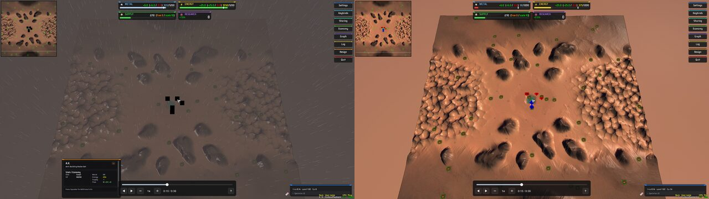

The first look, on the left, had every unit as a black square, in the view and on the minimap. Those are unit icons, and the cause is the run's settings file and not the playback. Splinter Faction 0.1.89 has 90 icons of 512 by 512 pixels, the engine packs them into one atlas, and an atlas of the default `MaxTextureAtlasSizeX` and `MaxTextureAtlasSizeY`, 4096, holds 64 of them. The engine's log says `atlas=IconsAtlas_0 atlasFinalized=0` on every try, 290 times in that run, and every icon draws black. Splinter Faction's Initial Settings widget sets both to 8192 the first time the game is played, so a player's own settings file has them. On the right is the same match with those two settings and nothing else added.

So a settings file for a scripted run needs three lines for Splinter Faction:

```
SFInitialSettingsVersion = 1
MaxTextureAtlasSizeX = 8192
MaxTextureAtlasSizeY = 8192
```

Without the first line, the Initial Settings widget reloads the engine four seconds after it loads, which is what every headless run above does, since each has a settings file of its own. The match has no countdown to wait behind, so a driver starts, is cut off at about frame 100 and starts again, and the tests read what it said from its last start.

A scripted screenshot can hang this engine for good. `CBitmap::Save` logs while it holds the bitmap lock, and the info console, updating on the main thread, holds its own lock while it wraps a new line and loads any character its font does not have yet, which takes the bitmap lock. The font has ASCII from the start. Splinter Faction logs an em dash and an arrow in its first frames. Echo both before the first screenshot, wait until the game's start has logged, and keep any line of your own a second away from a screenshot.

The order a seek makes its units in and the arrival effect were looked at on 14 October 2026, in six runs with a window: one of the player as it was, four on Splinter Faction and one on Balanced Annihilation V15.9.8, each with a scratch gadget that pointed the camera, seeked, read the engine once a frame and took the engine's own screenshots part way through a seek. [Which units first](#which-units-first) and [The arrival effect](#the-arrival-effect) have the pictures and the figures. In the first two of those runs the camera moved by itself, because the pointer was at the edge of the window. A run that needs the camera to stay sets `WindowedEdgeMove = 0` in its settings file.

The timeline has been looked at, once, by hand, on 13 October 2026: the same playback game opened in the engine with a window, in Splinter Faction 0.1.89 and in Metal Factions v2.58, with a scratch widget pressing the timeline's keys and taking the engine's own screenshots. The two pictures on this page are from those runs. The marks on the bar were not in them, since nothing writes a marks file yet. To do it again, set `COILBOX_PLAYBACK_KEEP_GAME` to a folder when running the timeline's test, which copies the playback game and its script there, and launch `spring` on the script. A settings file Splinter Faction has not seen makes its Initial Settings widget reload the engine, which took this engine down, so give the run a settings file with `SFInitialSettingsVersion = 1` in it.

### The fixture

`tests/fixtures/small.cbtrack` is a track `crates/coilbox-track` wrote from a seed, and `tests/fixtures/expected.lua` holds what the Rust reader gives for 30 of its frames. The Rust test `crates/coilbox-track/tests/lua_fixture.rs` fails when either file stops matching what the Rust crate writes and reads. After a change to the writer or the reader, rewrite both:

```sh
COILBOX_UPDATE_LUA_FIXTURE=1 cargo test -p coilbox-track --test lua_fixture
```
